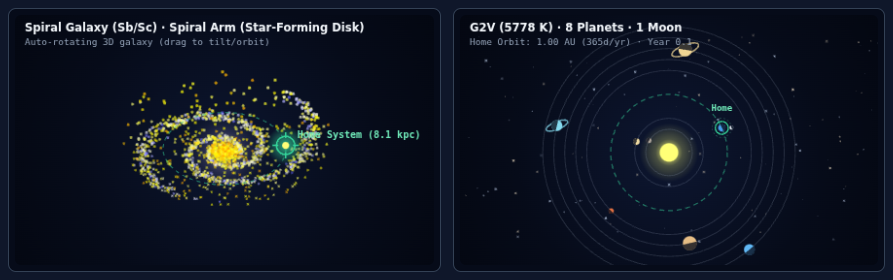
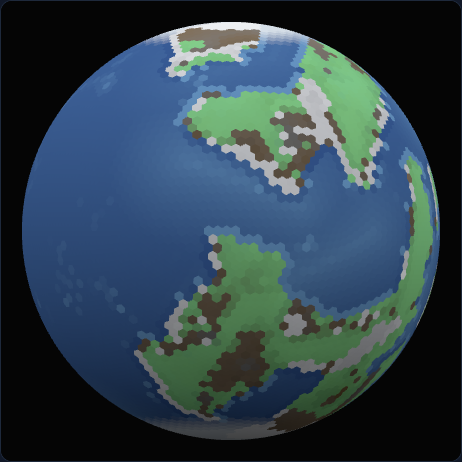
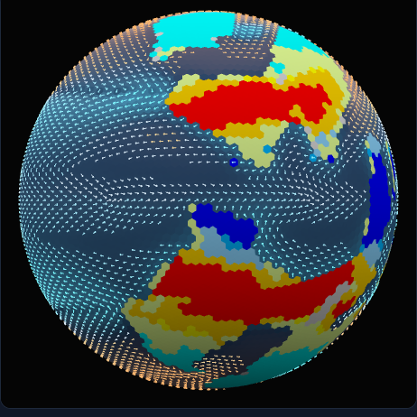
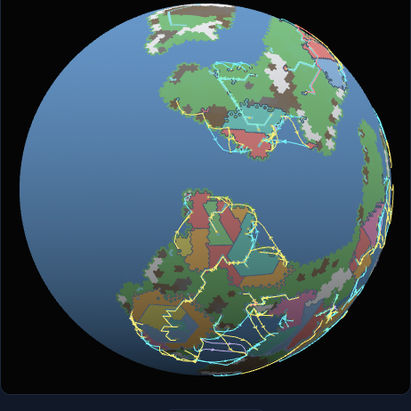
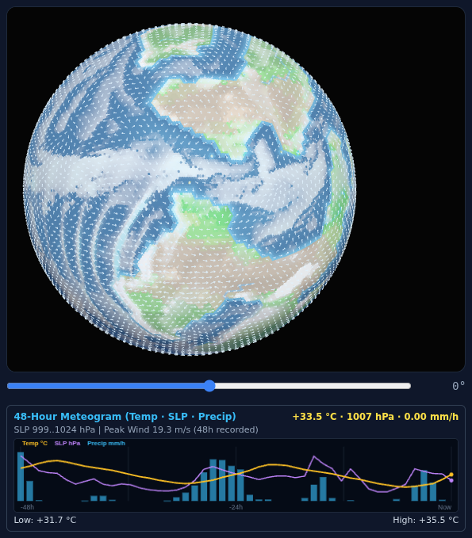

# World Simulation

https://travis-scholtens.github.io/tec11/

This is a tool for generating a model of a plausible planet, using realistic simulations whenever possible.

The globe is divided into uniform hexagonal tiles (plus 12 pentagens that are about 33% smaller).

## Simulation Parts

Planets are simulated in a few phases with different timesteps.

### Cosmos

The structure of the solar system and its location in a galaxy determine what it's night sky will look like, and have consequences for things like tides. The type of sun impacts the color of the sky when an atmosphere develops.

### Tectonics

Each simulated step is 5 million years as contents break up and come back together in a supercontinent cycle. Each hexagonal tile is about 285km (distance between the centers of adjacent tiles).

Geological processes and (when an atmosphere develops) a global climate model affect the composition of each tile and shape the land through erosion.

### Prehistory

Each simulated step is 4000 years as glaciers advance and retreat in the cycle between a "hothouse" and "snowball" planet.

The climate model continues to cause erosion, and early hunter-gatherer humans can spread throughout the habitable world starting from an initial location.

### History

Once agriculture is invented somewhere, each simulated step is 200 years, and land tiles are subdivided into smaller parts, about 95km apart.

Populations coalesce into nationalities with unique languages and form states that evolve over time.

### Weather

A model can show global weather evolving at a 1 hour timestep, driven by the position of the sun, lunar tides, atmospheric cells and ocean currents.

## Design Philosophy

I have tried to model processes realistically and allow behavior to emerge, rather than reifying abstract concepts.

For example, instead of tracking the age of a mountain and using that to determine its size and composition, we model physical processes (erosion, plate tectonics, geological metamorphism) at each timestep, and the size and composition will (or should) have the expected properties for a mountain of its age.

In a similar vein, climate types should be descriptive (for the user's benefit), not inputs into anything else (it's a rain forest because it rains a lot, not vice versa).

Where I do make RNG checks or apply noise, it should generally be representing some detail that is abstracted from the simulation, but according to some reasonable probability derived from the model: we don't simulate the exact dynamics of the mantle to figure out whether and where a continent is going to split, but the probability of it will be based on the size and weight of the continent at every point; when we apply noise to generate smaller-granularity terrain in the transition to the history simulation, it's scaled by each coarse tile's orogenic activity, not applied uniformly; we don't model which individual politician declares war (or individual politicians at all), but things like resource disparities and the strength of national identities affect the probability that states will be in conflict; et cetera.

## Development History

Most of the simulations were originally written in Python, then recently ported to Rust and extended using AI.

Most of the models have been significantly enhanced using AI. The cosmos and weather models were entirely AI implemented.
