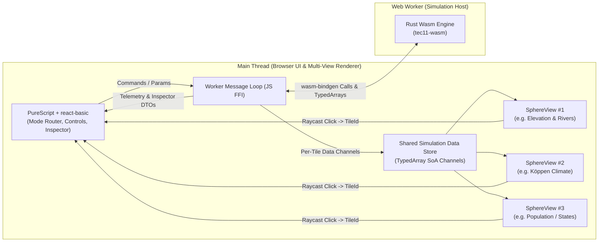

# Tec11 (Tec-Nine Browser Rewrite): Architecture & Detailed Design Document

## 1. Overview & Goals

The goal of this project is to rewrite **Tec-Nine**—originally a Python desktop/server application (Qt / NiceGUI) for procedural planet generation and historical simulation—to run **entirely in the client browser**.

### Core Objectives
1. **100% Client-Side Execution:** Eliminate the Python backend and server-side compute requirements. All simulation logic and rendering run locally in the browser.
2. **Tech Stack:**
   - **UI Layer:** PureScript using `react-basic` (`react-basic-hooks` and `react-basic-dom`).
   - **Simulation Engine:** Rust compiled to WebAssembly (`wasm32-unknown-unknown`), executing off the main thread in a dedicated Web Worker and emitting raw per-tile simulation data channels (`TypedArray` Structure-of-Arrays).
   - **Multi-Viewport Planet Rendering:** 1 to 4 simultaneous 3D globes (WebGL / Three.js) sharing the same static spherical hex/pentagon grid geometry and simulation data buffers, where each viewport independently maps its chosen data layer (elevation, climate, ocean currents, population, states, etc.) to vertex/face colors and overlays on the frontend.
3. **Simulation Modes:**
   - **Full Simulation Mode:** End-to-end planetary evolution from initial crust formation through tectonics, climate, lifeforms, prehistory, and history (`WorldSimulation` -> `PrehistorySimulation` -> `HistorySimulation`).
   - **Isolated Sandbox Modes:** Ability to run, inspect, and test every individual sub-simulation and algorithm in isolation (`Tectonics`, `Split`, `Move`, `Climate`, `Erosion`, `Rivers`, `Terrain`, `Lifeforms`, `Population`, `Racination`, `Prehistory`, `Language`, and `History`).
4. **Physical Model Departures (New Capabilities):**
   - **Full-Crust & Ocean Floor Modeling:** Depart from treating oceanic tiles as uniform zero-elevation placeholders; explicitly model bathymetry, oceanic lithosphere accretion, mid-ocean ridges, subduction trenches, volcanic island arcs, and abyssal plains while preserving the emergent Wilson Cycle (`split` and `suture`).
   - **Ocean Currents & Earth-Accurate Climate:** Model surface ocean gyres (with westward intensification), Ekman transport, coastal upwelling, and coupled heat/moisture/orographic transport so that running the climate simulation on Earth's actual topography produces a Köppen climate distribution closely matching Earth's actual climate.
5. **Mechanical Determinism & Explicit Stochasticity:**
   - Nearly all simulation rules proceed **mechanically** from geometry and physical laws. Every place that uses a pseudo-random number generator (PRNG) or procedural noise is explicitly isolated, seeded via a portable 16-byte `Pcg64Mcg` state, and documented in **Section 4** and within each subsystem specification in **Section 5**.

---

## 2. High-Level System Architecture

To keep the UI responsive during heavy simulation steps and maintain a clean separation between physical simulation and visual presentation, the Rust Wasm engine runs inside a dedicated **Web Worker** and emits **per-tile numerical/categorical data channels** (never RGB colors). PureScript (`react-basic`) and the Three.js `SphereView` components on the main thread own all colormaps, legends, overlays, and multi-viewport rendering.



### Multi-Viewport Data & Picking Pipeline
1. **Mesh Initialization (Once per Grid Topology Change):**
   - When a simulation mode starts (e.g., standard Size-6 coarse grid with $7,292$ faces, or partially subdivided `Terrain`/`History` grid with up to $65,612$ faces), Rust builds the triangulated fan geometry once:
     - Each $K$-gon tile ($K \in \{5, 6\}$) is tessellated into $K$ triangles around its center vector, producing `num_vertices = 3 * sum(K_i)`.
     - Along with `positions: Float32Array` and `normals: Float32Array`, Rust generates a flat `face_to_tile: Uint32Array` lookup table mapping each Three.js triangle index (`intersect.faceIndex`) in $O(1)$ time to its logical `TileId(u32)` (or `FineFaceId(u32)`).
2. **Per-Tick Structure-of-Arrays (SoA) Data Channel Updates:**
   - Rather than computing RGB colors in Wasm, the Worker emits compact **TypedArray data channels** indexed by `TileId` (or `FineFaceId` in subdivided modes), sending only the subsystem channels that changed on that tick:
     - **`GeologyChannels`** ($N$ coarse tiles): `elevation_km: Float32Array`, `group_id: Uint32Array`, `mountainosity: Float32Array`, `top_rock_type: Uint8Array`.
     - **`ClimateChannels`** ($N$ coarse tiles): `koeppen_code: Uint8Array`, `seasonal_temp_c: Float32Array` ($8 \times N$), `seasonal_precip_norm: Float32Array` ($8 \times N$), `aridity_norm: Float32Array`, `ocean_current_vec: Float32Array` ($3 \times N$), `upwelling: Float32Array`, `sst_anomaly_c: Float32Array`, `river_mask: Uint8Array`.
     - **`BiosphereChannels`** ($N$ coarse tiles): `plant_count: Uint16Array`, `animal_count: Uint16Array`, `carrying_capacity: Float32Array`.
     - **`AnthropologyChannels`** ($N$ coarse tiles in `Prehistory`; $F$ fine faces in `History`): `population_thousands: Float32Array`, `dominant_heritage_id: Uint16Array`, `agricultural_mask: Uint8Array`, `owner_state_id: Int16Array`, `dominant_language_id: Int16Array`, `is_city_mask: Uint8Array`.
   - Each `Float32Array` channel for Size 6 ($7,292$ tiles) is only **$29.1\text{ KB}$** (and a `Uint8Array` channel is **$7.3\text{ KB}$**), so transferring updated channels takes $< 0.2\text{ ms}$.
3. **Frontend Colormapping & Multi-Viewport Synchronization:**
   - The UI can display **1 to 4 synchronized `SphereView` panels** side by side (e.g., Viewport 1 showing *Elevation & Bathymetry*, Viewport 2 showing *Köppen Climate*, Viewport 3 showing *Ocean Currents*, and Viewport 4 showing *Population / Political States*).
   - Each `SphereView` subscribes to the shared simulation data store, runs its selected PureScript/WebGL colormap function (`Tec11.Components.Colormaps`) over the relevant channel(s) to populate its own Three.js `BufferAttribute` (and vector/river overlays), and optionally locks camera rotation/zoom with sibling viewports.
   - Switching a viewport's layer, toggling Summer vs. Winter, or highlighting a clicked species/language/state happens **instantaneously on the main thread** with zero round-trip to the Web Worker.
4. **Interactive Raycasting ($O(1)$ Picking):**
   - When the user clicks any viewport `<canvas>`, Three.js `Raycaster.intersectObject(mesh)` returns `intersect.faceIndex`.
   - The viewport looks up `tileId = faceToTile[intersect.faceIndex]` immediately, highlights the selected tile across all active viewports, and sends `SelectTile(tileId)` to the Worker, which replies with the detailed `TileInspectionPayload` for the inspector tree.

---

## 3. Complete Data Structures Specification

In Python, grid faces, rock layers, climate dictionaries, and populations were stored in nested hash maps keyed by 3-tuples of floats `(x, y, z)` or object references. In Rust, all state is represented by strongly-typed, `serde`-serializable, index-addressed contiguous arrays.

### 3.1. Identifiers & Deterministic PRNG (`tec9-math-grid`)

```rust
pub type Vec3 = [f32; 3]; // Unit vector on S^2: x^2 + y^2 + z^2 = 1

#[derive(Copy, Clone, Debug, PartialEq, Eq, PartialOrd, Ord, Hash, Serialize, Deserialize)]
pub struct TileId(pub u32);   // Indexes coarse grid faces (0..7292 at Size 6)

#[derive(Copy, Clone, Debug, PartialEq, Eq, PartialOrd, Ord, Hash, Serialize, Deserialize)]
pub struct FineFaceId(pub u32); // Indexes subdivided terrain faces (Terrain & History modes)

#[derive(Copy, Clone, Debug, PartialEq, Eq, PartialOrd, Ord, Hash, Serialize, Deserialize)]
pub struct VertexId(pub u32);

#[derive(Copy, Clone, Debug, PartialEq, Eq, PartialOrd, Ord, Hash, Serialize, Deserialize)]
pub struct GroupId(pub u32);  // Lithospheric plate / continental group ID

#[derive(Copy, Clone, Debug, PartialEq, Eq, PartialOrd, Ord, Hash, Serialize, Deserialize)]
pub struct SpeciesId(pub u16); // Indexes bundled animals.tsv + plants.tsv

#[derive(Copy, Clone, Debug, PartialEq, Eq, PartialOrd, Ord, Hash, Serialize, Deserialize)]
pub struct HeritageId(pub u16); // Prehistoric human population lineage ID

#[derive(Copy, Clone, Debug, PartialEq, Eq, PartialOrd, Ord, Hash, Serialize, Deserialize)]
pub struct StateId(pub u16);    // Historical polity / state ID

#[derive(Copy, Clone, Debug, PartialEq, Eq, PartialOrd, Ord, Hash, Serialize, Deserialize)]
pub struct NationId(pub u16);   // Historical nationality / ethnic group ID

#[derive(Copy, Clone, Debug, PartialEq, Eq, PartialOrd, Ord, Hash, Serialize, Deserialize)]
pub struct LanguageId(pub u16); // Historical language / dialect ID

#[derive(Copy, Clone, Debug, PartialEq, Eq, PartialOrd, Ord, Hash, Serialize, Deserialize)]
pub struct PhonemeId(pub u8);   // Indexes static UPSID table (0..11 vowels, 12..54 consonants)
```

### 3.2. Geodesic Hex/Pentagon Grid & Spatial Indexing (`tec9-math-grid`)

```rust
#[derive(Clone, Debug, Serialize, Deserialize)]
pub struct Neighbors {
    pub ids: [TileId; 6],
    pub len: u8, // 5 for the 12 dodecahedral pentagons, 6 for all hexagons
}

#[derive(Clone, Debug, Serialize, Deserialize)]
pub struct SphericalGrid {
    pub size: u8,                           // Grid subdivision level (0..8; default 6 -> 7,292 tiles)
    pub scale_rad: f32,                     // Characteristic angular distance between adjacent hexes
    pub face_centers: Vec<Vec3>,            // Indexed by TileId
    pub face_lat_lon: Vec<(f32, f32)>,      // (lat_deg in [-90, 90], lon_deg in [-180, 180])
    pub face_vertices: Vec<SmallVec<[Vec3; 6]>>, // Counter-clockwise polygon vertices on unit sphere
    pub adjacency: Vec<Neighbors>,          // 1-ring neighbors for each TileId
    pub octree: PointOctree,                // Deterministic 3D spatial octree (replaces pointtree.py)
}

#[derive(Copy, Clone, Debug, Serialize, Deserialize)]
pub enum FineParentage {
    CoarseOcean(TileId),                    // Un-subdivided coarse ocean face
    CoarseCenter(TileId),                   // Level N+2 face centered on a coarse land face (weight 1/9)
    CoarseVertex([TileId; 3]),              // Level N+2 face on a vertex between 3 coarse faces (weight 1/27 each)
    CoarseEdge {                            // Level N+2 face on a level N+1 vertex (1 coarse face + 2 neighbors)
        primary_coarse: TileId,
        flanking_coarse: [TileId; 2],
    },
}

#[derive(Clone, Debug, Serialize, Deserialize)]
pub struct SubdividedTerrainGrid {
    pub coarse_size: u8,
    pub fine_centers: Vec<Vec3>,            // Indexed by FineFaceId
    pub fine_vertices: Vec<SmallVec<[Vec3; 6]>>,
    pub fine_adjacency: Vec<SmallVec<[FineFaceId; 6]>>,
    pub parentage: Vec<FineParentage>,      // Maps FineFaceId -> parent coarse TileId(s)
    pub coarse_to_fine_children: Vec<SmallVec<[FineFaceId; 19]>>, // Used by routerivers
    pub fine_elevation: Vec<f32>,           // Interpolated + Simplex noise elevation per FineFaceId
    pub fine_octree: PointOctree,
}
```

### 3.3. Geology, Rock Strata & Lithospheric Groups (`tec9-geology`)

```rust
#[derive(Copy, Clone, Debug, PartialEq, Eq, Serialize, Deserialize)]
pub enum RockClass {
    Igneous,      // 'I'
    Sedimentary,  // 'S'
    Metamorphic,  // 'M'
}

#[derive(Copy, Clone, Debug, PartialEq, Eq, Serialize, Deserialize)]
pub enum RockName {
    // Extrusive Igneous
    Basalt, Dacite, Rhyolite,
    // Intrusive Igneous
    Gabbro, Andesite, Granite,
    // Clastic & Biogenic Sedimentary
    Claystone, Siltstone, Sandstone, Conglomerate, Limestone, Chalk,
    // Contact & Regional Metamorphic
    Pelite, Psammite, Psephite,
    Blueschist, Greenschist, Amphibolite, Eclogite,
    Hornfels, Granulite, Marble,
}

#[derive(Copy, Clone, Debug, PartialEq, Serialize, Deserialize)]
pub struct Rock {
    pub class: RockClass,
    pub name: RockName,
    pub toughness: f32,            // [0.0, 1.0]: controls erosion resistance
    pub felsity: Option<f32>,      // [0.0, 1.0]: silica content; controls rock density & intrusion depth
    pub clasticity: Option<f32>,   // Grain-size divisor; doubles each sedimentary erosion/deposition cycle
    pub calcity: Option<f32>,      // [0.0, 1.0]: marine carbonate fraction; >0.75 -> Limestone, >0.99 -> Chalk, metamorphoses to Marble
    pub bogginess: Option<f32>,    // [0.0, 1.0]: organic peat fraction in C-climate wetlands
}

#[derive(Copy, Clone, Debug, PartialEq, Serialize, Deserialize)]
pub struct RockLayer {
    pub rock: Rock,
    pub thickness: f32,            // Thickness in km (bottom-to-top in TileColumn::layers)
}

#[derive(Clone, Debug, Serialize, Deserialize)]
pub struct TileGeology {
    pub bottom: f32,               // Depth of Moho / base of rock column relative to sea-level datum (km)
    pub mountainosity: f32,        // Unclamped tectonic roughness accumulator (normalized to [0, 1] by min(20, m)/20)
    pub subduction: f32,           // Subduction amount in current tick (triggers intrusions & blueschist)
    pub intrusion: Option<(f32, f32)>, // (top_depth, bottom_depth) of igneous intrusion in current tick
    pub layers: Vec<RockLayer>,    // Ordered bottom-to-top (layers[0] is deepest, layers.last() is surface)
}

impl TileGeology {
    /// Signed surface elevation in km (> 0 land, <= 0 ocean bathymetry).
    /// Identical to the original Tile.elevation, with the max(0, ...) clamp removed!
    #[inline]
    pub fn thickness(&self) -> f32 {
        self.layers.iter().map(|l| l.thickness).sum()
    }

    #[inline]
    pub fn elevation(&self) -> f32 {
        self.bottom + self.thickness()
    }
}

#[derive(Clone, Debug, Serialize, Deserialize)]
pub struct LithosphericGroup {
    pub id: GroupId,
    pub tiles: Vec<TileId>,        // Both continental and accreted oceanic tiles belonging to this plate
    pub velocity: Vec3,            // Tangent velocity vector on unit sphere (radians per tick)
}
```

### 3.4. Oceanography, Climate & Hydrology (`tec9-climate`)

```rust
#[derive(Copy, Clone, Debug, PartialEq, Eq, Hash, Serialize, Deserialize)]
pub enum KoeppenCode {
    Af, Am, Aw,         // Tropical: Rainforest, Monsoon, Savanna
    BW, BS,             // Arid: Desert, Steppe
    Cf, Cs, Cw,         // Temperate: Fully humid, Dry summer, Dry winter
    Df, Ds, Dw,         // Continental/Cold: Fully humid, Dry summer, Dry winter
    ET, EF,             // Polar: Tundra, Ice cap
}

#[derive(Copy, Clone, Debug, Default, Serialize, Deserialize)]
pub struct SeasonalTileClimate {
    pub insolation: f32,           // Normalized solar insolation [0.0, 1.0]
    pub temperature_norm: f32,     // Normalized temperature [0.0, 1.0] mapped onto temprange
    pub temperature_c: f32,        // Surface air temperature in degrees Celsius
    pub sea_level_temp_c: f32,     // Sea-level equivalent temperature T_0 in degrees Celsius
    pub sst_c: f32,                // Sea Surface Temperature (for ocean tiles) in degrees Celsius
    pub pressure: f32,             // Normalized sea-level pressure P_i^(s)
    pub wind_vector: [f32; 2],     // Local tangent-plane (east, north) wind velocity vector
    pub wind_bearing_deg: f32,     // Compass bearing [0, 360)
    pub precip_norm: f32,          // Normalized seasonal precipitation [0.0, 1.0]
    pub precip_mm: f32,            // Seasonal precipitation in mm
}

#[derive(Copy, Clone, Debug, Default, Serialize, Deserialize)]
pub struct TileOceanography {
    pub streamfunction_psi: f32,   // Barotropic Stommel streamfunction \psi
    pub gyre_velocity: [f32; 2],   // Geostrophic current velocity (east, north) from \hat{n} \times \nabla\psi
    pub ekman_velocity: [f32; 2],  // Surface Ekman drift velocity (east, north)
    pub total_current: [f32; 2],   // Combined surface current \vec{u}_{ocean}
    pub upwelling: f32,            // Coastal/equatorial Ekman divergence w_{up} >= 0
}

#[derive(Clone, Debug, Serialize, Deserialize)]
pub struct TileClimateState {
    pub seasons: SmallVec<[SeasonalTileClimate; 8]>, // 8 seasonal snapshots across the orbital year
    pub ocean: TileOceanography,
    pub annual_temp_norm: f32,
    pub annual_precip_norm: f32,
    pub aridity_threshold_norm: f32,
    pub koeppen: KoeppenCode,
    pub supports_life: bool,       // True if any season has temperature_c > 18.0 C (when planet has_life)
}

#[derive(Clone, Debug, Serialize, Deserialize)]
pub struct ErosionTransfer {
    pub degree: f32,
    pub destination: TileId,
}

#[derive(Clone, Debug, Serialize, Deserialize)]
pub struct ErodedMaterialBatch {
    pub amount: f32,               // Thickness delivered to destination tile
    pub total_from_source: f32,    // Total thickness eroded from source tile
    pub source_layers: Vec<RockLayer>, // Slice of rock layers stripped from source (top-down)
}

pub type CoarseRiver = Vec<TileId>;      // Ordered source -> mouth (ends at first tile with z <= 0)
pub type FineRiverRoute = Vec<FineFaceId>; // Subdivided path across SubdividedTerrainGrid
```

### 3.5. Biosphere (`tec9-biosphere`)

```rust
#[derive(Copy, Clone, Debug, PartialEq, Eq, Serialize, Deserialize)]
pub enum SpeciesKind {
    Animal,
    Plant,
}

#[derive(Copy, Clone, Debug, Serialize, Deserialize)]
pub struct ClimateTolerance {
    pub temp_norm: (f32, f32),     // Normalized from Celsius: (c + 25.0) / 75.0
    pub precip_norm: (f32, f32),   // Normalized from cm/yr: cm / num_seasons / 30.0
    pub sunlight_norm: (f32, f32), // Normalized from hrs/yr: hrs / num_seasons / 400.0 (Animal = (0.0, 1.0))
}

#[derive(Clone, Debug, Serialize, Deserialize)]
pub enum HabitatDistribution {
    YearRound { tiles: Vec<TileId> },
    Seasonal { tiles: Vec<TileId>, active_seasons: u8 }, // Bitmask of active seasons (bits 0..7)
    Migratory {
        region_a: Vec<TileId>, seasons_a: u8,
        region_b: Vec<TileId>, seasons_b: u8, // Where (seasons_a | seasons_b) == all_seasons_mask
    },
}

#[derive(Clone, Debug, Serialize, Deserialize)]
pub struct SpeciesRecord {
    pub id: SpeciesId,
    pub kind: SpeciesKind,
    pub name: String,
    pub tolerance: ClimateTolerance,
    pub distributions: Vec<HabitatDistribution>,
}
```

### 3.6. Prehistory, Language & History (`tec9-anthropology`)

```rust
#[derive(Clone, Debug, Serialize, Deserialize)]
pub struct Heritage {
    pub id: HeritageId,
    pub name: String,              // Coined via Phoneme/Lexicon generator
    pub parents: SmallVec<[HeritageId; 2]>, // DAG of ancestor heritages from admixture/divergence
    pub agricultural: bool,
}

#[derive(Copy, Clone, Debug, PartialEq, Eq, Hash, Serialize, Deserialize)]
pub struct RaceContribution {
    pub heritage: HeritageId,
    pub fraction_permille: u16,    // Stored as f32 in calculation, normalized to sum to 1.0
}

#[derive(Clone, Debug, Serialize, Deserialize)]
pub struct Community {
    pub thousands: f32,            // Population in thousands
    pub nationality: NationId,
    pub language: LanguageId,
    pub agriculture: bool,
    pub racial_mix: SmallVec<[RaceContribution; 4]>,
}

// --- Language & Lazy Etymology Structures ---

#[derive(Clone, Debug, PartialEq, Eq, Hash, Serialize, Deserialize)]
pub struct Syllable {
    pub onset: SmallVec<[PhonemeId; 2]>,
    pub nucleus: SmallVec<[PhonemeId; 2]>,
    pub coda: SmallVec<[PhonemeId; 2]>,
}

#[derive(Clone, Debug, PartialEq, Eq, Hash, Serialize, Deserialize)]
pub struct Word {
    pub syllables: SmallVec<[Syllable; 4]>,
    pub stress: usize,             // Normalized syllable index in 0..syllables.len()
}

#[derive(Copy, Clone, Debug, PartialEq, Eq, PartialOrd, Ord, Hash, Serialize, Deserialize)]
pub enum Concept {
    Species(SpeciesId),
    Nation(NationId),
    State(StateId),
    Language(LanguageId),
}

#[derive(Copy, Clone, Debug, PartialEq, Eq, Serialize, Deserialize)]
pub enum SoundChangeKind {
    AMutate = 0,
    IMutate = 1,
    BreakVowels = 2,
    LeniteOpen = 3,
    LeniteSonorize = 4,
    LeniteVocalize = 5,
    Apheresize = 6,
    Syncopate = 7,
    Apocopate = 8,
}

#[derive(Clone, Debug, Serialize, Deserialize)]
pub struct LanguageHistoryLog {
    pub id: LanguageId,
    pub concepts: Vec<Concept>,
    pub concept_lookup: HashMap<Concept, u32>,
    // Per-tick event log for lazy reification:
    pub changes_per_tick: Vec<Vec<SoundChangeKind>>, // [tick][concept_idx]
    pub neologisms: BTreeMap<u32, Vec<([u8; 16], Vec<u32>)>>, // tick -> [(Pcg64Mcg state bytes, concept_indices)]
    pub loans: BTreeMap<u32, BTreeMap<LanguageId, Vec<u32>>>, // tick -> {src_lang -> [concept_indices]}
    pub derivations: BTreeMap<u32, Vec<(Concept, u32)>>,      // tick -> [(src_concept, dest_concept_idx)]
    pub redefinitions: BTreeMap<u32, Vec<(u32, u32)>>,        // tick -> [(src_concept_idx, dest_concept_idx)]
}
```

---

## 4. Audit of Determinism vs. Stochasticity (Random Numbers & Noise)

A core design principle of **Tec-Nine** is that once a planetary state is initialized, **physical and historical laws proceed mechanically**. Below is the complete inventory of every calculation in the system, separating 100% deterministic mechanics from the specific places where randomness or procedural noise is used.

> [!IMPORTANT]
> **Portable Deterministic PRNG:** All random draws use `rand_pcg::Pcg64Mcg` (128-bit state, 16 bytes), which is 100% reproducible across x86_64 and `wasm32` builds and serializes into snapshots effortlessly.

| Subsystem | 100% Mechanical / Deterministic Parts | Stochastic (PRNG / Noise) Parts & Why They Exist |
| :--- | :--- | :--- |
| **1. Grid & Geometry** | Dodecahedron initialization, recursive face/vertex subdivision, winding order, neighbor graphs, octree nearest-neighbor queries. | **None.** Completely deterministic for any grid size $N$. |
| **2. World Initialization** | Calculation of Hadley cell count $c$ from spin, $\Delta p$ speed scaling, tile distance falloffs for elevation/felsity. | 1. **Optional UI Parameter Randomization:** Triangular-weighted draws (`randomspinvalue`) for spin, tilt, land%, and geometric-distribution ticks (`p=0.05`) for `atmt`, `lifet`, `peoplet`.<br>2. **Initial Pangaea Placement:** Random center vector $\mathbf{p} \in S^2$, 16-vertex radius jitter $\mathcal{U}(0.9, 1.1)$ for the initial `SphericalPolygon`, and 1 random tile chosen inside the polygon as the felsic (`Rhyolite`) center. |
| **3. Plate Movement (`Move`)** | Centroid computation, rotation axis $\mathbf{a} \times \mathbf{v}$, Rodrigues rotation of tile vectors, inverse-rotation neighbor hole-filling, velocity tangent projection, rock layer voting/merging (`mergelayers`), and momentum conservation on group suturing. | **None.** Moving a group of tiles at velocity $\mathbf{v}$ and merging colliding rock columns is 100% mechanical. |
| **4. Continent Rifting (`Split`)** | Finding shape centroid $c$, farthest tile $f$, bounding square corner `firstcorner(c, f)`, constructing the wedge `SphericalPolygon`, partitioning tiles into $(A, B)$, and assigning opposite velocity vectors $\pm \mathbf{v}_a$. | 1. **Split Trigger Check:** Per tick, each group $i$ splits if $\mathcal{U}(0, 1) > \text{splitnum} / |T_{\text{cont}, i}|$ (where $\text{splitnum} = 25\times 10^6\text{ km}^2 / A_{\text{tile}}$, giving a $50\times 10^6\text{ km}^2$ continent a 50% chance to split).<br>2. **Rift Wedge Orientation:** 1 uniform random angle $b_1 \sim \mathcal{U}(0, 2\pi)$ setting the $120^\circ$ ($2\pi/3$) rift wedge orientation around the continent's center. |
| **5. Igneous Intrusions & Metamorphism** | Intrusion stopping depth $d = \max(2, H(1 - \text{felsity}))$, linear thermal gradient above/below the intrusion (`contact` hornfels/granulite), and depth-facies regional metamorphism (`regional` zeolite/blueschist/greenschist/amphibolite/eclogite/marble). | **Intrusion Occurrence & Silica:** At tiles with active subduction (`subduction > 0`), a $10\%$ bernoulli roll ($\mathcal{U}(0,1) < 0.1$) triggers a plutonic intrusion with silica drawn from a clamped Gaussian $\text{clamp}(\mathcal{N}(0.85, 0.15), 0, 1)$. |
| **6. Ocean Currents & Climate** | Insolation, Coriolis $f$ and $\beta$, Stommel streamfunction SOR solver, Ekman drift, upwelling, SST advection, 2D seasonal Energy Balance, geostrophic winds, Clausius–Clapeyron moisture advection, orographic rainout, and Köppen classification. | **None.** For any given topography, bathymetry, and orbital parameters, the ocean current and climate solver is **100% deterministic and mechanical**. |
| **7. Erosion, Deposition & Isostasy** | Downslope erosion rate from rock `toughness`, climate-weighted erosion degree, proportional distribution to lower neighbors, clastic grain-size halving, carbonate/peat rules, and Airy + thermal-age isostatic elevation. | **None.** Completely mechanical. |
| **8. Rivers** | Local-maxima peak detection ($z \ge h_{\min}$), steepest-descent path following to the sea, cumulative precipitation threshold ($P \ge p_{\min}$), and greedy fine-grid river routing (`findpath`). | **None.** Completely mechanical. |
| **9. Terrain Subdivision** | Topological subdivision of land tiles ($N \to N+2$) and hierarchical parent elevation/mountainosity averaging (`interpolate`). | **Procedural Simplex Noise (`snoise3`):** Adds fine-scale relief to each subdivided face $f = (x, y, z)$ using deterministic 3D Simplex noise (7 octaves, persistence $0.85$) scaled by interpolated `mountainosity`. |
| **10. Flora & Fauna (`Lifeforms`)** | Parsing species tolerances, union-find connected-component clustering of year-round, seasonal, hibernating, and migratory habitats. | **None.** Species settling on a climate map is **100% deterministic**. |
| **11. Prehistory (Eden, Migration, Agriculture, Racination)** | Main ocean basin detection, coastal/river habitability (`squattable`, `farmable`), BFS migration expansion (`expandpopulation`), and union-find geographic isolation/admixture (`racinate`). | 1. **Eden Selection:** Picks 1 random coastal `Aw` (savanna) tile bordering the main ocean (`random.choice(candidates)`).<br>2. **Sparking Agriculture:** On river tiles occupied by non-agricultural peoples, rolls $\mathcal{U}(0, 1) < g_{\text{factor}} \cdot P_{\text{ag}}(\text{koeppen})$ (`B`: $0.05$, `C`: $0.005$, `D`: $0.001$, `Aw`: $0.0001$).<br>3. **Lineage Naming:** Coining a random word for a newly branched/merged `Heritage`. |
| **12. Phonology & Language** | Phonotactic constraint extraction, syllable cluster repair (`constrain`), phonetic distance generator (`adaptsounds`), vowel breaking, $i$-mutation, $a$-mutation, apheresis, apocope, orthography, and IPA rendering. | 1. **Phoneme Inventory (`phonemes`):** Weighted random sample without replacement from UPSID frequencies (6–7 vowels, 8–25 consonants).<br>2. **Lexicon Generation (`lexicon`):** Random stress $\text{round}(\mathcal{N}(-0.5, 1))$, onset/coda probabilities $\mathcal{N}(0.5, 0.1)$, and random phoneme sampling per syllable.<br>3. **Sound Change Selection & Multi-Target Rules:** Random choice of sound change per concept per tick; `syncopate` picks a random unstressed syllable; `lenition` (`open`, `sonorize`, `vocalize`) picks randomly when a consonant has 2 possible lenited reflexes (e.g., `p -> ['pP', 'pf']`, `b -> ['B', 'v']`). |
| **13. History (States, Trade, War, Demographics)** | Carrying capacity, logistic population growth ($k=0.25$) and neighbor spillover, racial intermingling (2% max centroid shift), cultural/linguistic assimilation, dialect connected-component detection, trade network formation, military tension, conflict resolution, and lexical borrowing. | 1. **Initial & Split City Seeding (`randomcities`):** Bernoulli roll per populated face based on climate/agriculture (`cityprob`: $0.05\text{–}0.25$).<br>2. **Unclaimed Frontier Annexation:** When population spills into an unowned tile $f$, picks randomly among the adjacent states (`random.choice(states)`).<br>3. **State Breakup Trigger:** Per tick, non-warring state of size $N$ rolls $\mathcal{U}(0, 1) < \frac{3 + \text{sgn}(N-25)|N-25|^{1/3}}{600}$. |

---

## 5. Subsystem Specifications: Inputs, Calculations & Outputs

Below is the complete mathematical and algorithmic specification for every simulation module.

---

### 5.1. Geodesic Grid & Subdivided Terrain (`grid.py`, `terrainmethod.py`)

- **Inputs:**
  - `grid_size: u8` ($0..8$; Size 0 = 12 pentagons; Size 6 = 7,292 tiles; number of faces satisfies $F_0 = 12$, $F_k = 3 F_{k-1} - 6$).
  - For `SubdividedTerrainGrid`: coarse `SphericalGrid` + coarse `Vec<TileGeology>`.
- **Calculations:**
  1. **Base Dodecahedron ($N=0$):** Initialize 12 face center vectors using $\phi$-ratio constants $x = -0.525731112119133606$, $z = -0.850650808352039932$ and the 5-neighbor tables from `grid.py:64-79`. Each vertex of face $f$ with consecutive neighbors $(n_1, n_2)$ is the normalized sum $\text{norm}(f + n_1 + n_2)$.
  2. **Subdivision ($N-1 \to N$):**
     - **Face-from-Face:** Each face $f$ in level $N-1$ remains a face center in level $N$; its new vertices are the normalized centroids of $(f, v_a, v_b)$ for each adjacent pair of $f$'s old vertices.
     - **Face-from-Vertex:** Each vertex $v$ in level $N-1$ (where 3 old faces $f_1, f_2, f_3$ meet) becomes a new hexagon center in level $N$. Its 6 vertices are formed by taking each pair of meeting old faces $(f_a, f_b)$, finding their 2 common old vertices $(c_1, c_2)$, and computing $\text{norm}(f_a + c_1 + c_2)$ and $\text{norm}(f_b + c_1 + c_2)$. Ensure counter-clockwise winding by reversing the vertex list if $\mathbf{v} \cdot (\mathbf{u}_0 \times \mathbf{u}_1) > 0$.
  3. **2-Level Land Subdivision (`terrain`):**
     - Level $N+1$ calls `populate(v)` for every coarse tile with $z_v > 0$.
     - Level $N+2$ calls `populate(v)` for every face present in Level $N+1$.
  4. **Fine Elevation Interpolation (`elevation`):**
     - Recursive `components(f, grid, tiles)` gathers the parent coarse tile(s) contributing to fine face $f$.
     - Base elevation $\bar{z}(f)$ and mountainosity $\bar{m}(f) = \min(20, m)/20$ are recursively averaged across parent components.
     - Fine elevation adds 7-octave 3D Simplex noise (`persistence = 0.85`) evaluated at unit vector $f = (x, y, z)$:
       $$z_{\text{fine}}(f) = \bar{z}(f) + \bar{m}(f) \cdot \text{snoise3}(f_x, f_y, f_z; \text{octaves}=7, \text{persistence}=0.85)$$
- **Outputs:** `SphericalGrid` (or `SubdividedTerrainGrid` with `fine_elevation: Vec<f32>`).
- **Non-Determinism:** `SphericalGrid` is 100% deterministic. `SubdividedTerrainGrid` uses deterministic 3D Simplex noise (`snoise3`).

---

### 5.2. Spherical Advection (`Move` — `movemethod.py`, `movepoints.py`)

- **Inputs:**
  - `grid: &SphericalGrid`
  - `group_tiles: &[TileId]` (current member tiles of a lithospheric group)
  - `velocity: Vec3` (tangent velocity vector $\mathbf{v}$, where $\|\mathbf{v}\| = \text{speed}$ in radians/tick)
- **Calculations:**
  1. **Group Centroid & Rotation Axis:**
     - Compute mean vector $\mathbf{a} = \text{norm}\left(\frac{1}{|G|} \sum_{t \in G} \mathbf{p}_t\right)$.
     - Compute unit rotation axis $\boldsymbol{\omega} = \text{norm}(\mathbf{a} \times \mathbf{v})$ and angular step $\theta = \|\mathbf{v}\|$.
  2. **Forward Advection:**
     - For each tile $t \in G$, rotate its unit vector $\mathbf{p}_t$ around axis $\boldsymbol{\omega}$ by angle $+\theta$ using Rodrigues' rotation formula (`rotate(p, axis, theta)`).
     - Query `grid.octree.nearest(p_rotated, 1)` to find destination tile $d$, appending $t$ to `new_map[d]`.
  3. **Inverse-Rotation Hole Filling:**
     - Because discrete rotation on a hex grid can leave 1-tile gaps between advected neighbors, initialize a frontier `fill = keys(new_map)`.
     - While `fill` is non-empty, for every tile $f \in \text{fill}$ and every neighbor $h \in \text{adj}[f]$ not yet in `new_map`:
       - Rotate $\mathbf{p}_h$ **backward** by $-\theta$ around $\boldsymbol{\omega}$: $\mathbf{p}_{\text{back}} = \text{rotate}(\mathbf{p}_h, \boldsymbol{\omega}, -\theta)$.
       - Find nearest tile $n = \text{octree.nearest}(\mathbf{p}_{\text{back}}, 1)$.
       - If $n \in G$, fill the hole by setting `new_map[h] = vec![n]` and adding $h$ to the next frontier.
  4. **Velocity Parallel Transport:**
     - Rotate velocity vector $\mathbf{v}' = \text{rotate}(\mathbf{v}, \boldsymbol{\omega}, +\theta)$ and project onto the tangent plane at $\mathbf{a}$: $\mathbf{v}_{\text{next}} = \mathbf{v}' - (\mathbf{v}' \cdot \mathbf{a})\mathbf{a}$.
- **Outputs:**
  - `new_map: HashMap<TileId, SmallVec<[TileId; 4]>>` (mapping each destination tile $d$ to the source tile(s) from $G$ that moved into it).
  - `next_velocity: Vec3`.
- **Non-Determinism:** **None** during `move()`. (In the standalone `MovePoints` sandbox, `reset()` picks a random initial polygon center and radius jitter $\mathcal{U}(0.9, 1.1)$).

---

### 5.3. Continent / Plate Rifting (`Split` — `splitmethod.py`, `splitpoints.py`)

- **Inputs:**
  - `continental_tiles: &[TileId]` (tiles of a group to be split)
  - `all_group_tiles: &[TileId]` (all tiles including attached oceanic crust in full tectonics mode)
  - `rng: &mut Pcg64Mcg`
- **Calculations:**
  1. **Shape Extremes:**
     - Find center tile $c \in \text{continental\_tiles}$ closest to the mean vector of `continental_tiles`.
     - Find farthest tile $f \in \text{continental\_tiles}$ maximizing Euclidean/chord distance $\|\mathbf{p}_t - \mathbf{p}_c\|^2$.
  2. **Encompassing Square First Corner (`firstcorner`):**
     - Compute axis $\mathbf{u} = \text{norm}(\mathbf{p}_c \times \mathbf{p}_f)$ and angular radius $d = \text{atan2}(\|\mathbf{p}_c \times \mathbf{p}_f\|, \mathbf{p}_c \cdot \mathbf{p}_f)$.
     - Rotate $\mathbf{p}_c$ around $\mathbf{u}$ by $d\sqrt{2}$ to get $\mathbf{f}_2$, then rotate $\mathbf{f}_2$ around $\mathbf{p}_c$ by $\pi/4$ to get $\mathbf{fc}$.
  3. **Random $120^\circ$ Rift Wedge Construction:**
     - Draw random angle $b_1 \sim \mathcal{U}(0, 2\pi)$ and set $b_2 = b_1 + \frac{2\pi}{3}$.
     - Collect wedge angles $\Theta = [b_1] \cup \{k\frac{\pi}{2} \mid k \in \{1,2,3,4\} \land b_1 < k\frac{\pi}{2} < b_2\} \cup [b_2]$.
     - Construct `SphericalPolygon` from vertices $[\text{rotate}(\mathbf{fc}, \mathbf{p}_c, \theta) \text{ for } \theta \in \Theta] \cup [\mathbf{p}_c]$.
  4. **Partitioning & Divergent Velocities:**
     - Partition `all_group_tiles` into $A$ (`polygon.contains(t.vector) == true`) and $B$ (`false`).
     - If either $A$ or $B$ has zero continental tiles, abort the split and return the unsplit group.
     - Compute divergent unit velocity directions $\hat{\mathbf{v}}_A = \text{norm}(\text{rotate}(\mathbf{fc}, \mathbf{p}_c, \frac{b_1 + b_2}{2}))$ and $\hat{\mathbf{v}}_B = -\hat{\mathbf{v}}_A$.
- **Outputs:** Two daughter tile sets $(A, \hat{\mathbf{v}}_A)$ and $(B, \hat{\mathbf{v}}_B)$.
- **Non-Determinism:** 1 uniform random draw $b_1 \sim \mathcal{U}(0, 2\pi)$ for the rift wedge angle.

---

### 5.4. Full-Crust Tectonics, Rock Strata, Metamorphism & Isostasy (`planetsimulation.py`, `tile.py`, `rock/`)

A core design principle of the geological model is that **a tile has no hidden timers or special-case flags** (no `crust_age` or `trench_depression` fields): every tile's behavior and signed surface elevation $z = \text{bottom} + \text{thickness}$ depend **strictly on its `bottom` depth and its stack of rock `layers`** (their thicknesses and rock properties: `felsity`, `toughness`, `clasticity`, `calcity`).

- **Inputs:**
  - `tiles: &mut [TileGeology]`, `groups: &mut Vec<LithosphericGroup>`, `grid: &SphericalGrid`
  - Planet parameters: `dt` ($5\text{ Myr}$), `dp = (100.0 / r) * dt`, `build = dt / 5.0`, `erode = dt`, `splitnum = 25e6 / tile_area`, `atmosphereticks`, `lifeticks`.
  - `rng: &mut Pcg64Mcg`
- **Calculations (Per 5 Myr Tectonic Step):**
  1. **Advect Groups (`move`):**
     - Run `move()` on each `LithosphericGroup` $i$, recording `TileMovement { sources, speed }` and `overlapping[dest].push(i)` for each destination tile.
  2. **Symmetric Trailing-Edge Seafloor Accretion (Mid-Ocean Ridges):**
     - Identify any tile $u \notin \text{new\_destinations}$ (uncovered rift/wake gaps opened between diverging groups).
     - Assign each uncovered tile $u$ to the nearest adjacent diverging group's trailing edge, and initialize $u$ as newly accreted, buoyant mid-ocean ridge seafloor:
       - `layers = vec![RockLayer { rock: Basalt(0.50), thickness: 5.0 }]` (or `Gabbro` + `Basalt` totaling $5.0\text{ km}$).
       - Because newly welled-up mantle at a rift is thermally elevated, `bottom` starts high at `bottom = -7.5 km` $\implies \text{elevation} = \text{bottom} + \text{thickness} = -2.5\text{ km}$ (a mid-ocean ridge crest!).
       - As this tile is carried outward by its `Group` on subsequent ticks, `isostasize()` (Step 5) mechanically relaxes `bottom` toward its Archimedes density equilibrium depth $b_{\text{eq}} = -10.5\text{ km}$ ($\text{elevation} = -5.5\text{ km}$ abyssal plain)—producing realistic ridge-to-abyssal bathymetry **purely from `bottom` and `layers` without tracking age!**
  3. **Resolve Convergent Overlaps, Orogeny, Trenches & Subduction:**
     - **Within-Group Source Averaging (`Tile::mergelayers`):** When multiple source tiles from the *same* group move into `dest`, pad bottoms and tops with `None` layers to common bounds, slice from top to bottom by minimum remaining layer thickness, **vote** for the most common rock at each slice (breaking ties by preferring a rock different from the layer immediately above), compact adjacent identical layers, and average `mountainosity`.
     - **Cross-Group Collisions (`mergesources` & Subduction):**
       - We distinguish **Continental Columns** (buoyant: $\text{elevation} > -1.0\text{ km}$ or thickness $H > 8\text{ km}$ with felsic/sedimentary strata) from **Oceanic Columns** (dense mafic crust with $z < -1.0\text{ km}$).
       - **Continental–Continental Collision:** Stack the merged rock columns of the colliding groups (`MAX_THICKNESS = 75.0 km`, shrinking oldest bottom layers first in `limit()`), sum `mountainosity`, and increment `collisions[(group_a, group_b)] += 1`.
       - **Oceanic Subduction (Ocean–Continent or Deeper/Denser Ocean under More Buoyant Ocean):**
         - Scrape off top `Sedimentary` layers (and $15\%$ of top `Basalt`) from the subducting column onto the overriding column (`mergesources`), and consume the remaining subducting mafic slab (remove tile from subducting group).
         - **Overriding Uplift (`Tile::build`):** Exactly as in the original `Tile.build(amount, rock)` (`amount = build * avg_speed`), push `bottom -= amount`, insert `Layer(Basalt, 2 * amount)` at the base of the overriding column (so net elevation rises by $+\text{amount}$), add `amount` to `mountainosity`, and set `tile.subduction = amount`.
         - **Subduction Trench Formation (Pure `bottom` Deflection):** On the 1-ring of ocean tiles immediately in front of the overriding leading edge, slab pull pushes their `bottom` downward (`neighbor.bottom -= amount`) *without* adding a double-thickness layer! Their `elevation = bottom + thickness` immediately drops from $-5.5\text{ km}$ to $\approx -8.0\text{ km}$ (a deep oceanic trench), and if subduction later ceases, Step 5 (`isostasize`) naturally buoys `bottom` back up to $-10.5\text{ km}$.
  4. **Climate & Erosion Coupling (If `has_atmosphere`):**
     - Run `Climate` solver (Section 5.5) and `Erosion` + `Sedimentary` deposition (Section 5.6).
  5. **Compositional Archimedes Isostasy (`isostasize` & `limit`):**
     - Every rock layer's density $\rho_i$ is a pure function of its composition:
       - **Igneous (`I`):** $\rho = 3,000 - 350 \cdot \text{felsity}\text{ kg/m}^3$ (`Rhyolite`/`Granite` $\approx 2,680$, `Basalt`/`Gabbro` $\approx 2,825\text{–}2,900$).
       - **Sedimentary (`S`):** $\rho = 2,400 + 250 \cdot \text{toughness}\text{ kg/m}^3$.
       - **Metamorphic (`M`):** Derived from facies (`Zeolite` $2,650$, `Greenschist` $2,850$, `Blueschist` $3,100$, `Amphibolite` $3,000$, `Eclogite` $3,400\text{ kg/m}^3$).
     - Given mantle density $\rho_m = 3,300\text{ kg/m}^3$, seawater density $\rho_w = 1,030\text{ kg/m}^3$, and reference Moho depth $D_{\text{ref}}$, a column with total mass $M = \sum_i \rho_i h_i$ and thickness $H = \sum_i h_i$ has an exact Archimedes equilibrium base depth $b_{\text{eq}}(\text{layers})$.
     - On each tick, `bottom` relaxes fractionally toward $b_{\text{eq}}(\text{layers})$ (`bottom += alpha * (b_eq - bottom)`, plus regional continental erosion rebound `dh`), and `limit()` enforces `MAX_THICKNESS = 75 km` and `MAX_HEIGHT = 10 km` while setting:
       $$\text{elevation} = \text{bottom} + \text{thickness}$$
       *(with the old `max(0, ...)` clamp removed so ocean bathymetry is negative!)*
  6. **Random Plutonic Intrusions & Contact Metamorphism (`intrude`, `metamorphic::contact`):**
     - For each tile with `tile.subduction > 0`:
       - Roll $\mathcal{U}(0, 1) < 0.10$. If true, draw silica $s = \text{clamp}(\mathcal{N}(0.85, 0.15), 0.0, 1.0)$ (`Granite` if $s > 0.63$, `Andesite` if $s > 0.52$, `Gabbro` otherwise).
       - Insert a $1\text{ km}$ intrusive layer at depth $d = \max(2.0, H \cdot (1.0 - s))$ from the top, recording `intrusion = (d, d + 1.0)`.
       - Compute intrusion center temperature $T_{\text{int}} = 900 - 40\sqrt{d_{\text{mid}}}^\circ\text{C}$, with temperature dropping linearly to $0^\circ\text{C}$ over distance $w = 1.0\text{ km}$ above and below the intrusion.
       - Split and transform rock layers intersecting the thermal halo: $T \in [250, 800]^\circ\text{C} \to \text{Hornfels}$ (`toughness = 1.0`); $T > 800^\circ\text{C} \to \text{Granulite}$ (`toughness = 1.0`); any layer with `calcity > 0.75` becomes `Marble`.
  7. **Regional Metamorphism (`metamorphic::regional`):**
     - Accumulate depth $d$ from surface ($d=0$) down to `bottom`, splitting layers across facies depth boundaries:
       - **Normal Gradient (`subduction == 0`):** $[0, 5]\text{ km} \to \text{unchanged}$; $[5, 15]\text{ km} \to \text{Zeolite}$ (clastic sediments become `Pelite`, `Psammite`, or `Psephite` based on grain size $10^{-3}/\text{clasticity}$, deleting `clasticity`); $[15, 30]\text{ km} \to \text{Greenschist}$; $[30, 70]\text{ km} \to \text{Amphibolite}$; $>70\text{ km} \to \text{Eclogite}$.
       - **High-P / Low-T Subduction Gradient (`subduction > 0`):** $[0, 10]\text{ km} \to \text{unchanged}$; $[10, 20]\text{ km} \to \text{Zeolite}$; $[20, 60]\text{ km} \to \text{Blueschist}$; $>60\text{ km} \to \text{Eclogite}$.
       - Any metamorphosed layer with `calcity > 0.75` becomes `Marble`.
  8. **Group Suturing (Merging) & Rifting (Splitting):**
     - **Suturing:** Any pair of groups $(A, B)$ with `collisions[(A, B)] > min(len(A.cont), len(B.cont)) / 10` merges into a single `LithosphericGroup` with mass-weighted velocity $\mathbf{v} = \frac{|A|\mathbf{v}_A + |B|\mathbf{v}_B}{|A| + |B|}$.
     - **Splitting:** For each group $i$, if $\mathcal{U}(0, 1) > \text{splitnum} / |T_{\text{cont}, i}|$, invoke `split()` (Section 5.3) to replace group $i$ with two groups moving at $\mathbf{v}_i \pm \hat{\mathbf{v}}_{\text{split}} \cdot \Delta p$.
- **Outputs:** Updated `Vec<TileGeology>`, `Vec<LithosphericGroup>`, continent count, land percentage.
- **Non-Determinism:**
  1. Initial Pangaea placement (1 center vector, 16 polygon vertex jitters, 1 felsic center tile).
  2. Intrusion roll ($\mathcal{U}(0,1) < 0.1$) and silica $\mathcal{N}(0.85, 0.15)$ on subducting tiles.
  3. Group split probability roll ($\mathcal{U}(0,1)$) and split wedge angle ($b_1 \sim \mathcal{U}(0, 2\pi)$).

---

### 5.5. Ocean Currents & Coupled Climate (`climatemethod.py`, `climateclassification.py`)

- **Inputs:**
  - `grid: &SphericalGrid`
  - `elevations: &[f32]` (signed elevation/bathymetry $z_i$ in km for each `TileId`)
  - Orbital/planetary parameters: `spin: f32` ($s = 24 / T_{\text{day}}$), `cells: u8` ($c \in \{1, 3, 5, 7\}$), `tilt_deg: f32` ($\varepsilon$), `glaciation: f32` ($g \in [0, 1]$), `mean_temprange: (f32, f32)` (default `(-25.0, 50.0)`), `has_life: bool`, `seasons: &[f32]` (8 orbital phases $[-1.0, -0.5, 0.0, 0.5, 1.0, 0.5, 0.0, -0.5]$).
- **Calculations:**
  1. **Glacial Offsets & Temperature Limits:**
     - `dtemp = 5.0 * (glaciation / 0.5)` $\implies \text{templimits} = (\text{min} + \text{dtemp}, \text{max} + \text{dtemp})$.
     - `glacial_dt = 0.15 * (glaciation - 0.5) / 0.5`, `glacial_dp = 0.2 * (0.5 - glaciation) / 0.5`.
  2. **Insolation (Per Tile $i$, Season $s$):**
     $$\theta = (\text{lat}_i + \varepsilon \cdot s)\frac{\pi}{180}, \qquad I_i^{(s)} = 0.5 + (\max(0, \cos\theta) - 0.5)\cos\left(\varepsilon\frac{\pi}{180}\right)$$
  3. **Ocean Circulation (Stommel Barotropic Streamfunction $\psi$ + Ekman Drift):**
     - Compute baseline zonal wind stress $\vec{\tau}_w$ from latitude, $c$ cells, and Coriolis parameter $f_i = 2\Omega\sin\phi_i$, $\beta_i = \frac{2\Omega\cos\phi_i}{R}$.
     - Solve the depth-weighted Stommel vorticity PDE on all ocean tiles ($z_i \le 0$, with $\psi = 0$ on land tiles $z_i > 0$) via 50 SOR iterations ($\omega = 1.65$):
       $$\frac{r_b}{H_{\text{eff}}(z_i)} \nabla_s^2 \psi_i + \beta_i \left(\hat{e}_i^{\text{east}} \cdot \nabla_s \psi_i\right) = \hat{n}_i \cdot (\nabla_s \times \vec{\tau}_w)_i$$
       where $H_{\text{eff}}(z_i) = \text{clamp}(|z_i| / 4.0, 0.1, 1.0)$.
     - Extract gyre current $\vec{u}_{\text{gyre}, i} = \hat{n}_i \times \nabla_s \psi_i$, surface Ekman drift $\vec{u}_{\text{Ek}, i} = \frac{r_e \vec{\tau}_{w,i} + f_i(\vec{\tau}_{w,i} \times \hat{n}_i)}{\rho_w(r_e^2 + f_i^2)}$, total current $\vec{u}_{\text{ocean}, i} = \vec{u}_{\text{gyre}, i} + \vec{u}_{\text{Ek}, i}$, and coastal upwelling $w_{\text{up}, i} = \max(0, \nabla_s \cdot \vec{u}_{\text{Ek}, i})$.
  4. **SST Advection & Coupled 2D Seasonal Energy Balance:**
     - Advect Sea Surface Temperature $\text{SST}_i^{(s)}$ along $\vec{u}_{\text{ocean}, i}$ with radiative relaxation toward $I_i^{(s)}$ and upwelling cooling $- \gamma_{\text{up}} w_{\text{up}, i} (\text{SST}_i - T_{\text{deep}})$.
     - Solve 2D seasonal air temperature $T_{0,i}^{(s)}$ with thermal inertia ($C_{\text{ocean}} = 10.0$, $C_{\text{land}} = 1.0$) and elevation lapse rate:
       $$t_{\text{norm}, i}^{(s)} = \text{clamp}\left(T_{0, \text{norm}, i}^{(s)} \cdot \left(1.0 - \frac{\max(0, z_i)}{10.0}\right) + \text{glacial\_dt}, \; 0.0, \; 1.0\right)$$
  5. **Thermal Pressure & Frictional Geostrophic Winds:**
     - Compute sea-level pressure $P_i^{(s)} = P_{\text{zonal}}(\phi_i, c, s) - \alpha_P (T_{0,i}^{(s)} - \bar{T}_0(\phi_i, s))$.
     - Compute surface wind vector from pressure gradient and Coriolis balance:
       $$\vec{w}_i^{(s)} = \frac{-r_a \nabla_s P_i^{(s)} - f_i (\hat{n}_i \times \nabla_s P_i^{(s)})}{\rho_a (r_a^2 + f_i^2)}$$
  6. **Clausius–Clapeyron Moisture Advection & Orographic Rainout:**
     - Compute upwind transfer weights $W_{j \to i}$ from $\vec{w}_i^{(s)}$ (matching `_definemapping` in `climatemethod.py`, weighted by $\max(0, \cos(\text{bearing}(j, i) - \text{wind\_dir}_j))$).
     - Over ocean tiles, moisture source scales with Clausius–Clapeyron saturation $q_{\text{sat}}(\text{SST}_i)$.
     - Propagate atmospheric moisture $q_i^{(s)}$ downwind; when air ascends ($\Delta z = \max(0, z_i - z_j) > 0$) or cools ($T_i < T_j$), condense excess moisture as orographic/frontal precipitation, add ITCZ convective convergence, and recycle $\eta_{\text{et}} = 0.35$ of land rainfall back into downwind humidity.
  7. **Köppen-Geiger Classification (`ClimateClassification`):**
     - Convert normalized seasonal temperatures $t_{\text{norm}}$ and precipitations $p_{\text{norm}}$ to physical units across the $N_s$ seasons:
       $$T_s = t_{\text{norm}, s} \cdot (T_{\max} - T_{\min}) + T_{\min} \text{ } (^\circ\text{C}), \qquad P_s = p_{\text{norm}, s} \cdot \frac{1800.0}{N_s} \text{ (mm)}$$
     - Sort season indices `byt` by ascending temperature; compute total annual precipitation $P_{\text{tot}} = \sum_s P_s$ and warm-half precipitation $P_{\text{warm}} = \sum_{s \in \text{top } N_s/2} P_s$.
     - Compute aridity threshold $P_{\text{thr}}$:
       $$P_{\text{thr}} = 20.0 \cdot \bar{T} + \begin{cases} 280.0 & \text{if } P_{\text{warm}} \ge 0.7 P_{\text{tot}} \\ 140.0 & \text{if } 0.3 P_{\text{tot}} \le P_{\text{warm}} < 0.7 P_{\text{tot}} \\ 0.0 & \text{otherwise} \end{cases}$$
     - Assign `KoeppenCode`:
       - If $P_{\text{tot}} \le P_{\text{thr}}$: **`BW`** if $P_{\text{tot}} \le P_{\text{thr}}/2$, else **`BS`**.
       - Else if $\min(T_s) \ge 18^\circ\text{C}$: **`Af`** if $\forall s, P_s \ge 60 N_s$; else **`Am`** if $\exists s, (100 - P_{\text{tot}}/25)N_s \le P_s < 60 N_s$; else **`Aw`**.
       - Else if $\max(T_s) > 10^\circ\text{C}$: prefix is **`C`** if $\min(T_s) \ge -3^\circ\text{C}$ else **`D`**. Suffix is **`w`** if $\min(P_{\text{warm}}) < \max(P_{\text{cold}})/10$; else **`s`** if $\min(P_{\text{cold}}) < \min(30 N_s, \max(P_{\text{warm}})/3)$; else **`f`**.
       - Else ($\max(T_s) \le 10^\circ\text{C}$): **`ET`** if $\max(T_s) \ge 0^\circ\text{C}$, else **`EF`**.
     - `supports_life = has_life && any(T_s > 18.0)`.
- **Outputs:** `Vec<TileClimateState>` for all tiles.
- **Non-Determinism:** **None (100% deterministic).**

---

### 5.6. Erosion & Sedimentary Deposition (`erodemethod.py`, `tile.py`, `rock/sedimentary.py`)

- **Inputs:**
  - `tiles: &mut [TileGeology]`, `climate: &[TileClimateState]`, `grid: &SphericalGrid`, `dt: f32`, `has_life: bool`.
- **Calculations:**
  1. **Erosion Graph Construction (`erode`):**
     - For each land tile $i$ ($z_i > 0$), compute climate erosion factor:
       $$d_i = \frac{z_i}{10.0} \cdot \bar{p}_{\text{norm}, i} \cdot (1.0 - \bar{t}_{\text{norm}, i})$$
     - For each neighbor $j \in \text{adj}[i]$ with $z_j < z_i$, record an `ErosionTransfer { degree: d_i, destination: j }`.
  2. **Stripping Source Rock Layers (`Tile::erode`):**
     - For each tile $i$ with outgoing transfers, let `total_degree` $= \sum \text{degree}$ and `degree` $= \text{total\_degree} / |\text{destinations}|$.
     - Pop rock layers from the top of `tile.layers` while `degree > 0`:
       - Compute layer erosion rate from rock toughness: $\text{rate} = 0.5 + 9.5 \cdot (1.0 - \text{rock.toughness})$.
       - Potential thickness eroded from this layer is $\text{potential} = \min(z_i, \text{degree} \cdot \text{rate} \cdot dt)$.
       - If $\text{potential} < \text{layer.thickness}$, subtract $\text{potential}$ from the top layer, record eroded material, and break.
       - If this is the last remaining bottom layer (`layers.is_empty()`), leave at least `MIN_THICKNESS = 4.0 km` behind ($\text{amount} = \max(0, \text{potential} - 4.0)$) and break.
       - Otherwise, consume the entire layer and decrement $\text{degree} \mathrel{-}= \text{layer.thickness} / (\text{rate} \cdot dt)$.
     - Distribute total eroded thickness $M$ to each destination $j$ proportionally ($M \cdot \text{degree}_j / \text{total\_degree}$), and reduce `tile.mountainosity = max(0, mountainosity - M)`.
  3. **Sedimentary Rock Formation (`sedimentary::deposit`):**
     - For each tile $j$ receiving `ErodedMaterialBatch`es:
       - Weight source rock attributes (`felsity`, `clasticity`, `calcity`, `bogginess`) by their thickness contributions.
       - Set `rock.class = Sedimentary`, `rock.toughness = 0.0`, and double clasticity: `clasticity = prev_clasticity.map_or(1.0, |c| c * 2.0)`.
       - **Biogenic & Organic Modifiers (if `has_life`):**
         - If deposited in the sea ($z_j \le 0$): compute $\text{calcity} = \text{clamp}\left(\frac{T_{\text{celsius}, j} - 18.0}{25.0}, 0.0, 1.0\right)$. If $\text{calcity} > 0.99 \implies \text{Chalk}$; else if $\text{calcity} > 0.75 \implies \text{Limestone}$.
         - If deposited on land ($z_j > 0$) in a `C` Köppen zone with $T_{\text{celsius}, j} < 18^\circ\text{C}$: set $\text{bogginess} = \max(0.0, (\bar{p}_{\text{norm}, j} - 0.75) \cdot 4.0)$.
       - **Clastic Grain-Size Naming (if not Chalk/Limestone):**
         - Compute grain size $g = 10^{-3} / \text{clasticity}$:
           - $g < 4\times 10^{-6} \implies \text{Claystone}$
           - $g < 60\times 10^{-6} \implies \text{Siltstone}$
           - $g < 2\times 10^{-3} \implies \text{Sandstone}$
           - $g \ge 2\times 10^{-3} \implies \text{Conglomerate}$
       - Append the deposited `RockLayer` to the top of tile $j$'s column (`tile.deposit()`), increasing `mountainosity` by the deposited thickness and compacting adjacent identical layers.
- **Outputs:** Updated `TileGeology` columns, per-tile material lost and material gained.
- **Non-Determinism:** **None (100% deterministic).**

---

### 5.7. Rivers & Fine-Grid River Routing (`riversmethod.py`, `terrainmethod.py`)

- **Inputs:**
  - Coarse Rivers: `tiles: &[TileGeology]`, `climate: &[TileClimateState]`, `grid: &SphericalGrid`, `hmin: f32` (default $5.0$), `pmin: f32` (default $0.5$).
  - Fine River Routing: `terrain: &SubdividedTerrainGrid`, `coarse_rivers: &[CoarseRiver]`.
- **Calculations:**
  1. **Coarse Drainage Tracing (`riversmethod::run`):**
     - Find all local-maximum land tiles $t$ where $z_t \ge h_{\min}$ and $\forall n \in \text{adj}[t], z_t \ge z_n$.
     - From each peak $t$, recursively `follow(tile)` via DFS moving to non-visited neighbors ordered by ascending elevation $z_n$ until reaching the first ocean tile ($z \le 0$).
     - Walk along the resulting path $[t_0, t_1, \dots, t_k]$, accumulating precipitation $P_{\text{cum}} \mathrel{+}= \bar{p}_{\text{norm}, t_m}$. At the first non-polar tile (`koeppen` $\notin \{\text{ET}, \text{EF}\}$) where $P_{\text{cum}} \ge p_{\min}$, emit the active river sub-chain $[t_m, \dots, t_k]$.
  2. **Fine-Grid River Routing (`terrainmethod::routerivers`):**
     - For each coarse river $[r_0, r_1, \dots, r_k]$, start the fine route at the center fine face of $r_0$.
     - For each step $i \in 0..k$:
       - Let `pool` be the set of fine faces parented to coarse tile $r_i$.
       - If $i < k - 1$, let `edge_goals` be the 3 fine faces in `pool` closest in 3D chord distance (`dist2`) to the next coarse tile center $r_{i+1}$.
       - If $i == k - 1$ (coastal mouth), let `edge_goals` be the single lowest-elevation fine face in `pool`.
       - Run greedy steepest-descent `findpath(current_fine, edge_goals, pool)` (visiting unvisited neighbors in `pool` ordered by ascending `fine_elevation`) and append the sub-path to the fine river route.
- **Outputs:** `Vec<CoarseRiver>` and `Vec<FineRiverRoute>`.
- **Non-Determinism:** **None (100% deterministic).**

---

### 5.8. Flora & Fauna Settling (`lifeformsmethod.py`, `species.py`)

- **Inputs:**
  - Bundled `animals.tsv` and `plants.tsv` (species names and JSON ranges for temperature $^\circ\text{C}$, precipitation $\text{cm/yr}$, and sunlight $\text{hrs/yr}$).
  - `tiles: &[TileGeology]`, `climate: &[TileClimateState]`, `grid: &SphericalGrid`.
- **Calculations:**
  1. **Parameter Normalization:**
     - For each species record and `num_seasons` ($N_s = 8$):
       - $\text{temp\_norm} = ((T_{\text{low}} + 25.0)/75.0, (T_{\text{high}} + 25.0)/75.0)$
       - $\text{precip\_norm} = (P_{\text{low}} / (30.0 N_s), P_{\text{high}} / (30.0 N_s))$
       - $\text{sun\_norm} = (S_{\text{low}} / (400.0 N_s), S_{\text{high}} / (400.0 N_s))$ for plants, or $(0.0, 1.0)$ for animals.
  2. **Habitat Strategy Cascade (`populatefromparams`):**
     - **Plants** test Strategy 1 (`findseasonalregions`):
       - For each land tile ($z_i > 0$), compute the bitmask of seasons `ss` (non-empty) in which $(t_{\text{norm}}, p_{\text{norm}}, I_{\text{norm}})$ all fall within the plant's tolerance ranges.
       - Run Disjoint-Set (Union-Find) over pairs `(TileId, ss)` where adjacent tiles share the exact same active season mask `ss`, yielding connected `Seasonal` regions.
     - **Animals** test three strategies in priority order, stopping at the first strategy that yields at least one valid habitat:
       1. `findregions` (Year-Round): Land tiles where *all* $N_s$ seasons are in range, clustered into connected components via Union-Find.
       2. `findhibernationregions` (Hibernation): Land tiles where a proper subset of seasons `ss` ($0 < |\text{ss}| < N_s$) is in range, and all out-of-range winter seasons satisfy $t_{\text{norm}} \in [\max(0.0, \min(0.3, T_{\text{low}} - 0.01)), T_{\text{low}}]$ (not fatally cold). Clustered by `(TileId, ss)`.
       3. `findmigratorypatterns` (Migratory): Pairs of seasonal regions `(R1, R2)` from `findseasonalregions` whose active season masks cover the full year (`(R1.seasons | R2.seasons) == all_seasons_mask`).
- **Outputs:** `Vec<SpeciesRecord>` (settled fauna and flora) and per-tile seasonal species bitsets/lists `tilespecies`.
- **Non-Determinism:** **None (100% deterministic).**

---

### 5.9. Prehistory: Human Origins, Migration, Agriculture & Racination (`prehistorysimulation.py`, `populationmethod.py`, `racinatemethod.py`, `passability.py`, `populationlevel.py`)

- **Inputs:**
  - `tiles: &mut [TileGeology]`, `climate: &mut [TileClimateState]`, `groups: &[LithosphericGroup]`, `grid: &SphericalGrid`
  - Parameters: `coastprox = 2`, `travel_range = 6`, `glaciationstep = 16`, `anthroglacial = 6` migrations/tick, `minriverelev = 5.0`, `minriverprecip = 0.5`.
  - `rng: &mut Pcg64Mcg`
- **Calculations (Per 4,000-Year Prehistory Tick):**
  1. **Glacial Cycle & Glacio-Isostasy:**
     - Count current glacier tiles (`koeppen in {ET, EF}`) per continent group $s$: $G_{\text{old}, s}$.
     - Advance glacial phase $t_g \mathrel{+}= 1$ and compute sinusoidal glaciation $g = 0.5 - 0.5\cos(\pi t_g / 16)$.
     - Re-run `Climate` solver with glaciation $g$. Remove any existing population on tiles that are no longer `habitable` ($z > 0 \land \text{koeppen} \in \{\text{Aw}\} \cup \text{C*} \cup \text{D*}$).
     - For each continent group $s$, compute change in glacier tile count $\Delta G_s = G_{\text{new}, s} - G_{\text{old}, s}$ and apply glacio-isostatic rebound/depression to every tile in $s$: $\Delta h = 0.6 \cdot \Delta G_s / |s.\text{tiles}|$.
  2. **Genesis ("Eden" — if `populated` is empty):**
     - Partition all ocean tiles ($z \le 0$) into connected basins via Union-Find and identify the largest ocean basin `main_ocean`.
     - Find all land tiles with `koeppen == Aw` (tropical savanna) that are immediately adjacent to `main_ocean`.
     - Pick 1 random candidate tile (`rng`) and seed it with a newly named `Heritage` (`newrace()`).
  3. **Rivers & Sparking Agriculture:**
     - Run coarse `rivers` (`hmin = 5.0`, `pmin = 0.5`).
     - Compute interglacial agriculture factor $g_{\text{factor}} = g^2$.
     - For every tile $t$ on a river occupied by a non-agricultural heritage $h$, roll $\mathcal{U}(0, 1) < g_{\text{factor}} \cdot P_{\text{ag}}(\text{koeppen}_t)$ where:
       $$P_{\text{ag}}(k) = \begin{cases} 0.05 & k \in \{\text{BW}, \text{BS}\} \\ 0.005 & k \in \{\text{Cf}, \text{Cs}, \text{Cw}\} \\ 0.001 & k \in \{\text{Df}, \text{Ds}, \text{Dw}\} \\ 0.0001 & k == \text{Aw} \\ 0.0 & \text{otherwise} \end{cases}$$
       If successful, mark heritage $h$ as `agricultural = true`.
  4. **Migration Expansion (`expandpopulation`, repeated up to `anthroglacial = 6` steps):**
     - Define tile passability (`passability.py`):
       - `passable(t, ag)`: $z_t > 0$ and `koeppen` $\notin (\{\text{EF}\} \text{ if } \text{ag} \text{ else } \{\text{BW}, \text{ET}, \text{EF}\})$.
       - `hoppable(t, ag)`: $z_t \le 0$ (allows coastal/island hopping within range) or `passable(t, ag)`.
     - Define settlement eligibility:
       - Non-agricultural (`squattable`): ($t$ is `habitable` and within `coastprox = 2` hops of ocean) OR ($t$ lies on a river).
       - Agricultural (`farmable`): $z_t > 0$ and `koeppen` $\in \{\text{Am}, \text{Aw}, \text{BS}\} \cup \text{C*} \cup \text{D*}$.
     - From each currently populated tile $t$, expand outward layer-by-layer ($d = 0..6$) across `hoppable` neighbors; at the first distance ring containing any unpopulated eligible tile(s), colonize them with $t$'s `HeritageId`.
  5. **Genetic Isolation & Admixture (`racinate`):**
     - Build connected components of populated tiles using Union-Find where two populated tiles $(t_1, t_2)$ are linked if $t_2$ is reachable from $t_1$ within `travel_range = 6` hops over strictly **land-passable** tiles (`condition = passable`, i.e., oceans, deserts, and ice sheets isolate populations!).
     - **Admixture (Fusion):** If a connected geographic cluster contains $> 1$ distinct `HeritageId`s, merge them into a single new `Heritage` whose `parents` set is the union of those heritages (inheriting `agricultural = any(parents.agricultural)`).
     - **Divergence (Branching):** If a single `HeritageId` appears in $> 1$ disconnected geographic clusters, branch each cluster into a new child `Heritage` with `parents = [old_heritage]`.
  6. **Population Count (`populationlevel`):**
     - Each occupied tile supports:
       - Paleolithic (`!ag`): `35` thousand if `koeppen == A*`, else `5` thousand.
       - Agricultural (`ag`): `150` thousand if `koeppen in A* | C*`, `100` thousand if `D*`, else `50` thousand.
- **Outputs:** `populated: HashMap<TileId, HeritageId>`, `heritages: Vec<Heritage>`, total world population.
- **Non-Determinism:**
  1. Picking the initial `Eden` tile from coastal `Aw` candidates.
  2. Bernoulli roll for sparking agriculture along rivers.
  3. Coining random phonetic names for new `Heritage`s.

---

### 5.10. Phonology, Sound Changes & Lazy Etymology (`language/`, `languagesimulation.py`)

- **Inputs:**
  - Static UPSID phoneme inventory (`12` vowels in $4\times 3$ height/backness grid, `43` consonants across 12 places of articulation, plus UPSID typological frequencies from `segment.py` and `upsid.py`).
  - `rng: &mut Pcg64Mcg`.
- **Calculations:**
  1. **Phoneme Inventory Sampling (`phonemes`):**
     - Draw vowel count $N_v \sim \mathcal{U}\{6, 7\}$ and consonant count $N_c \sim \mathcal{U}\{8, 25\}$.
     - Sample $N_v$ vowels and $N_c$ consonants without replacement weighted by `segment.frequencies[upsid.symbols[p]]`.
  2. **Lexicon Generation (`lexicon`):**
     - For a new language, draw stress position `round(N(-0.5, 1.0))`, `onsetp = N(0.5, 0.1)`, `codap = N(0.5, 0.1)`.
     - To coin $N$ unique words: build syllables by adding a random onset consonant (prob `onsetp`), 1 random vowel nucleus, and a random coda consonant (prob `codap`), repairing clusters via `constrain()` if phonotactic `Constraints` exist, until `wordkey(w)` (vowel heights + exact consonants) is not in `seen`.
  3. **Nine Sound Change Operators (`soundchanges`):**
     - **`a_mutate` (Metaphony):** Scan syllables right-to-left ($i = L-2 \dots 0$). If syllable $i+1$ contains an open vowel (`height == 3`), lower the last vowel of syllable $i$ by 1 height step (`height -= 1`).
     - **`i_mutate` (Umlaut):** Scan syllables right-to-left. If syllable $i+1$ contains `'i'` or `'i"'`, front the last vowel of syllable $i$ (`backness -= 1`), or if already front, raise it (`height += 1`).
     - **`break_vowels`:** Scan left-to-right for a monophthong syllable $i$ followed by another vowel or coda consonant; insert a backed glide (`backness += 1`) at the start of syllable $i$'s nucleus to form a diphthong.
     - **`lenite_open` (Spirantization/Debuccalization):** Across intervocalic syllable boundary $(i, i+1)$, transform consonant cluster `coda[i] + onset[i+1]` via table: `pp->p`, `tt->t`, `kk->k`, `p->{pP, pf}`, `t->{tT, ts}`, `k->kx`, `pP->P`, `pf->f`, `tT->T`, `ts->s`, `kx->x`, `{P,f,T,s,x}->h`, `h->∅`.
     - **`lenite_sonorize` (Voicing/Approximantization):** Intervocalic cluster transforms via table: `p->b`, `t->d`, `k->g`, `b->{B, v}`, `d->{D, z, *}`, `g->Q`, `v->w`, `z->*`, `Q->{w, j}`, `{B,w,D,*,j}->∅`.
     - **`lenite_vocalize`:** Intervocalic liquid/glide transforms via table: `l->{w, j}`, `w->u-`, `j->i` (merging into nucleus if vocalic).
     - **`apheresize`:** If initial syllable $0$ is unstressed (`stress != 0`) and has no onset (`onset.is_empty()`), delete its vowel and prepend `coda[0]` onto `onset[1]`, decrementing `stress`.
     - **`syncopate`:** Pick a random unstressed internal syllable $i$, delete its vowel, and attach its `onset` and `coda` onto adjacent syllables $i-1$ and $i+1$.
     - **`apocopate`:** If final syllable $L-1$ is unstressed and has no coda, delete its vowel and append `onset[L-1]` onto `coda[L-2]`.
  4. **Loanword Adaptation (`adaptsounds` & `constrain`):**
     - When borrowing `word` into a target language with inventory $(V_t, C_t)$, `adaptsounds` lazily searches combinations of nearest target phonemes (`nearestconsonants`, `nearestvowels` in place/height/backness grid).
     - `constrain` splits any illegal onset or coda cluster into valid sub-clusters by inserting the target language's most schwa-like vowel (`filler(V_t)` from `anaptyxity = ['@', 'V"', 'o', 'O', 'e', 'E', 'i"', 'a"', 'u', 'A', 'i', '&']`).
     - If the first adapted + constrained candidate is already in `existing` words of the target language, it tries the next generator candidate, falling back to `derivefrom` (appending a 1-syllable suffix).
  5. **Lazy Reification (`language/lazy.py`):**
     - Replays ticks $0..T$ for a requested `LanguageId` (and recursively only for the borrowed `Concept` subsets in source languages), restoring the saved 16-byte `Pcg64Mcg` state at each neologism event so dictionaries and etymological `Origin` chains are reconstructed on demand.
- **Outputs:** `Dictionary` mapping `Word <-> Concept` with full `Origin` pedigree, orthographic string (`orthography.py`), and `/IPA/` pronunciation (`ipa.py`).
- **Non-Determinism:** Inventory sampling, word coinage (saved in `neologisms` RNG state), per-tick sound change selection, `syncopate` syllable choice, and 2-way `lenition` reflex choices.

---

### 5.11. History: Carrying Capacity, States, Trade, Warfare & Dialect Branching (`historysimulation.py`, `people/`)

- **Inputs:**
  - `terrain: &SubdividedTerrainGrid`, `coarse_tiles: &[TileGeology]`, `climate: &[TileClimateState]`, `prehistory_pop: &HashMap<TileId, HeritageId>`, `agricultural_heritages: &HashSet<HeritageId>`, `coarse_rivers: &[CoarseRiver]`, `fine_rivers: &[FineRiverRoute]`, `settled_species: &[SpeciesRecord]`.
  - `rng: &mut Pcg64Mcg`.
- **Calculations:**
  1. **Initialization Phases (`initnations`):**
     - **Carrying Capacity (`capacity`):** Each fine face $f$ receives $1/9$ of its coarse parent's paleolithic and agricultural carrying capacities (or the average of $1/9$ shares across the 3 coarse parents if $f$ is a coarse vertex; coastal edge faces with an underwater parent average their nonzero fine neighbors).
     - **Initial Population Distribution (`population`):** Each fine face centered on a coarse tile gets $1/9$ of that coarse tile's prehistoric population (`Community` with `thousands = pop / 9.0`); coarse-vertex fine faces get $1/27$ from each of the 3 coarse faces.
     - **State Boundaries (`stateboundaries` & `nearestcity`):**
       - Seed initial capital cities via `randomcities`: each populated fine face becomes a city with probability `cityprob`: `0.0` if `koeppen == E*`, `0.25` if non-agricultural, `0.15` if `BW | BS | Af`, else `0.05`.
       - For every populated fine face $f$, query the 6 nearest cities in `citytree` and run greedy shortest-path `nearestcity` toward all 6 candidates simultaneously (stepping to neighbor $n$ minimizing chord distance `dist2(city, n)`):
         - Step cost: $+\infty$ if underwater ($z \le 0$), unpopulated, or mixes agricultural and non-agricultural people; $+10$ to cross a river; $+3$ to cross a majority-nationality boundary; $+2$ to cross a majority-language boundary; $+1$ otherwise.
       - Assign $f$ to the lowest-cost reachable city $c$ (or spawn a new city at $f$ if all 6 candidates have cost $\infty$).
       - Assign initial `nationality = state_id` and `language = state_id`, filter out states with $< 20$ native species (`minspecies = 20`), coin initial species/nation/state/language vocabulary, and run 2 initial coastal growth steps. (Political state map coloring is handled deterministically on the frontend from `owner_state_id` and face adjacency.)
  2. **Per-Tick Historical Update (`HistorySimulation::update`):**
     - **Step A — Sound Changes:** Each active language appends a vector of random `SoundChangeKind` indices (one per concept) to `changes_per_tick`.
     - **Step B — Logistic Population Growth & Spillover (`grow`):**
       - For each populated fine face $f$, define `neighborhood` $= [f] \cup \{n \in \text{adj}[f] \mid z_n > 0 \land |\text{facespecies}(n)| \ge 20\}$.
       - Compute total neighborhood population $P_{\text{tot}}$ and available space shares $s_n = (P_{\text{tot}} - P_n) / P_{\text{tot}}$.
       - For each `Community` $c$ in $f$, compute effective carrying capacity $K = \max(0, \sum_{n \in \text{nbhd}} K_n(c.\text{ag}) - P_{\text{tot}}) + K_f(c.\text{ag})$ and logistic growth:
         $$\Delta P = \frac{K}{1 + \frac{K - c.\text{thousands}}{c.\text{thousands}} e^{-0.25}} - c.\text{thousands}$$
       - If $\Delta P > 0$, distribute $\Delta P \cdot s_n$ to each neighbor $n$. If $n$ is unowned (`!boundaries.contains(n)`), annex $n$ into a randomly chosen adjacent state and add $n$'s local species to that state's `_statespecies`.
     - **Step C — Community Intermingling & Assimilation (`people/community.py`):**
       - **Intermingle:** On each face with multiple communities, treat each community's `RacialMix` as a vector over `HeritageId` dimensions, compute the population-weighted centroid mix, and shift each community's mix toward the centroid (scaled so the smallest community shifts by at most $0.02 = 2\%$ and larger communities shift proportionally by $0.02 \cdot P_{\min} / P_i$).
       - **Cultural Assimilation:** If $\ge 75\%$ of a face's total population is agricultural, any non-agricultural community representing $> 5\%$ of the face's population converts to `agriculture = true`.
       - **Linguistic Assimilation:** Identify major languages on the face (spoken by $> 25\%$ of the face's population). Any tiny community (`thousands < 1.0`) speaking a minor language ($< 1\%$ of the face's population) is split and assimilated into the major languages proportionally.
     - **Step D — Dialect Branching (`branching dialects`):**
       - For each language $L$, run Union-Find over all fine faces containing speakers of $L$.
       - If $L$'s speakers form $> 1$ disconnected geographic components, keep the largest component (by face count) on language $L$, and for every smaller disconnected component, `clone()` language $L$ into a new dialect $L'$, record `dialect.redefine(Language, L, L')`, and switch speakers in that component to $L'$.
     - **Step E — Trade Networks (`tradepressure`, `tradepartners`):**
       - Two states are neighbors (`neighboringnations`) if their faces touch directly or across a single river face (`riverneighbors`).
       - For each state $n$ and neighbor $o$, compute `tradepressure[n][o]` = number of unique species available in $o$ (and $o$'s transitive trade network via `recursivetradepartners`) that are not native to $n$.
       - State $n$ is eligible to trade with $o$ if `pressure[n][o] >= 0.05 * len(statespecies[n])`. Pairs $(n, o)$ that are **mutually eligible** become trade partners (`_tradepartners`).
     - **Step F — Military Tension, Conflict & Conquest (`tension`, `conflicts`, `victors`):**
       - For each neighbor $o$ of state $n$, compute resource desire $d_r = |\text{species}_o \setminus \text{species}_n| / |\text{species}_n|$ and population advantage $d_p = (\text{pop}_n - \text{pop}_o) / \text{pop}_o$. If $d_r > 0 \land d_p > 0$, `tension[n][o] = d_r + d_p`.
       - Each state $n$ declares conflict against its highest-tension non-partner rival $o$ where `tension[n][o] >= 1.0`.
       - Compute per-opponent military force $\text{force}_n = \text{pop}_n / |\text{opponents}_n|$. In each conflict $(n, o)$, if $\text{force}_n / \text{force}_o > 1.5$ (and $n$ is not simultaneously losing another war), $n$ **conquers** $o$: all tiles of $o$ transfer to `boundaries[t] = n`.
       - **Monoglot Conquest Linguistic Adaptation:** If conqueror $n$ has a single dominant language $L_w$ ($> 25\%$ of population, and second language $\le 25\%$), compare $L_w$'s speaker count against conquered languages $L_c$:
         - If $L_c$ outnumbers $L_w$: $L_w$ branches into a new superstrate dialect $L_w'$ that borrows all missing concepts from substratum $L_c$.
         - If $L_w$ outnumbers $L_c$: speakers of $L_c$ convert to $L_w$ (in proportion to $L_w$'s population share).
     - **Step G — State Breakup (`breaking up states`):**
       - Each non-belligerent state of size $N = |\text{tiles}|$ rolls against cubic-root breakup probability:
         $$P_{\text{split}}(N) = \frac{3.0 + \text{sgn}(N - 25)|N - 25|^{1/3}}{600.0}$$
       - If triggered, seed new cities inside the state via `randomcities`; if $\ge 2$ cities form, partition the state's faces among them via `nearestcity`, coin new state names in each secessionist state's majority language, borrow those names into minority languages, and clear the parent state's trade treaties.
     - **Step H — Lexical Concept Accumulation & Borrowing:**
       - Each language accumulates concepts for all co-located nationalities/languages, native species, and trade/conflict partner states and imported species, borrowing words from the source state's majority language (`lang.borrow`) or coining neologisms (`lang.coin`) if untranslated.
- **Outputs:** Updated `boundaries`, `communities`, `languages`, `_tradepartners`, `_conflicts`, demographics, and reified dictionaries on tile click.
- **Non-Determinism:**
  1. Sound change selection per concept (`changesounds`).
  2. Initial and breakup city seeding (`randomcities`).
  3. Frontier tile state annexation tie-breaking (`random.choice(states)`).
  4. State breakup roll ($P_{\text{split}}(N)$).

---

## 6. Build System (Bazel), Rust Crates, Web Worker Protocol & PureScript UI

### 6.1. Bazel Build Architecture (`MODULE.bazel`)
All targets in `tec11`—from the Rust WebAssembly simulation engine to the PureScript + `react-basic` + Three.js web bundle—are built via **Bazel** (using Bzlmod in `MODULE.bazel`):
- **Rust & WebAssembly (`rules_rust` + `rules_rust_wasm_bindgen`):**
  - `MODULE.bazel` provisions a hermetic Rust toolchain with `extra_target_triples = ["wasm32-unknown-unknown"]`.
  - `//crates/tec11-wasm:tec11_wasm` compiles the Rust simulation crates to `wasm32-unknown-unknown` (`rust_shared_library`) and generates ES module bindings (`tec11_wasm.js` + `tec11_wasm_bg.wasm`) via `rust_wasm_bindgen(target = "web")`.
- **PureScript + React + Three.js Frontend (`//:web_bundle`):**
  - Compiles PureScript modules (`src/**/*.purs` + FFI `.js`) via `spago`/`purs` and bundles them with `react`, `react-dom`, `three`, and the `rust_wasm_bindgen` output using `esbuild` into a self-contained static web distribution (`dist/`).

### 6.2. Rust Workspace Crates
```text
crates/
├── tec11-proto/          # Protobuf schema (proto/tec11.proto) compiled via prost-build for .tec11 persistence
├── tec11-math-grid/      # SphericalGrid, SubdividedTerrainGrid, PointOctree, GreatCircle, SphericalPolygon
├── tec11-geology/        # Rock, RockLayer, TileGeology, LithosphericGroup, Move, Split, Erosion, Sedimentary, Metamorphic
├── tec11-climate/        # Stommel Ocean Currents, Ekman/Upwelling, 2D Seasonal EBM, Geostrophic Winds, Moisture, Köppen, Rivers
├── tec11-biosphere/      # Bundled animals.tsv/plants.tsv parser, SpeciesRecord, YearRound/Seasonal/Hibernating/Migratory finder
├── tec11-anthropology/   # Prehistory (Eden, Migration, Racination), Language (UPSID, Lexicon, SoundChanges, Lazy History), History
├── tec11-sim/            # SimulationRunner trait, 13 Mode Runners, Protobuf snapshot encode/decode
└── tec11-wasm/           # wasm-bindgen Web Worker entrypoint & TypedArray per-tile data channel builders
```

### 6.3. Web Worker Protocol (`PureScript <-> Rust Wasm`)
The Rust Wasm Worker never computes RGB colors or visual styling; instead, it emits structured **per-tile TypedArray data channels** (`FrameDataUpdate`) whenever simulation state changes, and the PureScript + Three.js frontend decides how to render each viewport:
- `InitMode { mode, params, seed }` -> Returns `GeometryReady { positions, normals, faceToTile, tileCenters }` + initial `FrameDataUpdate`.
- `Step { count }` / `SetRunLoop { running, intervalMs }` -> Returns `FrameDataUpdate { tick, phase, telemetry, geology?, climate?, biosphere?, anthropology? }` (only transferring the TypedArray channels modified during that step).
- `UpdateParam { param }` (e.g. `Cells`, `Glaciation`, `HMin`, `PMin`, `MoveDirection`, `MoveSpeed`, `TravelRange`, `CoastProx`) -> Re-evaluates simulation state and returns `FrameDataUpdate` with the updated subsystem channels.
- `SelectTile { tileId }` -> Runs `inspect_tile(tileId)` (including lazy language reification in `History` mode) and returns `TileInspected { tileId, treeNodes, relatedTileSet }` (where `relatedTileSet` is a `Uint32Array` of tile IDs for a selected species range, river basin, heritage, state, or language that any viewport can optionally highlight).
- `LanguageAction { action }` -> Runs standalone `Language` sandbox mutations/borrowing and returns `LanguageSandboxUpdate`.
- `LoadEarth` / `LoadSnapshot { bytes }` / `ExportSnapshot` -> Manages serialized Protobuf (`.tec11`) snapshots and pre-sampled ETOPO Earth bathymetry/topography.

### 6.4. PureScript + `react-basic` Component Hierarchy
```text
src/
├── Main.purs                          -- Mounts React root
├── Tec11/
│   ├── App.purs                       -- Top-level mode selector (Full World + 12 Isolated Sandboxes) & shared data store
│   ├── Types/
│   │   ├── Simulation.purs            -- ADTs for all 13 SimModes, SimParams, ViewLayer, Telemetry, DataChannels
│   │   └── Inspection.purs            -- ADTs for InspectorTree, RockLayerView, NationDemoView, LexiconRow
│   ├── Worker/
│   │   ├── Protocol.purs              -- Foreign/JSON codecs for WorkerCommand & WorkerEvent
│   │   └── Client.purs (+ .js)        -- useSimulationWorker hook & Transferable TypedArray SoA channel bridge
│   └── Components/
│       ├── ViewportGrid.purs          -- Configurable 1-to-4 synchronized 3D globe layout with independent ViewLayer selectors
│       ├── SphereView.purs (+ .js)    -- Three.js 3D globe viewport, per-viewport colormap/shader attribute & O(1) raycaster
│       ├── Colormaps.purs (+ .js)     -- PureScript/JS colormaps (hypsometric/bathymetric, Köppen, thermal, currents, states)
│       ├── InspectorTree.purs         -- Collapsible tree widget for rock layers, species, demographics, etymologies
│       ├── PlaybackBar.purs           -- Shared Start / Pause / Step / Tick & Year counter / Save / Load bar
│       └── Modes/                     -- Mode-specific control panels for all 13 simulations
```

---

## 7. Persistence & Serialization Architecture (Protocol Buffers)

In the original Python codebase ([planetdata.py](file:///home/travis/Tec-Nine/planetdata.py)), simulation state was saved to `.tec9` files using Python's `pickle` format (`version = 26`). In the browser rewrite, all simulation snapshots (and pre-baked Earth topography assets) use **serialized Protocol Buffers (`proto3`)** compiled to Rust via [`prost`](https://docs.rs/prost).

### 7.1. Design Principles for Protobuf Persistence
1. **Strictly for External Persistence (Never Used Internally During Simulation):**
   - In the Python NiceGUI port (`worldpresenter.py`, `historypresenter.py`, `worldsimulation.py`), the app serialized and deserialized state (`savedata()` -> `pickle` -> `loaddata()`) on **every single simulation tick** (to cross Python's `run.cpu_bound` process boundary) and during stage transitions (`Tectonics -> Prehistory`).
   - In Rust, the running simulation uses **only native, in-memory domain structs** (defined in Section 3) across ticks and stage transitions (`Tectonics -> Prehistory -> History` moves ownership of `SphericalGrid`, `Vec<TileGeology>`, and `Vec<LithosphericGroup>` directly in memory with zero serialization).
   - Protobuf conversion (`From<&WorldState> for PlanetSnapshot` and `TryFrom<PlanetSnapshot> for WorldState`) happens **exclusively** when the user explicitly saves/exports a `.tec9` snapshot or loads/imports one.
2. **Zero Redundant or Derived State:**
   - Every field that can be deterministically recomputed from primary state is **excluded** from the Protobuf schema and reconstructed on load:
     - **Grid Geometry & Subdivided Terrain:** `SphericalGrid(grid_size)` and `SubdividedTerrainGrid` (along with fine face elevations via deterministic 3D Simplex noise) are reconstructed from `grid_size` and `tiles`.
     - **Atmospheric Cells & Tectonic Rates:** `cells` (`7 if spin >= 3 else 5 if spin >= 2 else 3 if spin == 1 else 1`), `dt_myr` ($5.0$), `dp_rad`, `build_rate`, `erode_rate`, and `split_num` are pure functions of `radius_km`, `spin`, and `grid_size`.
     - **Climate, Ocean Currents & Köppen Classification:** Because the coupled Stommel ocean current + 2D EBM climate + Köppen classifier is 100% deterministic (~6–12 ms), `TileClimateState` (`seasons`, `koeppen`, `ocean`, `supports_life`) is never serialized; it is computed on load whenever atmosphere is active (`atmosphere_ticks_remaining == 0`).
     - **Rivers, Settled Species (`animals.tsv`/`plants.tsv`), Carrying Capacity & State Species:** Coarse and fine rivers (`riversmethod`, `routerivers`), settled flora/fauna (`lifeformsmethod`), fine-face carrying capacities (`HistorySimulation::capacity`), and per-state species inventories (`HistorySimulation::statespecies`, which is recomputed from `boundaries` every tick) are all 100% deterministic functions of tile elevations, climate, and state boundaries.
3. **Stage-Specific `oneof` Modeling:**
   - `PlanetSnapshot` models the simulation lifecycle as a **`oneof stage`** (`TectonicsStage`, `PrehistoryStage`, `HistoryStage`) with composed tile messages (`GeologicalTile` $\to$ `PrehistoryTile`) so early stages never carry placeholder fields for concepts (like `heritage_id`, `communities`, or `languages`) that do not exist yet.
4. **Exact PRNG Continuation:**
   - Both the simulation's active `Pcg64Mcg` state and every `LanguageHistoryLog` neologism coinage state are stored as `bytes` (16 bytes each, `u128` little-endian), guaranteeing that saving to `.tec9` and reloading later produces the exact same future trajectory bit-for-bit.
5. **Pure Wasm Compilation (`prost`) & Namespace Separation:**
   - `prost` generates Rust serialization types in the isolated `tec11_proto` crate/module (`package tec11;`) from `proto/tec11.proto` at build time (`prost-build`), so message names stay clean without a `Proto` suffix while keeping the core domain crates (`tec11-math-grid`, `tec11-geology`, `tec11-climate`, `tec11-biosphere`, `tec11-anthropology`) completely free of Protobuf types.

### 7.2. Protobuf Schema (`proto/tec11.proto`)

```protobuf
syntax = "proto3";
package tec11;

message Vec3 {
  float x = 1;
  float y = 2;
  float z = 3;
}

// --- Compositional Rock & Stratigraphy Messages ---

message IgneousRock {
  bool is_intrusive = 1; // false = extrusive (basalt/dacite/rhyolite), true = intrusive (gabbro/andesite/granite)
  float felsity = 2;     // [0.0, 1.0]; determines both rock name and toughness (== felsity)
}

message SedimentaryRock {
  float clasticity = 1;          // Grain-size divisor (determines claystone/siltstone/sandstone/conglomerate)
  optional float felsity = 2;    // Inherited weighted silica content
  optional float calcity = 3;    // [0.0, 1.0]; >0.75 = limestone, >0.99 = chalk
  optional float bogginess = 4;  // [0.0, 1.0]; C-climate wetland peat fraction
}

enum MetamorphicFacies {
  METAMORPHIC_FACIES_PELITE = 0;
  METAMORPHIC_FACIES_PSAMMITE = 1;
  METAMORPHIC_FACIES_PSEPHITE = 2;
  METAMORPHIC_FACIES_BLUESCHIST = 3;
  METAMORPHIC_FACIES_GREENSCHIST = 4;
  METAMORPHIC_FACIES_AMPHIBOLITE = 5;
  METAMORPHIC_FACIES_ECLOGITE = 6;
  METAMORPHIC_FACIES_HORNFELS = 7;
  METAMORPHIC_FACIES_GRANULITE = 8;
  METAMORPHIC_FACIES_MARBLE = 9;
}

message MetamorphicRock {
  MetamorphicFacies facies = 1;
  float toughness = 2;
  optional float felsity = 3;
  optional float calcity = 4;
  optional float bogginess = 5;
}

message Rock {
  oneof kind {
    IgneousRock igneous = 1;
    SedimentaryRock sedimentary = 2;
    MetamorphicRock metamorphic = 3;
  }
}

message RockLayer {
  Rock rock = 1;
  float thickness = 2;
}

message LithosphericGroup {
  repeated uint32 tile_ids = 1 [packed = true];
  Vec3 velocity = 2;
}

// --- Composable Tile Messages by Stage ---

// 1. Base geological tile (used in Tectonics; climate/ocean/Koeppen are derived on load)
message GeologicalTile {
  float bottom = 1;
  float mountainosity = 2;
  repeated RockLayer layers = 3;
}

// 2. Prehistory tile (composes GeologicalTile + optional prehistoric human heritage)
message PrehistoryTile {
  GeologicalTile geology = 1;
  optional uint32 heritage_id = 2;
}

// --- Stage 1: Tectonics ---

message TectonicsStage {
  uint32 tectonics_ticks = 1;
  uint32 atmosphere_ticks_remaining = 2; // 0 => atmosphere active (climate computed on load)
  uint32 life_ticks_remaining = 3;       // 0 => life active
  uint32 people_ticks_remaining = 4;
  repeated GeologicalTile tiles = 5;     // Stored in canonical TileId order (0..num_tiles)
  repeated LithosphericGroup groups = 6;
}

// --- Stage 2: Prehistory ---

message Heritage {
  string name = 1;
  repeated uint32 parent_heritage_ids = 2 [packed = true];
  bool agricultural = 3;
}

message PrehistoryStage {
  uint32 tectonics_ticks = 1;
  uint32 prehistory_ticks = 2;
  uint32 glaciation_tick = 3;
  repeated PrehistoryTile tiles = 4;     // Stored in canonical TileId order (0..num_tiles)
  repeated LithosphericGroup groups = 5;
  repeated Heritage heritages = 6;
}

// --- Stage 3: History & Language Lazy Etymology ---

message RaceContribution {
  uint32 heritage_id = 1;
  float fraction = 2;
}

message Community {
  float thousands = 1;
  uint32 nationality_id = 2;
  uint32 language_id = 3;
  bool agriculture = 4;
  repeated RaceContribution racial_mix = 5;
}

// Only stored for populated/claimed fine faces (capacities & species are derived on load)
message PopulatedFineFace {
  uint32 fine_face_id = 1;
  uint32 state_id = 2;
  repeated Community communities = 3;
}

message Concept {
  enum Kind {
    KIND_SPECIES = 0;
    KIND_NATION = 1;
    KIND_STATE = 2;
    KIND_LANGUAGE = 3;
  }
  Kind kind = 1;
  uint32 id = 2;
}

message TickSoundChanges {
  repeated uint32 sound_change_kinds = 1 [packed = true]; // Indexes SoundChangeKind (0..8) per concept
}

message NeologismBatch {
  uint32 tick = 1;
  bytes rng_state_16b = 2; // 16-byte Pcg64Mcg snapshot for deterministic lazy coinage
  repeated uint32 concept_indices = 3 [packed = true];
}

message LoanBatch {
  uint32 tick = 1;
  uint32 source_language_id = 2;
  repeated uint32 concept_indices = 3 [packed = true];
}

message DerivationEntry {
  uint32 tick = 1;
  Concept source_concept = 2;
  uint32 dest_concept_index = 3;
}

message RedefinitionEntry {
  uint32 tick = 1;
  uint32 source_concept_index = 2;
  uint32 dest_concept_index = 3;
}

message LanguageHistory {
  repeated Concept concepts = 1;
  repeated TickSoundChanges changes_per_tick = 2;
  repeated NeologismBatch neologisms = 3;
  repeated LoanBatch loans = 4;
  repeated DerivationEntry derivations = 5;
  repeated RedefinitionEntry redefinitions = 6;
}

message StatePair {
  uint32 state_a = 1;
  uint32 state_b = 2;
}

message HistoryStage {
  PrehistoryStage prehistory_base = 1; // Coarse tiles, heritages, and prior stage ticks
  uint32 history_ticks = 2;
  repeated PopulatedFineFace populated_faces = 3;
  repeated LanguageHistory languages = 4;
  repeated StatePair trade_partners = 5;
  repeated StatePair conflicts = 6;
}

// --- Top-Level Snapshot Message (.tec11 file payload) ---

message PlanetSnapshot {
  bytes rng_state_16b = 1;   // 16-byte Pcg64Mcg state
  uint32 grid_size = 2;      // 4..8 (default 6)

  // Primary Planetary & Orbital Parameters
  float radius_km = 3;
  float spin = 4;            // Relative rotation rate (24.0 / day_hours); determines atmospheric cells
  float tilt_deg = 5;

  // Stage-specific state: each variant only contains primary state for that stage
  oneof stage {
    TectonicsStage tectonics = 6;
    PrehistoryStage prehistory = 7;
    HistoryStage history = 8;
  }
}
```

### 7.3. Browser Save / Load & Asset Workflows
1. **File Download & Upload (`.tec11`):**
   - **Save:** When the user clicks `Save`, PureScript sends `ExportSnapshot` to the Worker. Rust encodes `PlanetSnapshot` via `prost::Message::encode_to_vec()` ($\approx 150\text{–}400\text{ KB}$ for a Size-6 planet, optionally compressed with `flate2`/gzip or raw protobuf bytes) and returns `SnapshotExported { bytes }`. The PureScript UI triggers a browser download (`Blob` + `<a download="planet.tec11">`).
   - **Load:** When the user selects a `.tec11` file via `<input type="file">`, PureScript reads the `ArrayBuffer` into a `Uint8Array` and transfers it to the Worker via `LoadSnapshot { bytes }`. Any isolated simulation mode (`Climate`, `Rivers`, `Erosion`, `Terrain`, `Lifeforms`, `Prehistory`, `History`) can load the same `PlanetSnapshot` and extract the fields it needs.
2. **In-Browser Quick Slots (`IndexedDB`):**
   - In addition to file downloads, the UI provides an in-browser snapshot drawer backed by `IndexedDB` so users can checkpoint a planet after `Tectonics`, switch to the `Climate` or `Erosion` sandbox to experiment with that exact planet, and then load it into `Prehistory` or `History` without touching the local filesystem.
3. **Pre-Sampled Earth Asset (`earth_etopo.pb`):**
   - A build-time Rust utility (`bazel run //crates/tec11-sim:bake_earth`) samples the ETOPO2 dataset onto Size-6 ($7,292$ tiles) and Size-7 ($21,872$ tiles) grids—preserving signed bathymetry ($z < 0$) and land elevation ($z > 0$)—and outputs a static `PlanetSnapshot` protobuf asset (`earth_size6.tec11`) bundled with the web app for instant loading via the `Earth` button in `Climate` and `Erosion` modes.

