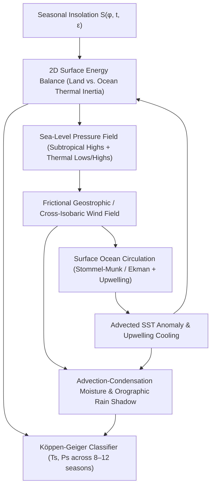

# Ocean Current & Coupled Climate Simulation Models for Spherical Geodesic Grids

## 1. Diagnosis of `Tec-Nine`'s Existing Climate Engine

An audit of [`climatemethod.py`](file:///home/travis/Tec-Nine/climatemethod.py), [`climateclassification.py`](file:///home/travis/Tec-Nine/climateclassification.py), [`climatesimulation.py`](file:///home/travis/Tec-Nine/climatesimulation.py), and [`tile.py`](file:///home/travis/Tec-Nine/tile.py) reveals why running `Tec-Nine` on Earth's ETOPO2 topography ([`earth.py`](file:///home/travis/Tec-Nine/earth.py)) fails to reproduce Earth's Köppen-Geiger climate distribution:

1. **Purely Zonal, Pressure-Blind Winds ([`climatemethod.py:96-105`](file:///home/travis/Tec-Nine/climatemethod.py#L96-L105)):**
   `Climate.winddirection(lat, c, s)` computes wind direction solely from latitude, cell count `c`, and planetary spin `s`. Although `self.pressure[v]` is computed in [`climatemethod.py:128-135`](file:///home/travis/Tec-Nine/climatemethod.py#L128-L135) (and even there, land pressure is hardcoded to `0.5`), **pressure is never read anywhere in the codebase**. Consequently:
   - Winds do not curve around subtropical oceanic highs (Azores/Pacific highs) or subpolar lows.
   - Seasonal land–sea thermal contrasts do not deflect winds, making **monsoons** (South/East Asian, West African, North American) impossible.
2. **Zero Ocean Circulation or Sea Surface Temperature (SST) Transport ([`climatemethod.py:118-123`](file:///home/travis/Tec-Nine/climatemethod.py#L118-L123)):**
   Ocean tiles (`elevation == 0`) have their temperature set strictly to zonal solar insolation (`ins + glacial_dt`). Furthermore, [`climatesimulation.py:80-86`](file:///home/travis/Tec-Nine/climatesimulation.py#L80-L86) clamps negative ETOPO elevations to `0`, discarding bathymetry (`tile.bottom` is set to `-1`). Because there are no ocean currents:
   - **No Western Boundary Currents (Gulf Stream, Kuroshio, Brazil, Agulhas):** Western Europe at $50^\circ\text{N}–65^\circ\text{N}$ receives the same baseline temperature as Labrador or Kamchatka, turning `Cfb` marine west coast climates into `Dfc`/`ET` subarctic/tundra.
   - **No Cold Eastern Boundary Currents or Coastal Upwelling (Humboldt, Benguela, Canary, California):** Subtropical west coasts are not cooled or stabilized, preventing the formation of coastal hyper-arid deserts (`BWh`/`BWk` in Atacama, Namib, Baja/Sonora).
3. **Zero Thermal Inertia / Continentality ([`climatemethod.py:89-94`](file:///home/travis/Tec-Nine/climatemethod.py#L89-L94)):**
   Both land and ocean respond instantaneously to seasonal insolation `insolation(lat, season, tilt)`. In reality, the ocean mixed layer (~50–100 m) has ~30–50× the effective thermal inertia of continental surfaces, damping seasonal ocean temperature swings to $\pm 2\text{–}5^\circ\text{C}$ while interior Eurasia/North America swings by $40\text{–}60^\circ\text{C}$. Without continentality and eastward marine heat advection, `Cfb` vs. `Dfa`/`Dfb`/`Dfc` boundaries cannot form accurately.
4. **Topological BFS `seabreeze` Instead of Moisture Advection & Orographic Rain Shadows ([`climatemethod.py:158-196`](file:///home/travis/Tec-Nine/climatemethod.py#L158-L196)):**
   `_seabreeze()` runs an unweighted breadth-first search up to `breezedistance = 10` hops downwind from any ocean tile (`elevation <= 0`), decaying as $((10 - d)/10)^2$, and adds it to a purely latitudinal `convective` term:
   - **No Orographic Lift or Rain Shadows:** Elevation is never checked during `_propagate()`. Moist air crosses the Andes, Himalayas, Cascades, and Rockies without dumping windward precipitation or drying out leeward basins (Patagonia, Tibetan Plateau, Great Basin).
   - **Latitudinal `convective` Overwrites Deserts:** In [`climatemethod.py:186`](file:///home/travis/Tec-Nine/climatemethod.py#L186), `p = min(1.0, self.seabased[v] + self.convective[v] + self.glacial_dp)` guarantees high precipitation at the equator and $60^\circ$ regardless of continental interiority or mountain barriers, and `convective` is never suppressed over cold upwelling water.

---

## 2. Core Physics Needed for Arbitrary Planetary Grids

To work on **any procedural continent configuration, bathymetry, rotation rate ($\Omega$), axial tilt ($\varepsilon$), and grid resolution** (~7,292 dual hex/pentagon tiles at size 6) while converging to an Earth-accurate Köppen map on ETOPO topography, the model must capture five coupled mechanisms.

### 2.1 Wind-Driven Surface Ocean Circulation & Westward Intensification

When surface winds $\vec{\tau}$ blow over a rotating spherical ocean, the Coriolis parameter $f = 2\Omega \sin\phi$ varies meridonally with gradient $\beta = \frac{1}{R}\frac{\partial f}{\partial \phi} = \frac{2\Omega \cos\phi}{R}$.
- **Ekman Transport & Divergence:** Within the top ~50–100 m Ekman layer, friction and Coriolis deflect net mass transport $90^\circ$ to the right of the wind in the Northern Hemisphere (left in the Southern), or at an angle $\alpha_{\text{Ek}} \approx 25^\circ\text{–}45^\circ$ at the immediate surface. Near the equator ($|\phi| \to 0$), viscous/Rayleigh damping $r_E$ dominates so flow aligns with the wind:
  $$\vec{u}_{\text{Ek}} = \frac{r_E \vec{\tau} - f (\hat{n} \times \vec{\tau})}{\rho_w H_E (r_E^2 + f^2)}$$
- **Why Naive Vector Blurring Fails (And Why Stommel 1948 / Munk 1950 Is Essential):**
  If you simply advect or average wind vectors inside an ocean basin, you get symmetric gyres: the Gulf Stream is no faster or narrower than the Canary Current. In reality, **vorticity conservation under the $\beta$-effect** ($\beta v \approx \frac{1}{\rho H} \hat{n} \cdot (\nabla \times \vec{\tau})$ in the Sverdrup interior) forces poleward-moving water to gain planetary vorticity $f$, while equatorward-moving water loses $f$. Frictional vorticity dissipation can only balance the basin-wide wind-stress curl inside a narrow **western boundary layer** of width $\delta_S \sim \frac{r_b}{\beta}$ (Stommel bottom drag) or $\delta_M \sim \left(\frac{A_h}{\beta}\right)^{1/3}$ (Munk lateral viscosity).
- **The Barotropic Stommel–Munk Streamfunction Equation on a Sphere:**
  For depth-integrated volume transport $\vec{U} = \hat{n} \times \nabla_s \psi$ (with $\psi = 0$ on continental coastlines and island boundaries):
  $$r_b \nabla_s^2 \psi + \beta \frac{1}{R \cos\phi} \frac{\partial \psi}{\partial \lambda} - A_h \nabla_s^4 \psi = \hat{n} \cdot (\nabla_s \times \vec{\tau}_w)$$
  Because the east-west derivative $\beta \frac{\partial \psi}{\partial x}$ is first-order while damping $r_b \nabla_s^2 \psi$ is second-order, solving this linear equation on any arbitrary ocean basin mask automatically concentrates intense poleward warm currents along **western basin boundaries** (east coasts of continents in the subtropics) and broad, slow equatorward return flow on **eastern basin boundaries**—scaling naturally with planetary spin $\Omega$ (including retrograde rotation $\Omega < 0$, which flips intensification to eastern boundaries!).
- **Bathymetry & Coastal Upwelling:**
  - **Bathymetric Steering ($f/H$ potential vorticity):** Where ocean depth $H(v)$ varies over continental shelves, sills (e.g., Drake Passage, Greenland–Scotland Ridge), or mid-ocean ridges, dividing the vorticity balance by effective depth $H_{\text{eff}}(v) = \max(H_{\text{min}}, \min(H(v), H_{\text{thermocline}}))$ deflects currents along $f/H$ contours and throttles flow across shallow sills.
  - **Coastal Upwelling (Ekman Divergence):** Whenever wind-driven Ekman transport $\vec{u}_{\text{Ek}}$ points offshore away from a coastline neighbor $u \in \text{Land}$:
    $$w_{\text{up}}(v) = \max\left(0, \nabla_s \cdot \vec{u}_{\text{Ek}}(v)\right)$$
    Upwelling pulls cold deep water ($T_{\text{deep}} \approx 2\text{–}6^\circ\text{C}$) to the surface, creating sharp cold SST anomalies along subtropical western continental coasts (Peru/Chile, Namibia, California, Morocco/Iberia, Western Australia).

### 2.2 Coupling Ocean Currents to SST, Pressure, Wind, and Precipitation

1. **Advection-Diffusion of Sea Surface Temperature (SST):**
   Instead of prescribing ocean temperatures by latitude, solve the steady or seasonal advection-diffusion relaxation equation over ocean tiles:
   $$\frac{\partial T_{\text{ocean}}}{\partial t} + \vec{u}_{\text{ocean}} \cdot \nabla_s T_{\text{ocean}} = \kappa_o \nabla_s^2 T_{\text{ocean}} + \frac{T_{\text{rad}}(\phi, t) - T_{\text{ocean}}}{\tau_o} - \gamma_{\text{up}} w_{\text{up}} (T_{\text{ocean}} - T_{\text{deep}})$$
   where $\tau_o \approx 60\text{–}90\text{ days}$ is mixed-layer relaxation time. Warm western boundary currents carry tropical heat to $55^\circ\text{–}70^\circ$ latitude; cold eastern boundary currents and $w_{\text{up}} > 0$ cool subtropical west coasts by $4\text{–}8^\circ\text{C}$.
2. **Seasonal Pressure Field & Monsoon Wind Deflection:**
   - Base zonal pressure $P_{\text{zonal}}(\phi, t)$ follows the seasonal shift of the ITCZ (thermal equator $\phi_{\text{ITCZ}}(t) \approx \varepsilon_{\text{eff}} \sin(2\pi t)$) and the $N_{\text{cells}}$ atmospheric cells (equatorial trough, subtropical ridge at $\sim 30^\circ$, subpolar low at $\sim 60^\circ$, polar high).
   - **Thermal Pressure Anomaly:** Continent–ocean heating contrasts shift sea-level pressure via a thermal anomaly:
     $$P(v, t) = P_{\text{zonal}}(\phi_v, t) - \alpha_T \left(T_{\text{sea-level}}(v, t) - \overline{T}_{\text{zonal}}(\phi_v, t)\right)$$
     In summer, hot continents develop deep **thermal lows** (e.g., Asian Monsoon Low over Tibet/NW India) while cooler subtropical oceans maintain strong **subtropical highs** (Hawaiian/Azores Highs). In winter, frigid continental interiors form **Siberian Highs**.
   - **Frictional Geostrophic Wind Law:** Surface winds respond to $-\nabla_s P$ and the Coriolis parameter $f = 2\Omega \sin\phi$ with surface Rayleigh friction $r_a$ (higher over rough land $r_{\text{land}}$ than smooth ocean $r_{\text{ocean}}$):
     $$\vec{w}(v) = \frac{-r_a \nabla_s P - f (\hat{n} \times \nabla_s P)}{\rho_a (r_a^2 + f^2)}$$
     This single closed-form vector equation on the spherical grid automatically produces trade winds, mid-latitude westerlies, cyclonic rotation around subpolar lows, anticyclonic gyre winds around subtropical highs, and cross-equatorial monsoon reversals!
3. **Clausius–Clapeyron Moisture Advection & Orographic Rain Shadows:**
   - **Moisture Capacity:** Saturation vapor capacity follows the Clausius–Clapeyron relation:
     $$q_{\text{sat}}(T) = q_0 \exp\left(\frac{17.67 \, T(^\circ\text{C})}{T(^\circ\text{C}) + 243.5}\right)$$
   - **Evaporation Over Ocean (SST-Sensitive!) & Land Recycling:**
     Over ocean tiles, evaporation $E(v) = c_{\text{evap}} \|\vec{w}\| \max(0, q_{\text{sat}}(T_{\text{ocean}}) - q)$. When cold upwelling reduces $T_{\text{ocean}}$ below the overlying air temperature, $q_{\text{sat}}(T_{\text{ocean}})$ drops and marine inversion stability suppresses convection—starving adjacent western coastal deserts (Atacama/Namib) of rain even right next to the ocean! Over land, evapotranspiration recycles a fraction $\beta_{\text{ET}} P_{\text{prev}}$ (critical for keeping the Amazon and Congo basins wet far inland).
   - **Orographic Condensation & Rain Shadows:**
     As moisture flux $\vec{w} q$ moves from upwind tile $u$ to tile $v$, temperature drops with elevation $T(v) = T_{\text{SL}}(v) - \Gamma z(v)$ ($\Gamma \approx 6.5^\circ\text{C/km}$). Additionally, upslope motion $\Delta z = \max(0, z(v) - z(u))$ triggers forced condensation:
     $$P_{\text{oro}} = \max\left(0, q_{\text{in}} - q_{\text{sat}}(T(v))\right) + c_{\text{oro}} \frac{\Delta z}{z_{\text{scale}}} q_{\text{in}}$$
     Rain is subtracted from $q$, so when air descends the leeward slope ($\Delta z < 0$), $q_{\text{sat}}(T)$ rises exponentially while $q$ is depleted—creating dry **rain shadows** immediately downwind of mountain ranges.

---

## 3. Survey of Prior Art in Procedural & Fast Planetary Climate Modeling

| Project / Methodology | Ocean Current Model | Atmosphere & Moisture Model | Strengths & Limitations |
| :--- | :--- | :--- | :--- |
| **Worldbuilding Pasta / Artifexian / Madeline James** | Rule-based topological gyre tracing along coastlines inside latitude bands; labels warm poleward vs. cold equatorward shores. | Idealized 3-cell wind belts + manual/rule-based ITCZ shift, monsoon zones, and upwind/downwind coastal distance kernels. | Visually faithful to Earth Köppen rules, fast, great heuristics for SST/coastal aridity; brittle when automated on complex procedural archipelagos or inland seas without a field solver. |
| **Tectonics.js (`davidson16807`)** | None (zonal insolation + simple heat diffusion). | Latitudinal wind belts + basic upwind moisture blur. | Fast WebGL execution, good tectonic geology, but poor regional Köppen fidelity (no western boundary currents or sharp monsoons). |
| **PlanetGenerator / Red Blob Games / Dual-Mesh Worldgens** | Iterative vector relaxation: seed ocean velocities with wind, project tangent to coastlines, diffuse across hex neighbors. | Upwind DAG / Jacobi moisture advection with elevation lapse rate and rain-shadow subtraction. | Runs in <10 ms on 10k hexes; reproduces rain shadows and continentality well, but lacks $\beta$-effect westward intensification unless explicitly added. |
| **2D Energy Balance Models (North et al. 1981 / Sellers) + Stommel (1948)** | 2D barotropic Stommel streamfunction ($\psi$) solved via Gauss-Seidel/SOR + SST advection-diffusion. | 2D seasonal heat diffusion $C(\mathbf{x})\partial_t T = Q - (A+BT) + \nabla\cdot(D\nabla T)$ + frictional geostrophic wind + Clausius–Clapeyron moisture transport. | Physically grounded, handles arbitrary rotation/tilt/continents, reproduces Gulf Stream, Atacama/Namib upwelling, Asian Monsoon, and rain shadows in ~5–15 ms in Rust/Wasm. |
| **ExoPlaSim / PlaSim / FastGCM** | Slab ocean or multi-layer primitive equations. | 3D spectral primitive equations (8–10 vertical levels). | Gold-standard physical accuracy for exoplanets, but requires minutes to hours of CPU time—too slow for interactive Wasm procedural generation. |

---

## 4. Comparison of Three Concrete Algorithmic Designs for `Tec-Nine` (Rust/Wasm)

All three designs operate directly on `Tec-Nine`'s static spherical geodesic dual grid (`N = 7,292` tiles at size 6, where each tile $v$ has 3D unit normal $\hat{n}_v$, area $A_v$, local tangent basis $(\hat{e}_v^{\text{east}}, \hat{e}_v^{\text{north}})$, and 5 or 6 neighbors $u \in \mathcal{N}(v)$ at great-circle distance $d_{vu}$).

### Design A: Enhanced Heuristic Graph & Vector-Relaxation Solver

An evolution of `Tec-Nine`'s existing graph pipeline that replaces BFS `seabreeze` and static zonal winds with iterative vector relaxation and upwind moisture transport.

#### Mathematical & Algorithmic Formulation (Per Simulation Update)
1. **Coastline Distance & Marine Influence:**
   Run a multi-source Dijkstra/BFS from ocean tiles to compute `dist_to_ocean[v]`.
2. **Heuristic Surface Ocean Currents + $\beta$-Weighting:**
   - Initialize ocean velocity $\vec{u}_v^{(0)}$ from zonal wind belts deflected by spin-dependent Ekman angle ($\pm 35^\circ \operatorname{sgn}(\phi)$).
   - For $k = 1 \dots 30$ iterations over ocean tiles:
     - Average incoming neighbor vectors weighted by upwind alignment, but multiply the weight of **westward-flowing** movement by $(1 + \gamma_\beta \cos\phi_v)$ so flow piles up against western basin boundaries.
     - For any neighbor $u \in \text{Land}$, remove the normal velocity component ($\vec{u}_v \leftarrow \vec{u}_v - (\vec{u}_v \cdot \hat{e}_{vu})\hat{e}_{vu}$) so currents deflect parallel to coastlines.
     - Advect scalar thermal anomaly $\Delta T_{\text{SST}}$ along $\vec{u}_v$ for 25 steps; subtract upwelling cooling $\Delta T_{\text{up}}$ where wind blows offshore from eastern basin coasts.
3. **Seasonal Temperature & Pressure-Deflected Wind:**
   - Compute land/ocean seasonal temperature using effective continentality factor $f_{\text{cont}}(v) = 1 - \exp(-\text{dist\_to\_ocean}[v] / L_{\text{mar}})$ plus advected $\Delta T_{\text{SST}}$.
   - Compute pressure $P(v) = P_{\text{zonal}}(\phi_v, \text{season}) - \alpha_T (T_{\text{SL}}(v) - \overline{T}(\phi_v))$ and blend the pressure-gradient wind vector $-\nabla_s P$ (rotated by Coriolis) with the baseline zonal wind.
4. **Upwind Graph Moisture Advection & Rain Shadow:**
   - Build upwind neighbor weights $W_{uv} \propto \max(0, \vec{w}_u \cdot \hat{e}_{uv})$ (reusing `Tec-Nine`'s `_mapping` concept, updated per season).
   - Iterate 15 passes of moisture propagation: ocean tiles inject $q_v = q_{\text{sat}}(T_{\text{ocean}})$; land tiles receive $q_{\text{in}} = \sum_u W_{uv} q_u$, condense $P_v = \max(0, q_{\text{in}} - q_{\text{sat}}(T_v)) + c_{\text{oro}} \max(0, z_v - z_u) q_{\text{in}}$, and pass remaining moisture $q_v = q_{\text{in}} - P_v + \beta_{\text{ET}} P_v$ downwind.

---

### Design B: Coupled Stommel Streamfunction + 2D Seasonal Energy Balance & Moisture Advection (Recommended)

This hybrid physics-reduced model solves the exact 2D geophysical PDEs that govern ocean gyres, seasonal continentality, monsoons, and orographic precipitation using fast sparse relaxation on the hex grid.

#### Discrete Operators on `Tec-Nine`'s Geodesic Hex/Pentagon Grid
Precompute once when the grid is initialized (or when elevation/bathymetry changes):
- **Tangent Basis at Tile $v$:** $\hat{e}_v^{\text{east}} = \frac{(-\sin\lambda_v, \cos\lambda_v, 0)}{\|( -\sin\lambda_v, \cos\lambda_v, 0 )\|}$, $\hat{e}_v^{\text{north}} = \hat{n}_v \times \hat{e}_v^{\text{east}}$.
- **Discrete Gradient ($\nabla_s \Phi$):**
  $$\nabla_s \Phi(v) = \frac{1}{A_v} \sum_{u \in \mathcal{N}(v)} \ell_{vu} \frac{\Phi(u) - \Phi(v)}{2} \hat{e}_{vu}$$
  where $\ell_{vu}$ is the Voronoi dual edge length between tiles $v$ and $u$, and $\hat{e}_{vu}$ is the unit tangent vector at $v$ pointing toward $u$.
- **Discrete Laplacian ($\nabla_s^2 \Phi$):**
  $$\nabla_s^2 \Phi(v) = \frac{1}{A_v} \sum_{u \in \mathcal{N}(v)} \frac{\ell_{vu}}{d_{vu}} \left(\Phi(u) - \Phi(v)\right)$$

#### Step-by-Step Per-Update Algorithm

1. **Step 1: Annual/Seasonal Stommel Ocean Streamfunction ($\psi$) & Ekman Velocity**
   - Set $\psi(v) = 0$ on all land tiles ($z_v > 0$). (For islands, fixing $\psi = 0$ on all land tiles works well and automatically permits realistic shelf/strait deflection when combined with an Ekman surface component).
   - Compute zonal wind stress curl $C_\tau(v) = \hat{n}_v \cdot (\nabla_s \times \vec{\tau}_w(v))$ over ocean tiles.
   - Solve the depth-weighted Stommel equation on ocean tiles via **40–60 iterations of Successive Over-Relaxation (SOR, $\omega = 1.65$)**:
     $$\frac{r_b}{H_{\text{eff}}(v)} \nabla_s^2 \psi(v) + \beta_v \left(\hat{e}_v^{\text{east}} \cdot \nabla_s \psi(v)\right) = C_\tau(v)$$
     where $\beta_v = \frac{2\Omega \cos\phi_v}{R}$ and $H_{\text{eff}}(v) = \text{clamp}(-z_{\text{bathymetry}}(v), 0.2, 4.0\text{ km})$.
   - **Total Surface Ocean Velocity:** Combine geostrophic gyre velocity with surface Ekman drift:
     $$\vec{u}_{\text{ocean}}(v) = \frac{1}{H_{\text{eff}}(v)} \left(\hat{n}_v \times \nabla_s \psi(v)\right) + \vec{u}_{\text{Ek}}(v)$$
   - **Coastal Upwelling Index:**
     $$w_{\text{up}}(v) = \max\left(0, \frac{1}{A_v} \sum_{u \in \mathcal{N}(v)} \ell_{vu} \, \frac{(\vec{u}_{\text{Ek}}(v) + \vec{u}_{\text{Ek}}(u))}{2} \cdot \hat{e}_{vu}\right) \quad (\text{with } \vec{u}_{\text{Ek}}(u) = 0 \text{ if } u \in \text{Land})$$

2. **Step 2: Ocean SST Advection-Diffusion Solver**
   - Solve for equilibrium/seasonal ocean surface temperature $T_{\text{SST}}(v, s)$ using 20 upwind Gauss-Seidel iterations:
     $$\sum_{u \in \mathcal{N}_{\text{ocean}}(v)} F_{uv}^{\text{upwind}} \left(T_{\text{SST}}(v) - T_{\text{SST}}(u)\right) - \kappa_o \nabla_s^2 T_{\text{SST}}(v) + \frac{T_{\text{SST}}(v) - T_{\text{rad}}(\phi_v, s)}{\tau_o} + \gamma_{\text{up}} w_{\text{up}}(v) \left(T_{\text{SST}}(v) - T_{\text{deep}}\right) = 0$$
     This produces a $+6\text{ to }+10^\circ\text{C}$ warm anomaly in the North Atlantic/Norwegian Sea and Kuroshio extension, and a $-5\text{ to }-8^\circ\text{C}$ cold anomaly off Peru, Namibia, California, and NW Africa.

3. **Step 3: Seasonal 2D Energy Balance Model (Thermal Inertia & Continentality)**
   - Across the 8 (or 12) seasonal steps $s = 0 \dots N_s - 1$, march or relax surface air temperature $T_{\text{air}}(v, s)$ with heat capacity $C_v = C_{\text{ocean}}$ (high, $\tau_{\text{ocean}} \approx 60\text{ days}$) vs. $C_{\text{land}}$ (low, $\tau_{\text{land}} \approx 5\text{ days}$):
     $$C_v \frac{T_{\text{air}}(v, s) - T_{\text{air}}(v, s-1)}{\Delta t} = Q_{\text{insol}}(\phi_v, s, \varepsilon)(1 - \alpha_v) - (A_{\text{OLR}} + B_{\text{OLR}} T_{\text{air}}(v, s)) + \nabla_s \cdot (D_{\text{atm}} \nabla_s T_{\text{air}}) - \vec{w}_{\text{prev}} \cdot \nabla_s T_{\text{air}} - \Gamma_{\text{lapse}} z_v$$
     Sweeping 2 annual cycles (16–24 seasonal steps total) locks in the periodic seasonal cycle with realistic thermal lag (warmest ocean in August/September, warmest land in July) and eastward marine air advection onto western continental margins.

4. **Step 4: Seasonal Sea-Level Pressure & Frictional Geostrophic Wind**
   - Compute sea-level temperature $T_{\text{SL}}(v, s) = T_{\text{air}}(v, s) + \Gamma_{\text{lapse}} z_v$ and zonal mean $\overline{T}_{\text{SL}}(\phi_v, s)$.
   - Compute surface pressure:
     $$P(v, s) = P_{\text{belts}}(\phi_v, s, N_{\text{cells}}, \varepsilon) - \alpha_P \left(T_{\text{SL}}(v, s) - \overline{T}_{\text{SL}}(\phi_v, s)\right)$$
   - Compute surface wind vector $\vec{w}(v, s)$ via the frictional geostrophic balance:
     $$\vec{w}(v, s) = \frac{-r_a(v) \nabla_s P(v, s) - f_v \left(\hat{n}_v \times \nabla_s P(v, s)\right)}{\rho_a \left(r_a(v)^2 + f_v^2\right)}$$

5. **Step 5: Upwind Moisture Advection, Orographic Lift, and Convective/Frontal Precipitation**
   - For each season $s$, solve steady moisture transport $\nabla_s \cdot (\vec{w} q) = E - P_{\text{precip}}$ via 15–20 Gauss-Seidel upwind sweeps (or topological sort along DAG edges where $\vec{w}_v \cdot \hat{e}_{vu} > 0$):
     - **Ocean Source:** $q(v)$ relaxes toward $\text{RH}_{\text{marine}} \cdot q_{\text{sat}}(T_{\text{SST}}(v, s))$. Notice that if $T_{\text{SST}}(v, s)$ is cooled by upwelling while coastal land is warm, the air parcel moving onshore has low relative humidity $q / q_{\text{sat}}(T_{\text{land}}) \ll 1$, completely suppressing coastal rainfall!
     - **Land Condensation & Rain Shadow:**
       $$\text{Lift}_{uv} = \max\left(0, (z_v - z_u) \frac{\vec{w}_v \cdot \hat{e}_{uv}}{d_{uv}}\right)$$
       $$P_{\text{rain}}(v, s) = \max\left(0, q_{\text{in}}(v) - q_{\text{sat}}(T_{\text{air}}(v, s))\right) + q_{\text{in}}(v) \left(1 - \exp\left(-c_{\text{oro}} \text{Lift}_v - c_{\text{conv}} \max(0, -\nabla_s \cdot \vec{w}_v)\right)\right)$$
     - **Downwind Depletion & Land Evapotranspiration Recycling:**
       $$q_{\text{out}}(v) = \left(q_{\text{in}}(v) - P_{\text{rain}}(v, s)\right) + \beta_{\text{ET}} P_{\text{rain}}(v, s)$$

---

### Design C: 1.5-Layer Reduced-Gravity Shallow-Water Ocean + 2-Layer Moist Atmospheric Primitive Model

A dynamical time-stepping shallow-water fluid simulation on the spherical Voronoi mesh (similar to simplified *PlaSim* / *FastGCM*).

#### Mathematical & Algorithmic Formulation
1. **Ocean Layer (1.5-Layer Reduced Gravity):**
   Evolves upper-thermocline thickness $h_v$ and momentum $\vec{u}_v$ explicitly in time:
   $$\frac{\partial \vec{u}}{\partial t} + (\vec{u}\cdot\nabla_s)\vec{u} + f (\hat{n}\times\vec{u}) = -g' \nabla_s h + \frac{\vec{\tau}_w}{\rho_w h} - r_b \vec{u} + A_h \nabla_s^2 \vec{u}$$
   $$\frac{\partial h}{\partial t} + \nabla_s \cdot (h \vec{u}) = w_{\text{ekman}}$$
2. **Atmosphere Layer:**
   Time-steps baroclinic momentum, potential temperature $\theta$, and column water vapor $q$ using explicit RK3/RK4 integration with $\Delta t \approx 10\text{ minutes}$ (CFL-limited by gravity wave speed $\sqrt{gH}$ across ~250 km hexes) over 5–10 simulated years (~250,000 time steps) to reach statistical equilibrium.

---

## 5. Side-by-Side Comparison & Earth Climate Failure-Mode Resolution

| Criterion / Earth Failure Mode | Current `Tec-Nine` (`climatemethod.py`) | Design A: Heuristic Vector & Upwind Graph | Design B: Stommel $\psi$ + 2D EBM + Moisture PDE (Recommended) | Design C: 1.5-Layer Shallow-Water Primitive |
| :--- | :--- | :--- | :--- | :--- |
| **Gulf Stream / Western Europe (`Cfb` to $65^\circ\text{N}$)** | Fails (`Dfc`/`ET`; zonal temp only). | Partial (heuristic $\beta$-bias requires manual tuning per basin size). | **Solved naturally** (Stommel $\beta \partial_x \psi$ concentrates warm transport on western basin boundaries; EBM advects heat eastward onto Europe). | **Solved naturally** (Rossby wave dispersion forms western boundary jets). |
| **Atacama / Namib / Baja Coastal Deserts (`BWh`/`BWk`)** | Fails (`seabreeze` forces all coasts within 10 hexes to be wet). | Partial (requires explicit coastal upwelling rule on west coasts). | **Solved naturally** (Offshore Ekman divergence cools SST via $w_{\text{up}}$; cold $q_{\text{sat}}(T_{\text{SST}})$ + subsiding subtropical high starves coast of rain). | **Solved naturally** (Upwelling lowers thermocline $h$ and SST). |
| **South/East Asian Monsoon (`Am`/`Cwa` vs. `BWh` Arabia)** | Fails (pressure is ignored; zonal winds never reverse). | Moderate (blended thermal pressure deflects winds seasonally). | **Solved naturally** (Summer Tibetan/Indian thermal low + Mascarene/Pacific highs drive strong cross-equatorial SW monsoon moisture flux). | **Solved naturally** (Full seasonal Hadley/monsoon overturning). |
| **Andes / Himalayas / Cascades Orographic Rain Shadows (`BWk`/`BSk`)** | Fails (BFS `seabreeze` ignores elevation completely). | **Solved** (Upwind DAG subtracts windward condensation). | **Solved naturally** (Clausius–Clapeyron $q_{\text{sat}}(T(z))$ + upslope $\vec{w}\cdot\nabla z$ rains out windward slopes and leaves leeward slopes dry). | **Solved naturally** (Topographic convergence and adiabatic drying). |
| **Arbitrary Planet Generalization (Spin $\Omega$, Tilt $\varepsilon$, Continents)** | Only varies zonal bands `cells` and `spin` angle. | Good, though heuristic weights can struggle on extreme tilts ($\varepsilon > 45^\circ$) or tidally locked worlds. | **Excellent** (Scaling $f = 2\Omega\sin\phi$, $\beta = \frac{2\Omega\cos\phi}{R}$, and $Q(\phi, s, \varepsilon)$ adapts automatically to retrograde spin, high obliquity, or supercontinents). | **Excellent**, but CFL stability breaks down at high rotation rates or fine grids without implicit solvers. |
| **Wasm Execution Time (7,292 tiles, 8 seasons)** | ~1.5 ms (Python: ~40 ms) | **~2–4 ms** in Rust/Wasm | **~6–12 ms** in Rust/Wasm (~1.2 M floating-point ops total) | **~1,500–8,000 ms** (requires thousands of CFL substeps) |
| **Implementation Complexity in Rust** | Baseline | Low (~350 LOC) | **Medium (~600–800 LOC, zero external linear algebra crates needed)** | High (~2,000+ LOC, requires careful spherical vector stabilization) |

---

## 6. Integration Blueprint with `Tec-Nine`'s Köppen Classifier (`climateclassification.py`)

A major advantage of **Design B** is that it slots directly into [`ClimateClassification`](file:///home/travis/Tec-Nine/climateclassification.py#L1-L75) and [`ClimateSimulation`](file:///home/travis/Tec-Nine/climatesimulation.py#L40-L50) with two targeted improvements:

1. **Preserve Bathymetry in [`earth.py`](file:///home/travis/Tec-Nine/earth.py) and [`climatesimulation.py:80-86`](file:///home/travis/Tec-Nine/climatesimulation.py#L80-L86):**
   Currently, `ClimateSimulation.earth()` clamps `if elevation < 0: elevation = 0` and sets `t.bottom = -1`. Instead, preserve `t.bottom = elevation` when `elevation < 0` so the ocean depth $H(v) = -t.\text{bottom}$ (from ETOPO2 or procedural tectonic crust thickness in [`tile.py:280-285`](file:///home/travis/Tec-Nine/tile.py#L280-L285)) is available to the Stommel solver and coastal upwelling detector.
2. **Direct Physical Units (`°C` and `mm/season`) Into `ClimateClassification`:**
   [`climateclassification.py:5-6`](file:///home/travis/Tec-Nine/climateclassification.py#L5-L6) already converts normalized $[0, 1]$ temperature and precipitation into degrees Celsius (`tf`) and millimeters (`pf`, scaled to $1800\text{ mm/yr}$) and evaluates the exact Peel et al. (2007) Köppen-Geiger thresholds (`B` aridity threshold `thr = 20 * T_mean + {0, 140, 280}`, `A` $\min(T) \ge 18^\circ\text{C}$, `C`/`D` boundary at $\min(T) \ge -3^\circ\text{C}$, `w`/`s`/`f` seasonal ratios, and `ET`/`EF` at $10^\circ\text{C}$ and $0^\circ\text{C}$).
   - Optionally, in the Rust port, add the third Köppen letter (`a`/`b`/`c`/`d` for `C` and `D` climates, and `h`/`k` above/below $T_{\text{mean}} = 18^\circ\text{C}$ for `B` deserts/steppes), which requires only 12 lines of code on the existing `ts` array.
