# Full-Crust & Ocean-Floor Tectonic Simulation Models for `Tec-Nine`

## Executive Summary

Currently, `Tec-Nine` ([`planetsimulation.py`](file:///home/travis/Tec-Nine/planetsimulation.py), [`tile.py`](file:///home/travis/Tec-Nine/tile.py)) treats tectonic activity as **continental rafts** (`Group`s of tiles) drifting across a passive, stateless ocean basin. Whenever a tile is uncovered by a moving continent, [`Tile.emptyocean()`](file:///home/travis/Tec-Nine/tile.py#L280-L284) resets its crust to a single $5\text{ km}$ basalt layer with `bottom = -5` and clamps `elevation = max(0, bottom + thickness) = 0`. While `Tec-Nine` features a remarkably rich **explicit stratigraphic column** per tile ([`Layer`](file:///home/travis/Tec-Nine/tile.py#L3-L15) stacks of mafic/felsic igneous, clastic/chemical/biogenic sedimentary, and contact/regional metamorphic rocks), its ocean floor is completely flat and featureless.

To model the **entire planetary crust**—including **mid-ocean ridges (MORs), abyssal plains, oceanic trenches, volcanic island arcs, back-arc basins, and passive-margin continental shelves**—on arbitrary procedural planets without hardcoded Earth histories, we surveyed four foundational paradigms:
1. **cTectonics / Tectonics.js & pyTectonics (Carl Davidson):** Full-sphere Eulerian-Lagrangian plate partitioning with multi-pool crust columns (mafic, felsic, sediment, metamorphic), age-driven density/subduction, and Archimedes isostasy.
2. **PlaTec (Lauri Viitanen) & WorldEngine:** 2D grid-based plate masks with explicit crust thickness, crustal age, buoyancy-driven subduction vs. continental folding, and slab pull.
3. **Academic Computer Graphics & Geophysics (Cortial et al. 2019 *"Procedural Tectonic Planets"*, Parsons & Sclater 1977, Stein & Stein 1992 GDH1):** Spherical plate tessellations with analytical distance-transfer profiles for trenches, arcs, ridges, and thermal lithospheric cooling $d(t) = d_0 + c\sqrt{t}$.
4. **Stratigraphic & Isostatic Extension of `Tec-Nine`:** Generalizing `Tec-Nine`'s rock-layer column (`layers`, `bottom`, `mountainosity`) to support negative elevations (bathymetry), lithospheric mantle root cooling, seafloor spreading, and submarine sedimentation.

Below is an analysis of these models followed by **three concrete architectural options** tailored for the Rust/Wasm rewrite on a 7,292 to 65,612 tile geodesic hex/pentagon grid.

---

## 1. Survey of Existing Full-Crust Tectonic Models

### 1.1 cTectonics / Tectonics.js & pyTectonics (Carl Davidson)

Carl Davidson's **pyTectonics** and its WebGL/JavaScript successor **Tectonics.js** (`cTectonics`) are the closest conceptual relatives to `Tec-Nine`. They operate on a spherical geodesic mesh and explicitly model the entire lithosphere without relying on preset Earth histories.

#### How the Sphere is Partitioned into Plates
* **Full-Sphere Coverage:** Unlike `Tec-Nine`'s isolated continental `Group`s, every cell on the sphere belongs to one of $N$ tectonic **Plates** (typically $7–20$ plates initialized via spherical Voronoi tessellation or flood-fill).
* **Euler Pole Kinematics:** Each plate $P_k$ moves via rigid-body spherical rotation defined by an angular velocity vector (Euler pole) $\boldsymbol{\omega}_k \in \mathbb{R}^3$. The linear velocity at surface point $\mathbf{p}$ on a sphere of radius $R$ is:
  $$\mathbf{v}_k(\mathbf{p}) = \boldsymbol{\omega}_k \times \mathbf{p}$$
* **Grid Advection / Remapping:** In earlier versions (`pyTectonics`), plates carried local grids that rotated over a global world grid; in later iterations (`Tectonics.js`), crust properties are stored in conserved mass pools and resampled onto the static spherical grid at each step (semi-Lagrangian advection) or moved with plate masks that periodically re-index to the master sphere.

#### Crust Representation: Mafic, Felsic, Sedimentary, and Age
Instead of discrete variable-length layer lists, `Tectonics.js` tracks conserved **mass/thickness pools** per grid cell:
* **Mafic volcanic & plutonic pools** (basalt/gabbro, density $\rho_{\text{mafic}} \approx 2,900\text{ kg/m}^3$) — dominates oceanic crust.
* **Felsic volcanic & plutonic pools** (rhyolite/granite, density $\rho_{\text{felsic}} \approx 2,700\text{ kg/m}^3$) — dominates continental crust.
* **Sedimentary & Metamorphic pools** ($\rho_{\text{sed}} \approx 2,500\text{ kg/m}^3$).
* **Crustal Age ($t_{\text{age}}$):** Tracked per cell, initialized to $0$ at divergent rifts and incremented by $\Delta t$ every timestep.

#### Seafloor Spreading, Subduction, and Collisions
* **Divergent Boundaries (Rifting / Seafloor Spreading):** When adjacent plates pull apart (or a plate moves away from a gap), an uncovered cell is filled by newly upwelled asthenosphere: a thin (~$6–7\text{ km}$) column of pure **mafic** rock with $t_{\text{age}} = 0$.
* **Density & Thermal Cooling:** As oceanic lithosphere ages, the underlying lithospheric mantle cools and thickens. `Tectonics.js` computes an effective lithospheric density $\rho_{\text{eff}}(t_{\text{age}})$ that increases with $\sqrt{t_{\text{age}}}$. Once $\rho_{\text{eff}}$ exceeds the asthenosphere density ($\rho_m \approx 3,300\text{ kg/m}^3$), the oceanic column becomes negatively buoyant.
* **Subduction vs. Continental Collision (Detachability / Buoyancy):** When two plates overlap at a convergent boundary:
  * **Ocean-Continent (O-C) or Ocean-Ocean (O-O):** The denser, older oceanic column subducts. Its **mafic** pool is destroyed (recycled into the mantle or partially melted into **felsic/andesitic** magma added to the overriding plate's arc), while its low-density **sedimentary** and **felsic** pools are scraped off (**accreted** as an accretionary wedge / terrane) onto the overriding plate!
  * **Continent-Continent (C-C):** Neither column can subduct because their high felsic thickness makes both positively buoyant. Both crust columns merge/stack, thickening the felsic/metamorphic root and building high fold belts (orogeny).

---

### 1.2 PlaTec (Lauri Viitanen, 2012) & WorldEngine

**PlaTec** is a C++ 2D toroidal grid simulator written by Lauri Viitanen (*Physically Based Terrain Generation: Procedural Heightmap Generation Using Plate Tectonics*, 2012) and integrated into **WorldEngine**.

#### Core Mechanics
* **Data Per Cell:** Each cell stores crustal thickness/elevation $z$, crustal age $t$, and plate ownership ID. A threshold thickness $z_{\text{cont}}$ separates oceanic crust ($z < z_{\text{cont}}$, denser) from continental crust ($z \ge z_{\text{cont}}$, more buoyant).
* **Spreading Centers:** Cells exposed between diverging plates are assigned fresh oceanic crust of minimum thickness $z_{\text{ridge}}$ and age $t = 0$.
* **Collision & Subduction Rules:**
  * **Continental-Continental:** When two cells with $z \ge z_{\text{cont}}$ overlap, a fraction of the colliding mass is folded into both plates, transferring momentum and slowing down plate convergence (eventual plate suturing).
  * **Oceanic Subduction:** When oceanic crust ($z < z_{\text{cont}}$) collides with continental crust (or younger, more buoyant oceanic crust), the denser oceanic cell subducts. PlaTec spawns a **subducting slab packet** that travels under the overriding plate for a fixed distance along the relative velocity vector $\mathbf{v}_{\text{rel}}$, adding magmatic uplift (coastal mountains / island arcs) at a characteristic distance inland from the trench.
* **Limitations:** PlaTec's ocean floor lacks true bathymetric trenches and flexural profiles because it primarily outputs a single scalar height value rather than separating crustal composition, lithospheric mantle thickness, and water loading.

---

### 1.3 Academic Procedural & Geophysical Models

#### A. Cortial et al. (2019) — *"Procedural Tectonic Planets"* (Eurographics)
Yann Cortial, Adrien Peytavie, Eric Galin, and Éric Guérin introduced a real-time spherical tectonic framework designed specifically for procedural planet generation on a spherical point-set/grid ($\sim 40,000–100,000$ samples).

1. **Full-Sphere Lithosphere State:**
   Every sample point $p$ on the sphere belongs to a plate $P_i$ and stores:
   * Crust type $x_C \in \{\text{oceanic}, \text{continental}\}$
   * Crustal thickness $e(p)$ and surface elevation $z(p)$
   * Oceanic crust age $a_o(p)$ and ridge direction vector $\mathbf{r}(p)$ (for abyssal hill fabric)
   * Continental orogenic age $a_c(p)$ and fold direction $\mathbf{f}(p)$

2. **Subduction & Trench/Arc Profiles:**
   At convergent boundaries where plate $P_i$ (oceanic) subducts beneath overriding plate $P_j$ (continental or younger oceanic, i.e., $a_o(p_i) > a_o(p_j)$), Cortial et al. avoid solving PDEs by applying an analytical **distance-transfer uplift/depression profile** along the distance $d(p)$ from the subduction front (up to maximum reach $r_s \approx 600–800\text{ km}$):
   $$\Delta z_{\text{sub}}(p) = u_0 \cdot f\big(d(p)\big) \cdot g\big(\|\mathbf{v}_i(p) - \mathbf{v}_j(p)\|\big) \cdot h\big(z_i(p)\big)$$
   * **On the subducting plate ($d < 0$):** $f(d)$ dips sharply downward as $d \to 0^-$ to carve an **oceanic trench** (down to $-8$ to $-11\text{ km}$), with a slight positive outer-rise bulge just seaward of the trench.
   * **On the overriding plate ($0 \le d \le r_s$):** $f(d)$ starts negative at the trench ($d=0$), rises steeply to a positive peak at $d_{\text{arc}} \approx 150–250\text{ km}$ to form a **volcanic island arc** (if $P_j$ is oceanic) or **Cordilleran/Andean mountain belt** (if $P_j$ is continental), and decays to zero (or a slight negative back-arc depression) as $d \to r_s$.
   * **Velocity Scaling:** $g(v) = v / v_0$ scales trench depth and arc uplift linearly with convergence speed.

3. **Continental Collision & Terrane Accretion:**
   When continental crust on $P_i$ reaches a subduction trench against continental crust on $P_j$, subduction jams. The contiguous continental fragment (a **terrane** $R$) detaches from $P_i$, sutures onto $P_j$, and generates an orogenic uplift bell-curve within radius $r_c \propto (\text{Area}(R))^{1/3}$:
   $$\Delta z_{\text{coll}}(p) = \Delta_c \, A \, \left(1 - \left(\frac{d(p, R)}{r_c}\right)^2\right)^2$$

4. **Rifting & Seafloor Spreading:**
   At divergent boundaries ($\Gamma$), points uncovered between separating plates spawn oceanic crust with $a_o = 0$ and initial ridge elevation $z_{\text{ridge}} \approx -2.5\text{ km}$. As $a_o$ increases with each timestep, elevation subsides toward abyssal plain depth ($z_{\text{abyssal}} \approx -5.5\text{ km}$) following the square-root-of-age cooling curve. Periodically, large plates undergo **continental rifting**, splitting along a noisy geodesic path into two plates that diverge to open a new Wilson-cycle ocean basin.

#### B. Geophysical Bathymetry: Parsons & Sclater (1977) and Stein & Stein (1992) GDH1
In marine geophysics, ocean floor depth is governed by **thermal isostasy** of the cooling lithospheric mantle boundary layer:
* **Half-Space Cooling (Young Seafloor, $t \le 70\text{ Ma}$):**
  As newly formed hot asthenosphere cools at the surface, a thermal boundary layer (lithospheric mantle) thickens as $L_m(t) \approx 2\sqrt{\kappa t}$ (where $\kappa \approx 10^{-6}\text{ m}^2/\text{s}$ is thermal diffusivity). Because cold mantle is denser than hot asthenosphere by $\Delta \rho = \rho_m \alpha T_m$, isostatic balance under water ($\rho_w \approx 1,030\text{ kg/m}^3$) yields the classic **square-root-of-age depth law**:
  $$d(t) = d_0 + c_0 \sqrt{t}, \quad c_0 = \frac{2 \rho_m \alpha T_m}{\rho_m - \rho_w} \sqrt{\frac{\kappa}{\pi}}$$
  On Earth (Parsons & Sclater 1977): $d_0 \approx 2,500\text{ m}$ (mid-ocean ridge crest depth) and $c_0 \approx 350\text{ m}\cdot\text{My}^{-1/2}$.
* **Plate Cooling Asymptote (Old Seafloor, $t > 70\text{ Ma}$):**
  Basal heat flux from mantle convection prevents infinite thickening, flattening the depth curve toward an asymptotic abyssal depth $d_{\max}$:
  $$d(t) = d_{\max} - (d_{\max} - d_0) \exp(-t / \tau_0)$$
  (Parsons & Sclater: $d_{\max} = 6,400\text{ m}$, $\tau_0 = 62.8\text{ Ma}$; Stein & Stein GDH1: $d_0 = 2,600\text{ m}$, $d_{\max} = 5,651\text{ m}$, $\tau_0 = 36\text{ Ma}$).
* **Why This Generalizes to Arbitrary Exoplanets:**
  All parameters have clear physical meanings: $d_0$ sets ridge crest depth, $d_{\max}$ sets old abyssal plain depth, and $\tau_0$ sets the planetary mantle cooling timescale (faster on high-heat-flux young planets, slower on cool planets). A single smooth formula usable across all ages $t \ge 0$ is the rational or exponential-sqrt blend:
  $$d_{\text{thermal}}(t) = d_0 + (d_{\max} - d_0)\left(1 - \exp\!\left(-\sqrt{\frac{t}{\tau_{\text{cool}}}}\right)\right) \quad \text{or} \quad d_0 + \frac{c_0 \sqrt{t}}{1 + \frac{c_0 \sqrt{t}}{d_{\max} - d_0}}$$

---

## 2. Extending `Tec-Nine`'s Rock-Layer & Isostasy Model to the Ocean Floor

### 2.1 How `Tec-Nine` Works Today (and Why the Ocean Floor is Flat)
In [`tile.py`](file:///home/travis/Tec-Nine/tile.py):
1. **Stratigraphic Column:** Every [`Tile`](file:///home/travis/Tec-Nine/tile.py#L22-L299) has `self.bottom` (elevation of the base of the crust relative to sea level, in km) and `self.layers` (an ordered list of [`Layer(rock, thickness)`](file:///home/travis/Tec-Nine/tile.py#L3-L15) from bottom to top).
2. **Clamped Seafloor Elevation:** In [`Tile.limit()`](file:///home/travis/Tec-Nine/tile.py#L62-L81):
   ```python
   self._elevation = max(0, self.bottom + self.thickness)
   ```
   And [`Tile.emptyocean()`](file:///home/travis/Tec-Nine/tile.py#L280-L284) sets `self.bottom = -5`, `self.layers = [Layer(basalt, 5)]`, `self._elevation = 0`. Because `bottom + thickness == 0` and `_elevation` is clamped at `0`, **oceanic tiles have zero bathymetric relief**, and any marine sediment deposited on an ocean tile immediately raises `bottom + thickness > 0`, turning deep ocean into emergent land unless it exceeds a $1.5\text{ km}$ threshold!
3. **Ad-Hoc Group Isostasy:** In [`planetsimulation.py`](file:///home/travis/Tec-Nine/planetsimulation.py#L316-L321), isostasy only adjusts `self.bottom` across a continental `Group` to conserve the group's total pre-erosion elevation (`dh`), rather than computing buoyant equilibrium from rock densities!

### 2.2 Generalizing `Tile` to True Full-Crust Lithostratigraphy & Isostasy

We can preserve **100% of `Tec-Nine`'s signature geological mechanics**—[`mergelayers()`](file:///home/travis/Tec-Nine/tile.py#L98-L183), [`intrude()`](file:///home/travis/Tec-Nine/tile.py#L256-L270), [`metamorphic.contact()`](file:///home/travis/Tec-Nine/rock/metamorphic.py#L124-L192), [`metamorphic.regional()`](file:///home/travis/Tec-Nine/rock/metamorphic.py#L110-L111), and [`sedimentary.deposit()`](file:///home/travis/Tec-Nine/rock/sedimentary.py#L1-L63)—while unlocking full ocean-floor bathymetry with four clean extensions:

#### Extension 1: Signed Elevation ($z \in \mathbb{R}$) & Reference Sea Level ($z_{\text{sea}} = 0$)
Remove the `max(0, ...)` clamp on `self._elevation`:
$$z = \text{bottom} + \sum_{i} h_i$$
* $z > 0$: Subaerial land (exposed to subaerial climate/fluvial erosion).
* $-0.2\text{ km} \le z \le 0$: **Continental shelf** (shallow marine zone; high clastic sedimentation from rivers + warm-water carbonate/limestone/chalk deposition via [`sedimentary.py`](file:///home/travis/Tec-Nine/rock/sedimentary.py#L41-L47)).
* $-2.5\text{ km} \le z < -0.2\text{ km}$: **Continental slope & rise** / **Mid-ocean ridges** / **Seamounts**.
* $-6.0\text{ km} \le z < -2.5\text{ km}$: **Abyssal plains** (pelagic clay/chert/chalk deposition).
* $z < -6.0\text{ km}$: **Hadal oceanic trenches** (subduction zones).

#### Extension 2: Density-Driven Airy Isostasy + Thermal Mantle Age ($t_{\text{age}}$)
In [`rock/igneous.py`](file:///home/travis/Tec-Nine/rock/igneous.py), rocks already have `'felsity': silica` ($\in [0, 1]$), and sedimentary/metamorphic rocks inherit weighted attributes or toughness. We can define an intrinsic density $\rho_i$ for every [`Layer`](file:///home/travis/Tec-Nine/tile.py#L3-L15):
* **Igneous:** $\rho(\text{felsity}) = 3,000 - 350 \cdot \text{felsity}\text{ kg/m}^3$ (so basalt at $\text{felsity}=0.5$ or $0.45$ is $\sim 2,840–2,900\text{ kg/m}^3$; granite/rhyolite at $\text{felsity}=0.85$ is $\sim 2,700\text{ kg/m}^3$).
* **Sedimentary:** $\rho_{\text{sed}} \approx 2,400 + 200 \cdot \text{toughness}\text{ kg/m}^3$ (unconsolidated/clastic sediment is light; compacts under burial).
* **Metamorphic:** $\rho_{\text{meta}} \approx 2,750 + 200 \cdot (1 - \text{felsity})\text{ kg/m}^3$ (with **eclogite** at depth $> 60\text{ km}$ jumping to $\rho_{\text{eclogite}} \approx 3,400\text{ kg/m}^3$—naturally causing lower-crustal delamination, replacing `Tec-Nine`'s arbitrary `MAX_THICKNESS = 75` cutoff!).

By adding a single scalar **`crust_age: f32`** (in Myr) to each `Tile`, we get the **Airy + Thermal Isostatic Equilibrium Elevation** $z_{\text{eq}}$ directly from Archimedes' principle relative to a reference Mid-Ocean Ridge column ($h_{\text{mor}} = 6\text{ km}$ at $z_{\text{mor}} = -2.5\text{ km}$):
$$B_{\text{crust}} = \sum_{i} h_i \left(\frac{\rho_m - \rho_i}{\rho_m}\right)$$
$$\Delta z_{\text{thermal}}(t_{\text{age}}) = -\Delta d_{\max} \left(1 - \exp\!\left(-\sqrt{\frac{t_{\text{age}}}{\tau_{\text{cool}}}}\right)\right) \cdot \left(1 - \phi_{\text{cont}}\right)$$
where $\phi_{\text{cont}} \in [0, 1]$ is the continental fraction of the column, $\rho_m = 3,300\text{ kg/m}^3$, and water loading amplifies subaqueous depth by $\frac{\rho_m}{\rho_m - \rho_w} \approx 1.45$.
Then in each step, `Tile.isostasize()` simply relaxes `self.bottom` toward $z_{\text{eq}} - \text{thickness}$:
$$\text{bottom} \leftarrow \text{bottom} + \alpha_{\text{iso}} \left( (z_{\text{eq}} - H + \Delta z_{\text{dynamic}}) - \text{bottom} \right)$$
where $\Delta z_{\text{dynamic}}$ captures flexural trench depression during active subduction!

#### Extension 3: Multi-Layer Ophiolite Oceanic Crust at Mid-Ocean Ridges
When new seafloor is created at a divergent boundary, instead of a single dummy layer, `Tile.birth_seafloor()` initializes a realistic **ophiolite stratigraphy** ($6–7\text{ km}$ total thickness, $t_{\text{age}} = 0$, $z = -2.5\text{ km}$):
1. **Bottom layer ($4.5\text{ km}$):** Intrusive mafic **Gabbro** (`igneous.intrusive(0.45)`).
2. **Top layer ($2.0\text{ km}$):** Extrusive mafic **Pillow Basalt** (`igneous.extrusive(0.45)`).
As this oceanic tile drifts across the ocean basin over tens of millions of years:
* Its `crust_age` increases ($t_{\text{age}} \leftarrow t_{\text{age}} + \Delta t$), causing thermal subsidence from $-2.5\text{ km}$ (mid-ocean ridge) down to $-5.5\text{ km}$ (abyssal plain).
* Pelagic sediment (chalk/limestone in warm seas with life, or fine abyssal claystone) slowly deposits on top of the pillow basalt.
* When it eventually reaches a subduction zone or obducts onto a continent, the full ophiolite sequence (gabbro + basalt + pelagic chert/limestone) is already present in `tile.layers`!

#### Extension 4: Submarine Continental Shelf Deposition & Accretionary Wedges
In [`erodemethod.py`](file:///home/travis/Tec-Nine/erodemethod.py), eroded material currently flows to all lower neighbors, and [`planetsimulation.py`](file:///home/travis/Tec-Nine/planetsimulation.py#L301-L310) only adds an ocean tile to a continent once deposited material in a single step exceeds `1.5` km.
With signed bathymetry:
* Fluvial sediment entering ocean tiles ($z < 0$) settles rapidly in shallow coastal water ($-2\text{ km} < z < 0$), naturally prograding a **continental shelf** of sandstone, siltstone, and limestone out from passive margins.
* Because shelf sediments have low density ($\rho \approx 2,450\text{ kg/m}^3$), isostasy automatically subsides `bottom` under the sediment load while building the shelf surface up toward $z \approx -0.1\text{ km}$.
* At convergent Ocean-Continent or Ocean-Ocean margins, when the oceanic plate subducts, its dense lower layers (gabbro/basalt) sink into the mantle (triggering `tile.subduction > 0` on the overriding plate, which drives `Tec-Nine`'s existing felsic/andesitic intrusions [`planetsimulation.py#L325-L329`](file:///home/travis/Tec-Nine/planetsimulation.py#L325-L329) and blueschist low-T/high-P regional metamorphism [`metamorphic.py#L103-L111`](file:///home/travis/Tec-Nine/rock/metamorphic.py#L103-L111)), while its top **sedimentary layers** are scraped off and merged onto the trench-ward edge of the overriding plate!

---

## 3. Comparison of 3 Architectural Options for the Rust/Wasm Rewrite

To bring full-crust tectonics to `Tec-Nine` in Rust/Wasm on a static geodesic hex/pentagon grid ($N \in [7,292, \, 65,612]$ tiles), we compare three concrete architectures.

```mermaid
flowchart TD
    subgraph OptA["Option A: Full-Sphere Eulerian-Lagrangian Plates (Tectonics.js + Tec-Nine Layers)"]
        A1["Sphere Partitioned into K Plates (100% coverage)"] --> A2["Rigid Euler Pole Rotation ω_k × p"]
        A2 --> A3["Divergent Gaps → Spawn Gabbro/Basalt Seafloor (age=0, z=-2.5km)"]
        A2 --> A4["Convergent Overlaps → Density/Age Check"]
        A4 -->|O-C or O-O| A5["Subduction: Trench Depression + Scrape Sediments + Arc Intrusions"]
        A4 -->|C-C| A6["Continental Collision: Tile.mergelayers() + Orogenic Folding"]
    end

    subgraph OptB["Option B: Boundary-Driven Procedural Fields (Cortial et al. 2019 Hybrid)"]
        B1["Voronoi Plate Tessellation + Geodesic Boundary Graph"] --> B2["Distance-to-Boundary Fields d_ridge, d_trench, d_coll"]
        B2 --> B3["Analytical Bathymetry & Uplift Transfer Curves f(d)·g(v)"]
        B3 --> B4["Advect Stratigraphic Columns Along Velocity Field v(p)"]
    end

    subgraph OptC["Option C: Enhanced Continental Rafts + Stateful Ocean Basin Grid"]
        C1["Existing Continental Groups + Stateful Ocean Tiles (age, layers)"] --> C2["Continents Move; Wake Spawns Mid-Ocean Ridge"]
        C2 --> C3["Leading Edge Subducts Older Ocean Floor (Trench + Andean Arc)"]
        C3 --> C4["Passive Margins Accumulate Submarine Shelf Sediments"]
    end
```



---

### Option A: Full-Sphere Plate Tessellation with Stratigraphic Advection (`Tectonics.js` + `Tec-Nine` Hybrid) — **RECOMMENDED**

Every tile on the sphere belongs to one of $K$ tectonic plates ($K \approx 8–18$), covering **100% of the planet** (both continents and oceans). Each plate is a `Group` with an Euler pole angular velocity $\boldsymbol{\omega}_k$. Every tile—whether continental or oceanic—carries `Tec-Nine`'s full `Vec<Layer>` rock column plus `crust_age: f32`.

#### Core Algorithm & Equations (Per Timestep $\Delta t$)
1. **Plate Kinematics (Euler Rotation):**
   Each plate $k$ rotates its constituent tiles around its Euler axis $\hat{\boldsymbol{\omega}}_k$ by angle $\Delta \theta_k = \|\boldsymbol{\omega}_k\| \Delta t$ using the existing hole-filling discrete advection in [`movemethod.py`](file:///home/travis/Tec-Nine/movemethod.py#L59-L95) (accelerated in Rust via direct hex-neighbor walk instead of a global KD-tree).
2. **Divergent Boundaries (Mid-Ocean Ridges & Continental Rifting):**
   * **Uncovered Tiles (Seafloor Spreading):** Any hex tile left uncovered by diverging plates is assigned to the nearest plate and initialized via `birth_seafloor()`: $4.5\text{ km}$ Gabbro + $2.0\text{ km}$ Basalt, `crust_age = 0.0`, `elevation = -2.5` km.
   * **Intra-Continental Rifting:** When [`splitmethod.py`](file:///home/travis/Tec-Nine/splitmethod.py) splits a plate across continental crust, tiles along the rift zone have their crust thinned by stretching factor $\beta \approx 1.5–2.0$, dropping their elevation into a **rift valley / proto-oceanic gulf** (like the Red Sea or East African Rift) before full seafloor spreading begins.
3. **Convergent Boundaries (Subduction vs. Orogeny):**
   When tiles from plate $A$ and plate $B$ map to the same destination hex $t$ with relative convergence speed $v_{\text{conv}} = \max(0, -(\mathbf{v}_A - \mathbf{v}_B) \cdot \hat{\mathbf{n}}_{AB})$:
   * Compute **Subductability (Negative Buoyancy)** of each column:
     $$\rho_{\text{lith}} = \frac{\sum h_{\text{crust}, i} \rho_i + h_{\text{mantle}}(t_{\text{age}}) \rho_{\text{mantle}}(t_{\text{age}})}{H_{\text{crust}} + h_{\text{mantle}}(t_{\text{age}})}$$
     Practically, a tile is **continental** if its felsic/metamorphic/sedimentary thickness $H_{\text{felsic}} > 12\text{ km}$ (or mean crustal density $\bar{\rho}_c < 2,800\text{ kg/m}^3$), and **oceanic** otherwise.
   * **Case 1: Ocean–Continent (O–C) or Ocean–Ocean (O–O) Convergence:**
     The oceanic tile (or the **older** oceanic tile $t_{\text{age}, \text{sub}} > t_{\text{age}, \text{over}}$ in O–O collisions) **subducts** beneath the overriding tile:
     * **Trench Flexure:** The boundary tile on the subducting plate receives a dynamic trench depression $\Delta z_{\text{trench}} = -c_{\text{trench}} \cdot v_{\text{conv}} \cdot \sqrt{t_{\text{age, sub}}}$ (producing $-7\text{ km}$ to $-10.5\text{ km}$ trenches).
     * **Sediment & Seamount Obduction (Accretionary Wedge):** Any sedimentary layers (`type == 'S'`) or thick felsic layers on the subducting tile are **scraped off** (`pop()`ed) and merged onto the overriding tile via [`Tile.mergelayers()`](file:///home/travis/Tec-Nine/tile.py#L98-L183).
     * **Mafic Slab Recycling & Volcanic Arc:** The subducting tile's bottom mafic layers (gabbro/basalt) sink into the mantle instead of stacking to full thickness. A subducted slab signal propagates $1–3$ hexes inland along $\mathbf{v}_{\text{rel}}$ on the overriding plate, setting `tile.subduction = v_conv * slab_water_factor`.
     * **Volcanic Island Arcs & Andean Belts:** On those inland overriding tiles where `tile.subduction > 0`, `tile.build()` and `tile.intrude()` inject intermediate/felsic magma (andesite/dacite/granite), building **volcanic island arcs** (when the overriding tile is oceanic, e.g., Mariana/Japan) or **continental volcanic arcs** (when the overriding tile is continental, e.g., Andes) and triggering blueschist/hornfels metamorphism!
   * **Case 2: Continent–Continent (C–C) Convergence:**
     Neither tile can subduct. Both full stratigraphic columns stack and fold via `Tile.mergelayers()`, doubling crustal thickness up to $60–75\text{ km}$ (Himalayan/Tibetan plateau style) and transferring drag forces that slow the colliding plates and eventually merge them.
4. **Isostasy & Aging Update:**
   Every tile increments `crust_age += dt` and updates `bottom` and `elevation` using the Airy + Parsons-Sclater thermal cooling equation.

| Pros | Cons |
| :--- | :--- |
| **True Emergent Ocean Floor:** Naturally generates mid-ocean ridges (with transform-like offsets along hex boundaries), abyssal plains, deep ocean trenches, island arcs, and passive continental shelves. | **Higher Advection Workload:** Moving 100% of tiles (instead of ~30% land tiles) increases advection calls by ~3×, though in Rust this is still $< 5\text{ ms}$ per step at 65k tiles. |
| **Ocean–Ocean Island Arcs:** Because oceanic plates are first-class plates, O–O collisions naturally spawn volcanic island chains that can later accrete onto continents as terranes! | **Plate Maintenance:** Requires ensuring the $K$ plates always partition the sphere (assigning newly rifted/uncovered tiles to adjacent plates). |
| **Preserves 100% of `Tec-Nine` Rock Physics:** `Layer`, `mergelayers`, `intrude`, `metamorphic`, and `sedimentary` work seamlessly across both land and sea. | |

---

### Option B: Boundary-Distance Analytical Profiles + Semi-Lagrangian Advection (Cortial et al. 2019 Hybrid)

Instead of resolving collisions purely tile-by-tile during discrete movement, Option B explicitly extracts the **plate boundary graph** (divergent ridges, convergent trenches, suture zones, transform faults) between adjacent plates and computes geodesic distance fields $d(p)$ from these boundaries (via multi-source BFS/Dijkstra on the hex graph up to $k \approx 6–10$ rings), applying Cortial et al.'s analytical elevation/uplift transfer functions while advecting `Tec-Nine`'s rock layers via backward semi-Lagrangian lookup.

#### Core Algorithm & Equations
1. **Semi-Lagrangian Advection (Zero Holes):**
   Instead of rotating tiles forward and filling holes (as in [`movemethod.py`](file:///home/travis/Tec-Nine/movemethod.py#L79-L90)), for every destination hex $t$ on plate $k$, trace backward along the plate rotation $-\Delta \theta_k$:
   $$\mathbf{p}_{\text{src}} = \text{rotate}(\mathbf{p}_t, \hat{\boldsymbol{\omega}}_k, -\Delta \theta_k)$$
   Find the nearest source tile(s) via a 1-ring hex walk. If $\mathbf{p}_{\text{src}}$ comes from across a divergent boundary (a different plate), initialize new oceanic crust ($t_{\text{age}} = 0$).
2. **Geodesic Boundary Distance Profile:**
   Identify all boundary edges $(u, v)$ where `plate[u] != plate[v]`. Run a bounded Breadth-First Search (BFS) up to distance $r_{\max}$ ($\sim 600\text{ km}$) from convergent boundaries to assign each tile a distance $d_{\text{sub}}$ and relative speed $v_{\text{conv}}$.
   Apply Cortial et al.'s profile curve:
   * Subducting side ($-r_{\text{trench}} \le d \le 0$): trench depression curve peaking at $d = 0$.
   * Overriding side ($0 < d \le r_{\text{arc}}$): forearc basin dip followed by volcanic arc uplift peak at $d = d_{\text{arc}}$, injecting extrusive/intrusive igneous layers into `tile.layers`.

| Pros | Cons |
| :--- | :--- |
| **Crisp, Multi-Hex Morphological Profiles:** Trenches, outer rises, forearc basins, and volcanic arcs have clean, resolution-independent cross-sections across multiple hex rings even on high-res (65,612 tile) grids. | **Less "Emergent" Stratigraphy at Collisions:** Backward semi-Lagrangian advection requires special forward accumulation buffers at convergent boundaries so that colliding continental rock layers still stack and fold properly via `mergelayers()`. |
| **Hole-Free Advection:** Backward lookup eliminates the `while len(fill) > 0` hole-filling loop in `movemethod.py`. | **More Complex Boundary Graph Logic:** Classifying triple junctions, trench rollback, and piecewise cubic distance profiles requires more geometric bookkeeping. |

---

### Option C: Stateful Ocean Basin + Enhanced Continental/Oceanic Rafts (Minimal Diff from Current `Tec-Nine`)

Keep `Tec-Nine`'s current architecture where `self._shapes` only tracks moving continental (and island-arc) `Group`s, **but stop wiping uncovered ocean tiles with a flat `emptyocean()`**. Instead, ocean tiles become stateful: they store `crust_age`, `bottom`, and `layers`, and evolve through a wake-spreading and leading-edge-subduction model.

#### Core Algorithm & Equations
1. **Wake Rifting (Mid-Ocean Ridges Behind Drifting Continents):**
   In [`planetsimulation.py#L269-L270`](file:///home/travis/Tec-Nine/planetsimulation.py#L269-L270), tiles in `old` (uncovered in the wake of a moving continent) are newly opened ocean floor (`crust_age = 0`, $z = -2.5\text{ km}$). Furthermore, if two continents split via `split()`, the axis halfway between their diverging centers acts as an active **mid-ocean ridge**, resetting `crust_age = 0` along the spreading axis and advecting age outward toward the continents.
2. **Thermal Subsidence of Stationary Ocean Tiles:**
   Every non-continental tile increments `crust_age += dt`, subsiding from $-2.5\text{ km}$ down to $-5.5\text{ km}$ via $d(t) = -2.5 - 0.35\sqrt{t_{\text{age}}}$ and accumulating pelagic sediment.
3. **Leading-Edge Trench & Sediment Scraping:**
   When a continent moves onto an ocean tile (`dest not in old`), before overwriting the ocean tile:
   * Scrape the ocean tile's top sedimentary layers onto the continent's leading edge.
   * Depress the ocean tiles immediately adjacent to the continent's leading edge by $\Delta z_{\text{trench}} \propto -v \sqrt{t_{\text{age}}}$ to form a coastal oceanic trench.

| Pros | Cons |
| :--- | :--- |
| **Smallest Change to `Tec-Nine`:** Directly reuses the existing `self._shapes` continental raft loop in `planetsimulation.py`. | **Cannot Model Ocean–Ocean Subduction or Intra-Oceanic Island Arcs:** Because the ocean floor has no plate velocities of its own, you never get Mariana/Japan/Aleutian-style intra-oceanic trenches or island arcs unless faked heuristically. |
| **Fastest on Low-End Hardware:** Only advects continental tiles. | **Synthetic Mid-Ocean Ridges:** Without oceanic plates, mid-ocean ridges only appear in the immediate wake of moving continents or require a separate Voronoi skeleton heuristic to look realistic. |

---

## 4. Computational Complexity & Performance on 7,292 – 65,612 Hex Grids (Rust/Wasm)

A key concern in Python `Tec-Nine` was the cost of `PointTree.nearest()` and `Tile.mergelayers()` across thousands of tiles. In **Rust/Wasm**, we can exploit the topology of the static geodesic grid (`Grid` sizes 6, 7, and 8):

| Grid Size | Tile Count ($N$) | Mean Tile Area (Earth) | Mean Hex Spacing | Python Step Time (Continental Only) | Estimated Rust/Wasm Step Time (Option A Full-Sphere) |
| :--- | :--- | :--- | :--- | :--- | :--- |
| **Size 6** | $7,292$ | $\sim 70,000\text{ km}^2$ | $\sim 280\text{ km}$ | $\sim 450\text{ ms}$ | **$\sim 1.5 - 3\text{ ms}$** |
| **Size 7** | $21,872$ | $\sim 23,300\text{ km}^2$ | $\sim 160\text{ km}$ | $\sim 1,800\text{ ms}$ | **$\sim 5 - 9\text{ ms}$** |
| **Size 8** | $65,612$ | $\sim 7,770\text{ km}^2$ | $\sim 93\text{ km}$ | $\sim 6,500\text{ ms}$ | **$\sim 15 - 28\text{ ms}$** |

### Key Rust Algorithmic Optimizations for Full-Sphere Tectonics
1. **$O(1)$ Geodesic Walk Instead of Global KD-Tree (`PointTree`):**
   Because a plate moves at most $\sim 1$ hex spacing per step ($\Delta \theta = v \Delta t \le \text{scale}$), rotating a tile vector $\mathbf{p}_i$ lands either on the tile itself or one of its 5–6 immediate neighbors in `adj[i]`! Walking greedily along `adj` toward the dot-product maximum $\arg\max_{n \in \text{adj}} (\mathbf{p}_{\text{rot}} \cdot \mathbf{p}_n)$ finds the exact nearest hex in **$O(1)$ time (typically 1–2 dot products)** with zero tree lookups.
2. **Flat `SmallVec<[Layer; 8]>` and Interned/Copy `Rock` Structs:**
   In Python, `Rock` is a `dict` (`{'type': 'I', 'name': 'basalt', 'felsity': 0.5, ...}`) and `mergelayers` allocates dozens of temporary lists and dicts per tile. In Rust, representing `Rock` as a compact 16-byte `#[repr(C)] Copy` struct:
   ```rust
   #[derive(Clone, Copy, PartialEq)]
   pub struct Rock {
       pub kind: RockKind,       // u8: Igneous, Sedimentary, Metamorphic
       pub name: RockName,       // u8 enum: Basalt, Gabbro, Granite, Limestone, Blueschist, ...
       pub felsity: f32,         // [0.0, 1.0] -> determines density & silica
       pub toughness: f32,       // [0.0, 1.0] -> determines erosion resistance
       pub clasticity: f32,      // grain size inverse for clastic sediments
       pub calcity_or_bog: f32,  // carbonate / coal factor
   }
   ```
   makes [`Tile::mergelayers`](file:///home/travis/Tec-Nine/tile.py#L98-L183), [`metamorphic::regional`](file:///home/travis/Tec-Nine/rock/metamorphic.py#L110-L111), and [`metamorphic::contact`](file:///home/travis/Tec-Nine/rock/metamorphic.py#L124-L192) run in nanoseconds with zero heap allocations for typical 4–8 layer columns.
3. **Multi-Ring Trench/Arc Kernel via Bounded Hex BFS:**
   On Size 7 ($160\text{ km}$ hexes) and Size 8 ($93\text{ km}$ hexes), a subduction zone spans $3–5$ hex rings (trench $\to$ forearc $\to$ volcanic arc). Combining **Option A's conserved rock-layer advection** with **Option B's 4-ring BFS distance kernel** around convergent plate boundaries gives the best of both worlds at negligible CPU cost ($O(N_{\text{boundary}})$).

---

## 5. Recommended Synthesis for `Tec-Nine`

We recommend adopting **Option A enhanced with Option B's multi-ring subduction profile (Full-Sphere Plate Tectonics with Stratigraphic Columns)**:

1. **Partition the entire sphere into Plates (`Vec<Plate>`)** so both oceanic and continental lithosphere move via Euler poles $\boldsymbol{\omega}_k$. Initialize the planet either from a primordial supercontinent surrounded by oceanic plates (preserving `Tec-Nine`'s classic start) or from $K$ randomized plates.
2. **Give every `Tile` a `crust_age: f32` and signed `elevation: f32`** (removing the `max(0, ...)` clamp).
3. **Replace `emptyocean()` with `birth_seafloor()`** at divergent plate gaps, spawning a two-layer **Gabbro + Basalt** ophiolite sequence ($6.5\text{ km}$ thick, `crust_age = 0`) that thermally subsides with age via the **Parsons-Sclater / Stein-Stein equation**:
   $$z_{\text{thermal}}(t) = -2.5 - 3.2\left(1 - \exp\!\left(-\sqrt{\frac{t}{36.0}}\right)\right)\text{ km}$$
4. **Resolve Convergent Overlaps via Buoyancy/Density:**
   * **O–C and O–O (Subduction):** Carve a flexural **oceanic trench** on the subducting margin, **scrape off sedimentary layers** (`type == 'S'`) onto the overriding margin via `mergelayers()`, recycle the dense lower gabbro/basalt into the mantle, and trigger **volcanic arc uplift + felsic/intermediate intrusions + blueschist metamorphism** $1–3$ hexes inland on the overriding plate.
   * **C–C (Continental Collision):** Stack both rock columns via `mergelayers()` to form thick fold-belt mountains and suture colliding plates when overlap exceeds threshold.
5. **Submarine Shelf & Abyssal Sedimentation:** Allow eroded material in [`erodemethod.py`](file:///home/travis/Tec-Nine/erodemethod.py) to flow into coastal ocean tiles ($z < 0$) with high deposition rates in shallow shelf waters ($-0.2\text{ km} \le z \le 0$), naturally building passive-margin **continental shelves** and warm-water **limestone/chalk platforms**, plus slow pelagic clay/chalk accumulation on the deep abyssal plains.
