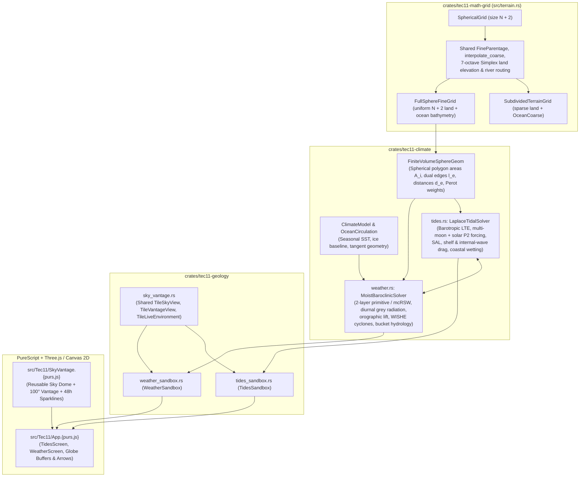

# Global Weather & Dynamic Tide Simulation on Fine (`coarse + 2`) Planetary Meshes

## 1. Architecture & Locked-In Design Summary

| Decision Area | Design Specification |
| :--- | :--- |
| **Screen Architecture** | Two standalone screens in `src/Tec11/App.purs`: **`TidesScreen`** (pure astronomical dynamic tides on `coarse + 2` with live moon sliders) and **`WeatherScreen`** (full coupled 2-layer moist baroclinic weather + dynamic tides + storm surge + surface hydrology). |
| **Grid Resolution** | Always full-sphere **`coarse + 2`** (`SphericalGrid::with_size(coarse_size + 2)`): $N(s) = 10 \cdot 3^s + 2$ cells (`65,612` fine tiles at $\Delta x \approx 88.2\text{ km}$ for `size = 6` Earth/worlds, `21,872` at $\Delta x \approx 153\text{ km}$ for `size = 5`, `7,292` for `size = 4`), covering **both land topography and ocean bathymetry**. |
| **World Loading & Overrides** | Boot on canned **Earth** (`size 6 -> 8` using `EARTH_SIZE6_ELEVATIONS_M` with real ETOPO2 bathymetry); support **Load Saved Planet** (`localStorage`) + **`.tec11` file import** (`Tectonics`, `Prehistory`, or `History`). Auto-derive star, atmosphere, and moons from snapshot (or Earth defaults), with live **Moon sliders** (`Count`, `Mass`, `Distance`) on `TidesScreen` and **Atmosphere / Glaciation / Moon overrides** on `WeatherScreen`. |
| **Time Step & Initial State** | Fixed **`1-hour`** macro tick (`Step +1h`, `Step +24h`, `Play / Pause`, and `Day-of-Year` jump slider). **No hidden initial spin-up** — start from seasonal/hydrostatic equilibrium at $t = 0$ so waves, amphidromic pinwheels, Rossby eddies, and fronts visibly organize from rest. |
| **Coastal Wetting & Inundation** | Positivity-preserving thin-layer wetting/drying: low-lying coastal tiles flood dynamically when total sea level $\eta_{\text{tide}} + \eta_{\text{surge}} > z_{\text{bed}}$, and shallow shoals expose intertidal flats when troughs drop below coastal bed depth. |
| **Surface Hydrology & Cryosphere (`WeatherScreen`)** | Prognostic Manabe-style bucket **soil moisture**, **snowpack accumulation & melt** (with live high-albedo radiative feedback), and **fine-grid river discharge pulses** from rain/snowmelt; deep ocean SST and seasonal sea-ice baseline anchored to `ClimateModel` / `OceanCirculation` plus fast mixed-layer weather anomalies. |
| **3D Globe Views** | **`TidesScreen`**: `Live Tide Height η`, `Running Tidal Range & Amphidromic Nodes`, `Tidal Current Speed & Dissipation`, `Fine Bathymetry` + toggleable `Tidal Current` vector arrows. **`WeatherScreen`**: Default **`Satellite True-Color`** (`biome/snow/inundation + semi-transparent cloud decks + rain/snow bands + day/night terminator`), plus `Pressure & Fronts`, `Surface Temperature`, `Precipitation & Cloud Water`, `Jet Stream & Winds`, `Tides & Storm Surge`, and toggleable `Surface Wind` / `Upper Jet` / `Tidal Current` arrows. |
| **Shared `SkyVantage` Module** | Extracted into `crates/tec11-geology/src/sky_vantage.rs` and `src/Tec11/SkyVantage.{purs,js}`. Preserves independent sky animation on `Tectonics`, `Prehistory`, `History`, and `World`, while **locking to the `1h` simulation clock** on `TidesScreen` and `WeatherScreen` and rendering live **clouds, storm darkening, rain/snow particles, snowpack on ridges, wind-whipped waves, and rising/falling coastal tide lines**, alongside a **48-hour Tide Gauge / Meteogram sparkline**. |

---

## 2. System & Crate Architecture

---

## 3. Mathematical Formulation & Numerical Discretization

### 3.1 Spherical Voronoi / Hexagonal–Pentagonal Finite-Volume Geometry (`TRiSK` / Perot)

Tec11's `SphericalGrid` at resolution $s = s_{\text{coarse}} + 2$ partitions the sphere of radius $R$ into $N = 10 \cdot 3^s + 2$ convex spherical polygons $\Omega_i$ ($N - 12$ hexagons and $12$ pentagons) with cell centers $\mathbf{x}_i = R\hat{\mathbf{x}}_i$ and ordered counter-clockwise vertices $\mathbf{v}_{i,1}, \dots, \mathbf{v}_{i,m_i}$ on the unit sphere [Ringler et al., 2010; Skamarock et al., 2012].

1. **Exact Spherical Cell Area ($A_i$)**:
   Decomposing $\Omega_i$ into $m_i$ spherical triangles $(\hat{\mathbf{x}}_i, \hat{\mathbf{v}}_{i,k}, \hat{\mathbf{v}}_{i,k+1})$ via Girard's spherical excess theorem (or L'Huilier's formula for numerical conditioning at small solid angles $\Delta x / R \sim 0.014\text{ rad}$):

$$
A_i = R^2 \sum_{k=1}^{m_i} 4 \arctan \sqrt{\tan\frac{s_k}{2}\tan\frac{s_k - a_k}{2}\tan\frac{s_k - b_k}{2}\tan\frac{s_k - c_k}{2}}
$$

   where $a_k, b_k, c_k$ are the geodesic arc lengths of triangle $k$ and $s_k = \frac{1}{2}(a_k + b_k + c_k)$, guaranteeing $\sum_{i=1}^N A_i = 4\pi R^2$ to machine precision.

2. **Primal–Dual Edge Staggering**:
   Each shared polygon edge $e$ separates cell $i(e)$ and cell $j(e)$:
   - **Primal geodesic center spacing**: $d_e = R \arccos(\hat{\mathbf{x}}_{i(e)} \cdot \hat{\mathbf{x}}_{j(e)})$.
   - **Dual Voronoi edge length**: $l_e = R \arccos(\hat{\mathbf{v}}_{e,1} \cdot \hat{\mathbf{v}}_{e,2})$, where $\hat{\mathbf{v}}_{e,1}, \hat{\mathbf{v}}_{e,2}$ are the two shared polygon vertices.
   - **Outward edge unit normal** at edge midpoint $\hat{\mathbf{x}}_e = \frac{\hat{\mathbf{v}}_{e,1} + \hat{\mathbf{v}}_{e,2}}{\|\hat{\mathbf{v}}_{e,1} + \hat{\mathbf{v}}_{e,2}\|}$: $\hat{\mathbf{n}}_e = \frac{\hat{\mathbf{x}}_{j(e)} - (\hat{\mathbf{x}}_{j(e)}\cdot\hat{\mathbf{x}}_e)\hat{\mathbf{x}}_e}{\|\hat{\mathbf{x}}_{j(e)} - (\hat{\mathbf{x}}_{j(e)}\cdot\hat{\mathbf{x}}_e)\hat{\mathbf{x}}_e\|}$, with orientation sign $s_{i,e} = +1$ if $i = i(e)$ and $-1$ if $i = j(e)$.

3. **Discrete Differential Operators**:
   - **Exact Conservative Finite-Volume Divergence** (Gauss's theorem on $\Omega_i$, satisfying $\sum_i A_i (\nabla \cdot \mathbf{F})_i \equiv 0$ identically):

$$
(\nabla \cdot \mathbf{F})_i = \frac{1}{A_i} \sum_{e \in \partial\Omega_i} s_{i,e}\, l_e\, F_e
$$

   - **Edge-Normal Gradient**:

$$
(\nabla_n \phi)_e = \frac{\phi_{j(e)} - \phi_{i(e)}}{d_e}
$$

   - **Cell-Center Vector Reconstruction** [Perot, 2000; Ringler et al., 2010]: Given normal velocity components $u_e = \mathbf{u} \cdot \hat{\mathbf{n}}_e$ on edges, the cell-centered tangent vector $\mathbf{u}_i$ (projected onto the local orthonormal tangent basis $(\hat{\mathbf{e}}_i^{\text{east}}, \hat{\mathbf{e}}_i^{\text{north}})$) is reconstructed via:

$$
\mathbf{u}_i = \frac{1}{A_i} \sum_{e \in \partial\Omega_i} l_e\, d_{i,e}\, u_e\, \hat{\mathbf{n}}_{i,e}
$$

   where $d_{i,e} = R \arccos(\hat{\mathbf{x}}_i \cdot \hat{\mathbf{x}}_e) \approx \frac{1}{2} d_e$ is the distance from cell center $i$ to edge midpoint $e$.

---

### 3.2 Global Barotropic Laplace Tidal & Storm Surge Equations (`tides.rs`)

Ocean tides and meteorologically forced storm surges evolve according to the nonlinear **Barotropic Shallow-Water / Laplace Tidal Equations (LTE)** on a rotating sphere [Laplace, 1775; Hendershott, 1972; Egbert et al., 2004]:

$$
\frac{\partial \eta}{\partial t} + \nabla \cdot \big(h\,\mathbf{u}_{\text{ocn}}\big) = 0
$$

$$
\frac{\partial \mathbf{u}_{\text{ocn}}}{\partial t} + f\,\hat{\mathbf{k}} \times \mathbf{u}_{\text{ocn}} = -g \nabla\big((1 - \beta_{\text{SAL}})\eta - \gamma_2 \eta_{\text{eq}}\big) - \frac{1}{\rho_w}\nabla p_s + \frac{\boldsymbol{\tau}_{\text{wind}}}{\rho_w h_{\text{eff}}} - \frac{C_b |\mathbf{u}_{\text{ocn}}|\,\mathbf{u}_{\text{ocn}}}{h_{\text{eff}}} - \mathcal{D}_{\text{wave}}\,\mathbf{u}_{\text{ocn}}
$$

where:
- $z_{\text{bed},i}$ is static bed elevation relative to mean sea level ($z_{\text{bed},i} < 0$ in ocean basins, $z_{\text{bed},i} > 0$ on land), $\eta_i$ is free-surface anomaly (`m`), and $h_i = \max(0, \eta_i - z_{\text{bed},i})$ is total instantaneous water column thickness (`m`).
- $f_i = 2\Omega \sin\phi_i$ is the planetary Coriolis parameter, with $\Omega = \frac{2\pi}{T_{\text{day}}}$ determined by the planet's `spin` (`day_hours`).
- **Astronomical Quadrupolar Equilibrium Potential ($\eta_{\text{eq}}$)** [Munk & Cartwright, 1966]: For host star $\odot$ and moons $k = 1, \dots, M$ at instantaneous planetocentric unit sky directions $\hat{\mathbf{m}}_k(t)$ and semi-major axes $a_k$ (in planetary radii $R_p$, following 2:1 Laplace mean-motion resonance $P_k = 2^{k-1} P_1 \implies a_k = 2^{2(k-1)/3} a_1$):

$$
\eta_{\text{eq}}(\hat{\mathbf{x}}_i, t) = A_{\odot} P_2(\hat{\mathbf{x}}_i \cdot \hat{\mathbf{s}}(t)) + \sum_{k=1}^{M} A_k P_2(\hat{\mathbf{x}}_i \cdot \hat{\mathbf{m}}_k(t)), \qquad P_2(\mu) = \frac{1}{2}(3\mu^2 - 1)
$$

  with Earth-calibrated lunar amplitude $A_1 = 0.358\text{ m} \cdot \left(\frac{M_1}{M_{\text{Moon}}}\right) \left(\frac{60\,R_p}{a_1}\right)^3 \left(\frac{R_p}{R_{\oplus}}\right)$ and solar amplitude $A_{\odot} = 0.164\text{ m} \cdot \text{solar\_tide\_factor}$.
- **Solid-Earth Love Numbers & Self-Attraction/Loading (`SAL`)** [Hendershott, 1972; Accad & Pekeris, 1978]: The elastic solid crust deforms with diminishing factor $\gamma_2 = 1 + k_2 - h_2 \approx 0.69$, while ocean self-attraction and crustal loading reduce the effective horizontal free-surface pressure gradient via the scalar SAL parameter $\beta_{\text{SAL}} \approx 0.09$.
- **Shelf Quadratic Friction & Internal-Wave Topographic Drag**:
  - Bottom boundary-layer drag [Taylor, 1919]: $C_b = 2.5 \times 10^{-3}$ acting over $h_{\text{eff}} = \max(h_e, h_{\text{min}})$ ($h_{\text{min}} = 2.0\text{ m}$), which naturally concentrates dissipation onto shallow continental shelves and resonant bays.
  - Baroclinic internal-tide wave conversion over rough bathymetry [Jayne & St. Laurent, 2001; Egbert et al., 2004]:

$$
\mathcal{D}_{\text{wave},e} = \frac{1}{2} \kappa_{\text{topo}} \frac{N_b \, |\nabla_n z_{\text{bed}}|_e^2 \, L_{\text{topo}}}{h_{\text{eff}}}
$$

  where $N_b \approx 1.5 \times 10^{-3}\text{ s}^{-1}$ is abyssal buoyancy frequency, preventing unrealistic runaway resonance in open ocean basins (~70% shelf dissipation, ~30% deep-ocean ridge/break conversion on Earth).
- **Storm Surge Forcing (`WeatherScreen` Coupling)** [Flather & Heaps, 1975]:
  - **Inverse Barometer**: $-\frac{1}{\rho_w}\nabla p_s$ raises sea surface by $\sim 1.0\text{ cm}$ per $1\text{ hPa}$ central pressure drop inside cyclones.
  - **Wind Setup**: Surface wind stress $\boldsymbol{\tau}_{\text{wind}} = \rho_a C_D |\mathbf{u}_1|\mathbf{u}_1$ (Charnock/Garratt drag $C_D = (1.0 + 0.04|\mathbf{u}_1|) \times 10^{-3}$) piles water onto shallow leeward shelves ($h_{\text{eff}}^{-1}$ amplification).

#### Forward–Backward Semi-Implicit Drag Time Integration & Wetting/Drying
Following Sielecki [1968] and operational C-grid tide/surge solvers, each `1-hour` ($3600\text{ s}$) macro step executes $N_{\text{tide}} = 20$ substeps of $\Delta t = 180\text{ s}$ (Courant number $\text{CFL} = \sqrt{g H_{\max}} \Delta t / \Delta x \approx 220 \times 180 / 88200 \approx 0.45 < 1$):
1. **Mass / Free-Surface Update** with upwind edge thickness $h_e^n = \begin{cases} h_{i(e)}^n & u_e^n \ge 0 \\ h_{j(e)}^n & u_e^n < 0 \end{cases}$ (which guarantees $h_i^{n+1} \ge 0$ under $\text{CFL} < 1$ at coastal wetting/drying fronts):

$$
h_i^{n+1} = \max\!\left(0,\; h_i^n - \frac{\Delta t}{A_i}\sum_{e \in \partial\Omega_i} s_{i,e}\, l_e\, h_e^n u_e^n\right), \qquad \eta_i^{n+1} = z_{\text{bed},i} + h_i^{n+1}
$$

2. **Momentum Update** using the **new** $\eta^{n+1}$ (forward–backward gravity-wave coupling, neutrally stable without artificial gravity-wave damping) and **implicit** bottom + internal-wave drag denominator so thin coastal sheets ($h_e \to 0$) never overshoot:

$$
u_e^* = u_e^n + \Delta t \left[ -f_e u_{e,\perp}^n - g \frac{(1 - \beta_{\text{SAL}})(\eta_j^{n+1} - \eta_i^{n+1}) - \gamma_2 (\eta_{\text{eq},j}^{n+1} - \eta_{\text{eq},i}^{n+1})}{d_e} - \frac{p_{s,j} - p_{s,i}}{\rho_w d_e} + \frac{\tau_{\text{wind},e}}{\rho_w h_{\text{eff},e}} \right]
$$

$$
u_e^{n+1} = \frac{u_e^*}{1 + \Delta t \left(\frac{C_b |\mathbf{u}_e^n|}{h_{\text{eff},e}} + \mathcal{D}_{\text{wave},e} + r_{\text{sponge}}\right)}
$$

---

### 3.3 Two-Layer Moist Baroclinic Primitive Atmospheric Core (`weather.rs`)

To capture **baroclinic instability** (mid-latitude cyclones, meandering jet streams, Rossby waves, and warm/cold fronts) alongside **tropical cyclones**, **orographic rain shadows**, and **diurnal sea/mountain breezes**, the atmosphere is discretized vertically into **two hydrostatic pressure/$\sigma$ layers** [Lorenz, 1960; Phillips, 1956; Molteni, 2003; Lambaerts et al., 2012; Vallis, 2017]:
- **Layer 1 (Lower Troposphere / Planetary Boundary Layer)**: $\sigma \in [0.5, 1.0]$ (representative level $p_1 \approx 775\text{ hPa}$, mass per unit area $m_1 = \frac{\Delta p_1}{g}$), carrying horizontal velocity $\mathbf{u}_1$ and potential temperature $\theta_1$.
- **Layer 2 (Upper Troposphere / Jet Level)**: $\sigma \in [0.1, 0.5]$ (representative level $p_2 \approx 300\text{ hPa}$, mass $m_2 = \frac{\Delta p_2}{g}$), carrying horizontal velocity $\mathbf{u}_2$ and potential temperature $\theta_2$.

#### 1. Hydrostatic Balance & Thermal-Wind Geopotential Coupling
With surface elevation $z_s = \max(0, z_{\text{bed}})$, surface pressure $p_s = p_0 \exp(-z_s / H_p) + \delta p_s$, and Exner function $\Pi_k = c_p (p_k / p_0)^{R_d / c_p}$ ($R_d / c_p = \kappa \approx 2/7$), hydrostatic integration [Lorenz, 1960] yields the horizontal pressure-gradient acceleration in each layer:

$$
\mathbf{G}_1 = -\nabla \Phi_s - \frac{R_d T_1}{p_s}\nabla \delta p_s - \frac{1}{2}\Delta\Pi_1 \nabla \theta_1
$$

$$
\mathbf{G}_2 = \mathbf{G}_1 - \Delta\Pi_{12}\,\nabla\bar{\theta}_{12}, \qquad \bar{\theta}_{12} = \frac{1}{2}(\theta_1 + \theta_2)
$$

Because $\mathbf{G}_2 - \mathbf{G}_1 = -\Delta\Pi_{12} \nabla\bar{\theta}_{12}$, any equator-to-pole or land–ocean horizontal temperature gradient $\nabla\theta$ automatically drives vertical wind shear $\mathbf{u}_2 - \mathbf{u}_1 = \frac{\Delta\Pi_{12}}{f}\hat{\mathbf{k}} \times \nabla\bar{\theta}_{12}$ (**thermal wind balance**). When vertical shear exceeds the two-layer Phillips [1956] baroclinic criticality threshold over the Rossby radius of deformation $L_D = \frac{\sqrt{\Delta\Pi_{12} \Delta\theta_{\text{vert}}}}{|f|} \approx 700\text{–}1000\text{ km}$ ($\sim 8\text{–}11$ fine grid cells!), synoptic waves spontaneously amplify into **migrating extratropical lows, highs, and sharp warm/cold fronts**.

#### 2. Continuity, Vertical Velocity ($\omega$), and Momentum Equations
Column mass conservation ties surface pressure tendency $\partial_t \delta p_s$ and mid-tropospheric vertical mass flux $W_{1\to 2}$ (`kg m⁻² s⁻¹`, positive upward) to horizontal wind divergence:

$$
\frac{\partial \delta p_s}{\partial t} = -g \Big( \nabla \cdot (m_1 \mathbf{u}_1) + \nabla \cdot (m_2 \mathbf{u}_2) \Big), \qquad W_{1\to 2} = -\nabla \cdot (m_1 \mathbf{u}_1) - \frac{1}{2g}\frac{\partial \delta p_s}{\partial t} = \frac{1}{2}\Big(\nabla \cdot (m_2 \mathbf{u}_2) - \nabla \cdot (m_1 \mathbf{u}_1)\Big)
$$

Horizontal momentum in layers $k \in \{1, 2\}$ evolves via:

$$
\frac{\partial \mathbf{u}_1}{\partial t} + (\mathbf{u}_1 \cdot \nabla)\mathbf{u}_1 + f\,\hat{\mathbf{k}} \times \mathbf{u}_1 = \mathbf{G}_1 - C_{D,i}\frac{\rho_a |\mathbf{u}_1|\mathbf{u}_1}{m_1} + \frac{M_{\text{conv}} + W_{1\to 2}^-}{m_1}(\mathbf{u}_2 - \mathbf{u}_1) - \nu_4 \nabla^4 \mathbf{u}_1
$$

$$
\frac{\partial \mathbf{u}_2}{\partial t} + (\mathbf{u}_2 \cdot \nabla)\mathbf{u}_2 + f\,\hat{\mathbf{k}} \times \mathbf{u}_2 = \mathbf{G}_2 + \frac{M_{\text{conv}} + W_{1\to 2}^+}{m_2}(\mathbf{u}_1 - \mathbf{u}_2) - r_{\text{top}}\mathbf{u}_2 - \nu_4 \nabla^4 \mathbf{u}_2
$$

where $C_{D,i} = C_{D,0}(1 + 2.5\,\text{mountainosity\_norm}_i)$ represents topographic roughness drag, $M_{\text{conv}}$ is cumulus momentum mixing, and $-\nu_4 \nabla^4 \mathbf{u}_k = -\nu_4 \nabla^2(\nabla^2 \mathbf{u}_k)$ is scale-selective 4th-order hyperviscosity [Skamarock et al., 2012] that damps $2\Delta x$ grid noise while leaving synoptic cyclones and jets undamped.

#### 3. Diurnal + Seasonal Grey-Atmosphere Radiative Transfer & Surface Energy Balance
At simulated day $D$ and hour $H$, the subsolar unit vector $\hat{\mathbf{s}}(t)$ is computed from orbital longitude $\lambda_{\odot}(t)$ and axial obliquity $\varepsilon = \text{tilt\_deg}$:

$$
\cos\zeta_i(t) = \max\!\big(0,\; \hat{\mathbf{x}}_i \cdot \hat{\mathbf{s}}(t)\big), \qquad S_{\text{inc},i}(t) = S_0 \left(\frac{L_{\star}}{L_{\odot}}\right)\left(\frac{1\text{ AU}}{a_{\text{orb}}}\right)^2 \cos\zeta_i(t)
$$

Following SPEEDY [Molteni, 2003], shortwave transmission accounts for cloud albedo $\alpha_{\text{cld}} = \min(0.68, 0.50 c_{\text{low}} + 0.25 c_{\text{high}})$ and surface albedo $\alpha_{\text{surf},i}$ (dynamically blending ocean Fresnel albedo `0.06`, sea ice `0.65`, bare rock felsity albedo `0.14–0.32`, vegetation canopy `0.12–0.18`, and fresh snowpack $\alpha_{\text{snow}} = 0.78$ via $1 - e^{-\text{snow\_m}/0.05}$). Longwave cooling uses a two-band grey emissivity ($\epsilon_1, \epsilon_2$) scaled by `AtmosphereType` optical depth $\tau_{\text{LW}}$ (modulated by `glaciation` and water-vapor feedback):

$$
C_{\text{surf},i} \frac{\partial T_{\text{skin},i}}{\partial t} = (1 - \alpha_{\text{cld}})(1 - \alpha_{\text{surf},i}) S_{\text{inc},i} + \epsilon_{\text{atm}} \sigma_{\text{SB}} T_1^4 - \sigma_{\text{SB}} T_{\text{skin},i}^4 - F_{\text{SH},i} - F_{\text{LH},i} - F_{\text{melt},i} + \frac{T_{\text{clim},i} - T_{\text{skin},i}}{\tau_{\text{deep}}}
$$

Because $C_{\text{surf}}$ is $\sim 40\times$ larger over the ocean mixed layer than over dry continental rock/sand, daytime solar heating creates coastal thermal pressure gradients that naturally generate **afternoon onshore sea breezes, nighttime offshore land breezes, afternoon continental convection, and seasonal monsoons**.

#### 4. Moist Thermodynamics, Convection, Tropical Cyclones (`WISHE`) & Orographic Precipitation
Saturation specific humidity follows Bolton's [1980] Magnus–Tetens Clausius–Clapeyron formula:

$$
e_s(T) = 611.2 \exp\!\left(\frac{17.67\,(T - 273.15)}{T - 29.65}\right)\text{ Pa}, \qquad q_{\text{sat}}(T, p) = \frac{0.622\, e_s(T)}{\max(p - 0.378\, e_s(T),\; 1000\text{ Pa})}
$$

- **Surface Evaporation & WISHE Feedback** [Emanuel, 1986; Rotunno & Emanuel, 1987]:

$$
E_i = \rho_a C_E \, \beta_{\text{wet},i} \, \sqrt{|\mathbf{u}_{1,i}|^2 + w_{\text{gust}}^2}\,\max\!\big(0,\; q_{\text{sat}}(T_{\text{skin},i}, p_{s,i}) - q_{1,i}\big)
$$

  where $\beta_{\text{wet},i} = 1$ over ice-free ocean/inundated tiles and $\beta_{\text{wet},i} = 0.15 + 0.85 w_{\text{soil},i}$ over vegetated/wet land. Over warm tropical oceans ($T_{\text{skin}} \gtrsim 299.6\text{ K} = 26.5^\circ\text{C}$) away from the equator ($|f| > f_{\min}$), rising wind speed $|\mathbf{u}_1|$ amplifies $E_i$, feeding moist-convective latent heating that deepens the warm-core surface low $\delta p_s < 0$ (**WISHE hurricane spin-up**).
- **Moist-Convective Mass Flux & Latent Heat (`mcRSW` / SPEEDY)** [Molteni, 2003; Bouchut et al., 2009; Rostami & Zeitlin, 2018]:
  Equivalent potential temperature $\theta_{e,1} = \theta_1 \exp\!\left(\frac{L_v q_1}{c_p T_1}\right)$ is compared against upper-layer saturation $\theta_{2}^* = \theta_2 \exp\!\left(\frac{L_v q_{\text{sat}}(T_2, p_2)}{c_p T_2}\right)$. When conditional instability ($\theta_{e,1} > \theta_2^*$) coincides with boundary-layer moisture ($R\!H_1 > 0.65$) or low-level convergence ($W_{1\to 2} > 0$), convective condensation $\dot{q}_{\text{conv}}$ releases latent heat $\frac{L_v}{c_p \Pi_k}\dot{q}_{\text{conv}}$ into the column and drives upward convective mass flux $M_{\text{conv}}$, concentrating cyclonic potential vorticity along **cold/warm fronts** and **tropical cyclone cores**.
- **Orographic & Large-Scale Condensation**:
  Upslope flow $\mathbf{u}_1 \cdot \nabla z_s > 0$ cools air adiabatically; any vapor exceeding $q_{\text{sat}}(T_1, p_1)$ condenses into cloud water $q_c$, which auto-converts (Kessler-style threshold + Bergeron–Findeisen ice efficiency) into **rain** ($T_1 > 273.15\text{ K}$) or **snowfall** ($T_1 \le 273.15\text{ K}$), depleting $q_v$ so air descending leeward slopes ($\mathbf{u}_1 \cdot \nabla z_s < 0$) creates realistic **rain shadows** and warm dry **Foehn/Chinook winds**.
- **Positive-Definite Semi-Lagrangian / Upwind Transport** [Robert, 1981; Staniforth & Côté, 1991]:
  Scalar fields $(\theta_1, \theta_2, q_v, q_c)$ are transported using mass-consistent upwind / quasi-monotone Semi-Lagrangian interpolation with positivity clamping ($q_v, q_c \ge 0$).

#### 5. Bucket Surface Hydrology, Snowpack & River Runoff (`Manabe, 1969`)
On land tiles ($z_{\text{bed},i} > 0$) with bucket field capacity $W_{\max} = 0.15\text{ m}$:
1. **Snowpack (`snow_m`, m water equivalent)**: Accumulates from snowfall $P_{\text{snow}}$ and melts at rate $M_{\text{snow}} = \min\!\big(\text{snow\_m}/\Delta t,\; k_{\text{melt}}\max(0, T_{\text{skin}} - 273.15)\big)$, consuming latent heat of fusion $L_f M_{\text{snow}}$ from $T_{\text{skin}}$.
2. **Soil Moisture ($w_{\text{soil}} \in [0, 1]$) & Overland Runoff**: Liquid input $P_{\text{rain}} + M_{\text{snow}} - E_i$ refills $W_{\max} w_{\text{soil}}$; saturation excess plus infiltration-excess runoff $R_i$ enters `runoff_cms[i]` and advects down the pre-routed fine-grid river graph toward coastal river mouths!

---

## 4. Phased Implementation Plan

1. **Phase 0 (Completed)**: Commit existing `100°` Rectangular Vantage & Coarse-Tile Sky/Vantage support (`df46d8f9`), then commit this math & architecture design document (`docs/weather_and_tides_design.md`).
2. **Phase 1 — Shared `SkyVantage` Extraction**:
   - Extract `crates/tec11-geology/src/sky_vantage.rs` and `src/Tec11/SkyVantage.{purs,js}` with `InteractiveSkyClock` vs. `SyncedSimClock`, `TileLiveEnvironment` rendering (clouds, storm darkening, rain/snow particles, snow-dusted ridges, waves, tidal waterline), and reusable 48-hour Canvas sparklines.
   - Verify all existing geology/CLI tests + `//:web_bundle`, then commit.
3. **Phase 2 — Shared Fine Subdivision & `FullSphereFineGrid` (`coarse + 2`)**:
   - Refactor `crates/tec11-math-grid/src/terrain.rs` so `SubdividedTerrainGrid` and `FullSphereFineGrid` share `FineParentage`, coarse interpolation, 7-octave Simplex land elevation (guaranteeing exact shoreline parity), and fine river routing, while adding full-sphere ocean bathymetry and `FiniteVolumeSphereGeom` spherical operators.
   - Add unit tests for shoreline parity, tile counts, and $\sum_i A_i (\nabla\cdot\mathbf{F})_i = 0$ conservation, then commit.
4. **Phase 3 — Barotropic Laplace Tidal Engine & Standalone `TidesScreen`**:
   - Implement `crates/tec11-climate/src/tides.rs` (`LaplaceTidalSolver`), `crates/tec11-geology/src/tides_sandbox.rs`, `crates/tec11-wasm/src/tides_session.rs`, and `TidesScreen` in `App.{purs,js}` wired to `SkyVantage` + 48h Tide Gauge sparkline.
   - Verify physics invariants & web bundle, then commit.
5. **Phase 4 — Coupled 2-Layer Moist Weather Engine & Standalone `WeatherScreen`**:
   - Implement `crates/tec11-climate/src/weather.rs` (`MoistBaroclinicSolver`) coupled to `LaplaceTidalSolver`, `crates/tec11-geology/src/weather_sandbox.rs`, `crates/tec11-wasm/src/weather_session.rs`, and `WeatherScreen` in `App.{purs,js}` (Satellite True-Color view, diagnostic modes, Wind/Jet/Tide arrows, live `SkyVantage` weather/tides, and 48h Meteogram).
   - Verify stability, physics tests, performance budget, and `//:web_bundle`, then commit.

---

## 5. References

1. **Accad, Y., & Pekeris, C. L. (1978).** Solution of the tidal equations for the $M_2$ and $S_2$ tides in the world oceans from a knowledge of the tidal potential alone. *Philosophical Transactions of the Royal Society of London. Series A*, 290(1368), 235–266.
2. **Bolton, D. (1980).** The computation of equivalent potential temperature. *Monthly Weather Review*, 108(7), 1046–1053.
3. **Bouchut, F., Lambaerts, J., Lapeyre, G., & Zeitlin, V. (2009).** Fronts and nonlinear wave interactions in moist-convective rotating shallow water. *Physics of Fluids*, 21(11), 116604.
4. **Egbert, G. D., Ray, R. D., & Bills, B. G. (2004).** Numerical modeling of the global semidiurnal tide in the present day and in the last glacial maximum. *Journal of Geophysical Research: Oceans*, 109(C3), C03003.
5. **Emanuel, K. A. (1986).** An air-sea interaction theory for tropical cyclones. Part I: Steady-state maintenance. *Journal of the Atmospheric Sciences*, 43(6), 585–604.
6. **Flather, R. A., & Heaps, N. S. (1975).** Tidal computations for Morecambe Bay. *Geophysical Journal of the Royal Astronomical Society*, 42(2), 489–517.
7. **Hendershott, M. C. (1972).** The effects of solid earth deformation on global ocean tides. *Geophysical Journal of the Royal Astronomical Society*, 29(4), 389–402.
8. **Jayne, S. R., & St. Laurent, L. C. (2001).** Parameterizing tidal dissipation over rough topography. *Geophysical Research Letters*, 28(5), 811–814.
9. **Klöwer, M., Gelbrecht, M., Hotta, D., Willisch, K., Silvestri, S., Wagner, G. L., White, A., & Hatfield, S. (2024).** SpeedyWeather.jl: Reinventing atmospheric general circulation models towards interactivity and extensibility. *Journal of Open Source Software*, 9(98), 6323.
10. **Lambaerts, J., Lapeyre, G., & Zeitlin, V. (2012).** Moist versus dry baroclinic instability in a simplified two-layer atmospheric model with condensation and latent heat release. *Journal of the Atmospheric Sciences*, 69(4), 1405–1426.
11. **Laplace, P.-S. (1775).** Recherches sur plusieurs points du système du monde. *Mémoires de l'Académie Royale des Sciences de Paris*, 75–182.
12. **Lorenz, E. N. (1960).** Energy and numerical weather prediction. *Tellus*, 12(4), 364–373.
13. **Manabe, S. (1969).** Climate and the ocean circulation: I. The atmospheric circulation and the hydrology of the earth's surface. *Monthly Weather Review*, 97(11), 739–774.
14. **Molteni, F. (2003).** Atmospheric simulations using a GCM with simplified physical parametrizations. I: Model climatology and variability in multi-decadal experiments. *Climate Dynamics*, 20(2), 175–191 (**SPEEDY**).
15. **Munk, W. H., & Cartwright, D. E. (1966).** Tidal spectroscopy and prediction. *Philosophical Transactions of the Royal Society of London. Series A*, 259(1105), 533–581.
16. **Perot, B. (2000).** Conservation properties of unstructured staggered mesh schemes. *Journal of Computational Physics*, 159(1), 58–89.
17. **Phillips, N. A. (1956).** The general circulation of the atmosphere: A numerical experiment. *Quarterly Journal of the Royal Meteorological Society*, 82(352), 123–164.
18. **Ringler, T. D., Thuburn, J., Klemp, J. B., & Skamarock, W. C. (2010).** A unified approach to energy conservation and potential vorticity dynamics for arbitrarily-structured C-grids. *Journal of Computational Physics*, 229(9), 3065–3090 (**TRiSK**).
19. **Robert, A. (1981).** A stable numerical integration scheme for the primitive meteorological equations. *Atmosphere-Ocean*, 19(1), 35–46.
20. **Rostami, M., & Zeitlin, V. (2018).** Improved moist-convective rotating shallow water model and its application to instabilities of hurricane-like vortices. *Quarterly Journal of the Royal Meteorological Society*, 144(714), 1450–1468.
21. **Rotunno, R., & Emanuel, K. A. (1987).** An air-sea interaction theory for tropical cyclones. Part II: Evolutionary study using a nonhydrostatic axisymmetric numerical model. *Journal of the Atmospheric Sciences*, 44(3), 542–561.
22. **Sielecki, A. (1968).** An energy-conserving difference scheme for the storm surge equations. *Monthly Weather Review*, 96(3), 150–156.
23. **Skamarock, W. C., Klemp, J. B., Duda, M. G., Fowler, L. D., Park, S.-H., & Ringler, T. D. (2012).** A multiscale nonhydrostatic atmospheric model using centroidal Voronoi tessellations and C-grid staggering. *Monthly Weather Review*, 140(9), 3090–3105 (**MPAS**).
24. **Staniforth, A., & Côté, J. (1991).** Semi-Lagrangian integration schemes for atmospheric models—A review. *Monthly Weather Review*, 119(9), 2206–2223.
25. **Taylor, G. I. (1919).** Tidal friction in the Irish Sea. *Philosophical Transactions of the Royal Society of London. Series A*, 220, 1–33.
26. **Thuburn, J., Ringler, T. D., Skamarock, W. C., & Klemp, J. B. (2009).** Numerical representation of geostrophic modes on arbitrarily structured C-grids. *Journal of Computational Physics*, 228(22), 8321–8335.
27. **Vallis, G. K. (2017).** *Atmospheric and Oceanic Fluid Dynamics: Fundamentals and Large-Scale Circulation* (2nd ed.). Cambridge University Press.
