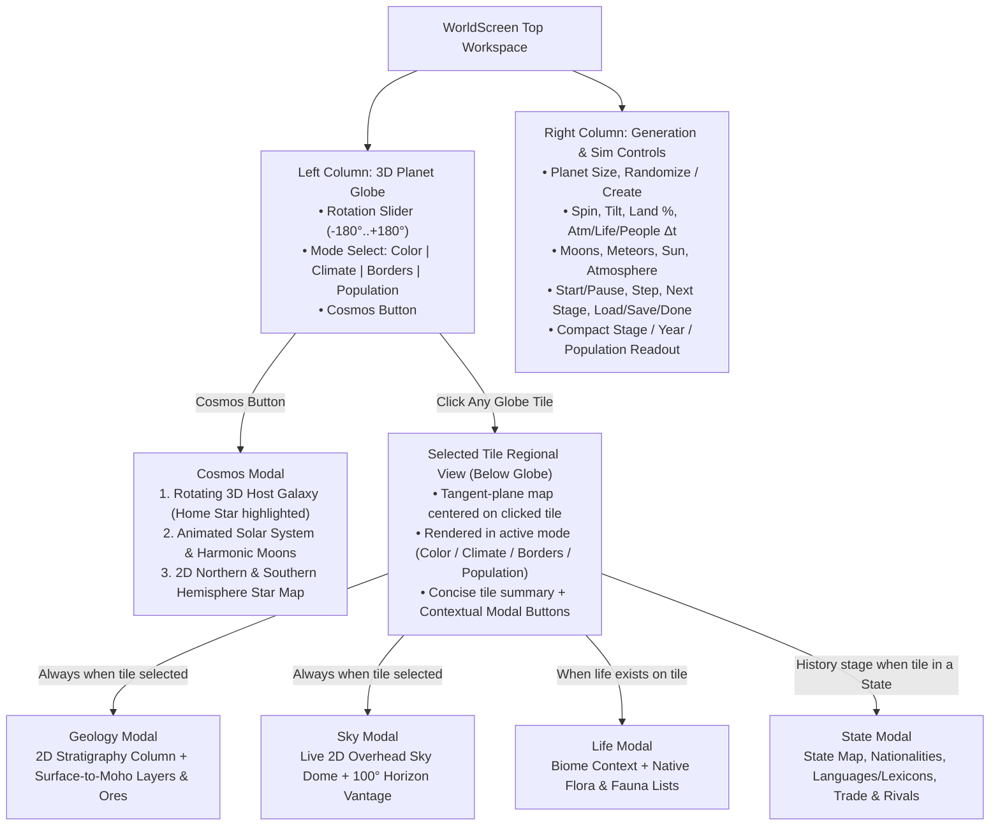

# World Simulation Page Simplification & Progressive-Disclosure Design

## 1. Goals & Motivation

Currently, `WorldScreen` ([src/Tec11/App.purs](file:///home/travis/tec11/src/Tec11/App.purs#L5215-L5795)) piles every subsystem into a single tall view: the 3D globe, generation sliders, solar-system summary text, sky/sunset/plant swatches, rock stratigraphy cross-sections, 2D overhead sky & horizon vantage canvases, zoomed political state maps, demographic tables, and full language lexicons all compete for space simultaneously.

This redesign restructures `WorldScreen` around **progressive disclosure**:
1. **Clean Top Workspace**: Only the 3D globe (with rotation & view-mode controls) and concise generation/simulation controls appear at the top.
2. **Four Clear, Stage-Consistent Globe Modes**: `Color`, `Climate`, `Borders`, and `Population`.
3. **Global `Cosmos` Modal**: Dedicated modal showcasing the planet's galactic home, animated solar system + moons, and 2D dual-hemisphere star map.
4. **Mode-Synced Regional Tile Detail View**: Clicking any tile on the globe opens a centered regional patch underneath rendered in the *same* mode as the globe, with contextual buttons (`Geology`, `Sky`, `Life`, `State`) that open focused modals on demand.

---

## 2. Target UI Architecture

---

## 3. Detailed Design by Feature

### 3.1 Stripped-Down Top View (`WorldScreen`)
- **Remove from main `WorldScreen` page**:
  - Inline `renderStratigraphySideViewBox`, `#world-details-box`, and `renderTileSkyAndVantageBox` (Tectonics/Prehistory).
  - Inline `renderHistoryTwoLevelInspector` (zoomed state box, nationality/language detail cards, lexicon table, and tile box in History).
  - Verbose multi-line `#world-planets-label` (`System: #1 ... | #2 ...`) and `#world-optics-label` swatch strip inside `#world-stats`, keeping `#world-stats` focused on **Stage**, **Elapsed Years**, **Orbital/Tidal Summary**, and **Total Population**.
- **Top-level layout**:
  - Left (`.viewport-column`): `#sphere-canvas` (`460 × 460`), rotation slider, `#world-aspect-select`, and the `Cosmos` button.
  - Right (`.sidebar-column.tectonics-sidebar`): Creation parameters, `Start/Pause` · `Step` · `Next Stage`, compact `#world-stats`, and `Load...` / `Load Saved` / `Save` / `Done`.

---

### 3.2 Globe Rendering Modes (`#world-aspect-select`)

Replace the current 7-option dropdown (`color`, `climate`, `population`, `nations`, `metallurgy`, `travel`, `meteors`) with **4 consistent modes** across all three stages (`Tectonics`, `Prehistory`, `History`):

| Mode | Land Rendering | Ocean Rendering | Stage Specifics |
| :--- | :--- | :--- | :--- |
| **`Color`** (`"color"`) | Physical rock felsity + photosynthetic flora tint (`optics.plant_foliage_rgb`), polar snow/ice (`EF`/`ET`), **plus hypsometric elevation & mountainosity darkening** so upland plateaus and mountain cordilleras stand out in clear relief. **Never** switches to political state colors when History begins. | Depth-shaded bathymetry reflecting `optics.sky_zenith_rgb` (or slate-grey before atmosphere forms). | Routed cyan rivers (`river_tiles`) shown in History on the subdivided terrain mesh, with zero political borders. |
| **`Climate`** (`"climate"`) | Köppen climate classification palette (`koeppen_rgb`, including emergent sub-grid islands in History; neutral grey prior to atmosphere emergence). | **Annual-mean ocean currents**: ocean tiles shaded by mean SST anomaly & gyre speed (warm western boundary currents in amber-red, cold upwelling/eastern currents in cyan-blue, calm abyssal water in deep navy) + **3D flow arrows** (`arrowLines`) from `ClimateModel::ocean()`. | Reads `hist.prehistory().climate_model()` directly in History (eliminating the current `hist.to_snapshot()` round-trip in [`WorldSimulation::tile_colors_rgb`](file:///home/travis/tec11/crates/tec11-geology/src/world.rs#L1222-L1248)). |
| **`Borders`** (`"borders"`) | • **In a State** (`History` `tile_states`): Distinct `NATION_PALETTE` political colors. • **Populated outside any State** (`Prehistory` inhabited tiles, plus `History` communities with `thousands > 0` and no `tile_states` entry, such as stateless frontier peoples or autonomous islands): Dedicated **Stateless Population** terracotta-ochre color (`[0.82, 0.56, 0.28]`). • **Uninhabited land**: Muted physical terrain. | Muted natural ocean color + **active overland & maritime Travel Routes** (`travel_route_segments_colored`) overlaid in History. | Cleanly separates sovereign states, stateless human settlements, and uninhabited wilderness while showing trade & conflict travel corridors. |
| **`Population`** (`"population"`) | Continuous quantitative **log-population heatmap** shaded strictly by number of people on each tile (`0` = dark muted slate `[0.13, 0.16, 0.18]`; `> 0` = `ln(1 + pop_k) / ln(1 + ref_max_k)` ramp from deep ember-crimson → warm orange → bright gold-ivory). | Deep abyssal navy (`[0.04, 0.07, 0.16]`). | Uses `PrehistorySimulation::tile_population_for_heritage_thousands` on coarse tiles in Prehistory and summed `Community::thousands` on fine faces in History. |

#### Elevation Darkening Formula in `"color"` Mode
In [`WorldSimulation::natural_color_with_optics`](file:///home/travis/tec11/crates/tec11-geology/src/world.rs#L1371-L1415) (and the matching History `"color"` branch), modulate land RGB by elevation `h` (km above sea level) and local relief:
- Let `u_elev = ((h - 0.35).max(0.0) / 4.8).clamp(0.0, 1.0)`.
- For vegetated/bare land (`koeppen != 12, 13`): multiply RGB by `(1.0 - 0.50 * u_elev.powf(0.85))` and reduce vegetation weight at alpine elevations (`h > 2.2 km`) so high ranges transition naturally into dark alpine crags.
- For glaciated/tundra highlands (`koeppen == 12 | 13`): shade by `(1.0 - 0.28 * u_elev)` with a subtle slate-blue shadow tint so high ice-capped mountain chains remain visible against lowland tundra/ice sheets.

---

### 3.3 `Cosmos` Modal
Triggered by a **`Cosmos`** button alongside `#world-aspect-select` (available at every stage):
- Driven by a new `WorldSimulation::cosmos_view_json()` + star-map typed buffers on [`WasmWorldSession`](file:///home/travis/tec11/crates/tec11-wasm/src/world_session.rs) exposing `WorldSimulation`'s actual `galaxy_type`, `galactic_vantage`, `home_star`, `solar_system`, `home_planet_index`, `constellations`, and lunar harmonic parameters (`moon_count`, `moon_mass`, `current_moon_dist_radii()`).
- **Modal Layout** (dark glassmorphic overlay, `Esc` / backdrop / `×` close):
  1. **Rotating 3D Host Galaxy Panel** (top-left canvas): Auto-rotating 3D particle cloud of the world's `GalaxyType` (drag-rotatable) with an emerald 3D reticle & galactocentric orbit ring marking `home_star.gal_pos_kpc`.
  2. **Animated Solar System & Moons Panel** (top-right canvas): Live `requestAnimationFrame` heliocentric animation of all `SolarSystemPlanet`s around `home_star` (showing rocky worlds, gas/ice giants, planetary rings, and habitable zone), with the **simulated Home World** highlighted and its **`0..4` harmonic moons** orbiting it in real time.
  3. **2D Dual-Hemisphere Star Map Panel** (bottom full-width canvas): Northern (`+90°`..`0°`) and Southern (`−90°`..`0°`) polar azimuthal star charts displaying this world's constellations, diffuse host-galaxy band, galactic plane, ecliptic, and naked-eye sibling planets.

---

### 3.4 Mode-Synced Centered Regional Tile Detail View
When `selectedTileIdx >= 0` (clicked on the 3D globe):
- Renders a compact **Selected Tile Panel** directly beneath the 3D globe in `.viewport-column` (hidden when `selectedTileIdx < 0`).
- **Centered Regional Canvas (`#world-regional-canvas`)**:
  - Rust helper `WorldSimulation::build_regional_tile_map(center_idx, aspect)` projects all tiles within an angular radius of `~22°` (`cos θ >= 0.927`) around the selected tile's unit normal `n_0` onto a local tangent plane `(east, north)` centered at `(0.5, 0.5)`:
    - In `Tectonics` & `Prehistory`: projects coarse `SphericalGrid` polygon vertices.
    - In `History`: projects `SubdividedTerrainGrid` display faces (`Fine` land/island polygons + `OceanCoarse` polygons, plus river edge highlights).
  - **Uses the exact same `aspect` color rules as the 3D globe** (`Color`, `Climate` including projected 2D ocean current arrows, `Borders` including state borders/capitals & stateless settlements, or `Population`).
  - Outlines the centered `selectedTileIdx` polygon in gold; clicking any other polygon in the regional map selects and re-centers on that tile!
- **Concise Tile Header & Action Row**:
  - 2-line summary (Tile coordinates, elevation/bathymetry, Köppen climate, and population/state summary).
  - Row of contextual modal buttons (`Geology`, `Sky`, `Life`, `State`).

---

### 3.5 Contextual Deep-Dive Modals (Added Incrementally)

| Button | Availability Rule | Modal Contents |
| :--- | :--- | :--- |
| **`Geology`** | Enabled whenever any tile is selected (`selectedTileIdx >= 0`, land or ocean, all stages). | 2D stratigraphic cross-section canvas (`#world-modal-strat-canvas`) + complete surface-to-Moho `RockLayer` list, thicknesses, felsity/toughness, hydrothermal/placer/evaporite interface occurrences, workable ores, and bolide impact signatures. |
| **`Sky`** | Enabled whenever any tile is selected (`selectedTileIdx >= 0`, all stages). | Live animated 2D Overhead Sky Dome + 100° Local Horizon Vantage (`Tec11.SkyVantage`), showing true atmospheric sky/sunset/twilight colors (or airless starfield in early Hadean), Sun & Moon diurnal paths/phases, naked-eye planets, visible constellations, `Play/Pause` clock, `Year`/`Day` sliders, and `◀ Bearing ▶` compass controls. |
| **`Life`** | Shown/enabled when `has_life` is true (`Tectonics` after life emerges, `Prehistory`, `History`) and the tile has native flora or fauna (`!flora.is_empty() \|\| !fauna.is_empty()`). | Habitat & soil fertility header, photosynthetic foliage pigment swatch (`optics.plant_color_name`), and structured **Native Flora** and **Native Fauna** lists for the tile (extending biosphere lookup to `Tectonics` once `tec.has_life()` is active). |
| **`State`** | Shown/enabled in `History` (`stageIndex == 2`) when the selected tile belongs to an active political state (`stateView.hasState`). | Zoomed full-state boundary map (`#state-zoom-canvas`), state metrics (`population`, `capacity`, `asabiya`, tech), **Nationalities** & **Languages** share pills with interactive **Nationality Origin/Diaspora** and **Language Phonology & Lexicon** drill-downs, **Trade Partners**, and **Conflicts**. |

---

## 4. Commit-by-Commit Implementation Plan

Each step below will be implemented, verified (`bazel test` + `bazel build //:web_bundle`), and committed as its own separate `jj` commit:

1. **Commit 1 — Strip down `WorldScreen` top layout**:
   - Remove inline stratigraphy, sky/vantage boxes, History two-level state/tile inspector, and verbose planet/optics stat lines from `WorldScreen` in [src/Tec11/App.purs](file:///home/travis/tec11/src/Tec11/App.purs) and [src/Tec11/App.js](file:///home/travis/tec11/src/Tec11/App.js), leaving only the 3D globe + view controls and generation/simulation controls at the top, plus reusable modal CSS in [static/index.html](file:///home/travis/tec11/static/index.html).
2. **Commit 2 — Redo World globe rendering modes (`Color`, `Climate`, `Borders`, `Population`)**:
   - Update [`WorldSimulation::tile_colors_rgb`](file:///home/travis/tec11/crates/tec11-geology/src/world.rs#L1055-L1338), [`HistorySimulation::tile_colors_rgb_with_optics`](file:///home/travis/tec11/crates/tec11-geology/src/history.rs#L7913-L8139), [`WasmWorldSession`](file:///home/travis/tec11/crates/tec11-wasm/src/world_session.rs), and [src/Tec11/App.js](file:///home/travis/tec11/src/Tec11/App.js):
     - `Color`: Pure physical terrain in all stages + elevation/mountainosity darkening.
     - `Climate`: Köppen land + annual-mean SST/speed ocean shading + 3D ocean current arrows.
     - `Borders`: Political states + distinct terracotta color for stateless populations across Prehistory & History.
     - `Population`: Continuous log-scaled population-count shading per tile across Prehistory & History.
3. **Commit 3 — Add `Cosmos` button and modal**:
   - Expose `WorldSimulation` galaxy, solar-system + moons, and star-map buffers via `WasmWorldSession`, and build the `Cosmos` modal with the rotating 3D galaxy (Home Star highlighted), live animated solar system + moons around the Home World, and 2D Northern/Southern hemisphere star map.
4. **Commit 4 — Add mode-synced regional tile detail view underneath the globe**:
   - Implement `WorldSimulation::build_regional_tile_map` (tangent-plane projection centered on `selectedTileIdx` across `Tectonics`, `Prehistory`, and `History`, colored in the active `Color` / `Climate` / `Borders` / `Population` mode with current arrows in `Climate`) and render `#world-regional-canvas` + concise tile summary underneath the globe when a tile is clicked.
5. **Commit 5 — Add `Geology` button and rock-strata modal**:
   - Add the `Geology` button to the selected-tile panel, opening a modal with the 2D stratigraphic column cross-section and detailed surface-to-Moho rock layers, interfaces, and mineral deposits.
6. **Commit 6 — Add `Sky` button and 2D sky/horizon vantage modal**:
   - Add the `Sky` button to the selected-tile panel, opening a modal hosting the live animated 2D overhead sky dome, 100° local horizon panorama, diurnal/seasonal sliders, and compass neighbor controls.
7. **Commit 7 — Add `Life` button and native flora & fauna modal**:
   - Ensure salient flora & fauna are available across `Tectonics` (when `has_life` is true), `Prehistory`, and `History`, and add the `Life` button (when applicable) opening the native flora & fauna modal.
8. **Commit 8 — Add `State` button and political/cultural inspector modal**:
   - Add the `State` button (when a History tile belongs to a state), opening a modal with the full state map, metrics, trade/conflict diplomacy, and interactive nationality & language/lexicon drill-downs.
