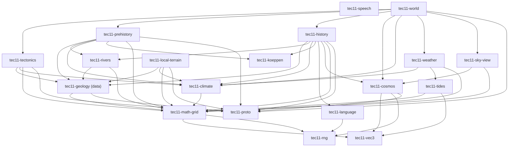

# Implementation Plan: Modular Stage-by-Stage Crate Architecture

**Branch**: `010-modular-stage-crates` | **Date**: 2026-11-26 | **Spec**: [spec.md](spec.md)  
**Input**: Feature specification from `specs/010-modular-stage-crates/spec.md`

## Summary

Decompose the workspace's monolithic `tec11-geology` crate and bundled math/climate utilities into lean, minimal-dependency Bazel/Rust crates organized by simulation stage, pure data domain, viewing helpers, and sandboxes. Use existing `tec11-proto` (`PlanetSnapshot`) messages for cross-stage data handoffs so later stages (`tec11-prehistory`, `tec11-history`, `tec11-local-terrain`) do not depend on earlier stages' simulation code. Execute the refactor across **6 small, independently green commits**, verifying `bazel test //crates/...` and `bazel build //:web_bundle` after every single phase.

## Technical Context

**Language/Version**: Rust 2021 (pure Rust simulation crates + `wasm-bindgen` in `tec11-wasm`), Bazel (`rules_rust`)  
**Primary Dependencies**: `prost` (via `tec11-proto`), `wasm-bindgen` (in `tec11-wasm` only)  
**Storage**: `.tec11` protobuf snapshots (`proto/tec11.proto`) — **zero breaking schema changes**  
**Testing**: `bazel test -c opt --incompatible_strict_action_env --disk_cache=~/.cache/bazel-disk-cache //crates/...` + `bazel build //:web_bundle` + `bazel query 'deps(...)'` boundary verification  
**Target Platform**: Native Linux (tests & CLI) + `wasm32-unknown-unknown` (web bundle)  

## Target Dependency Graph

## Staged 6-Phase Commit Plan (Zero Mega-Commits)

Each phase below is a self-contained commit that leaves the entire repo green (`bazel test //crates/...` + `bazel build //:web_bundle`). Temporary `pub use` re-exports are used during intermediate phases where helpful and removed cleanly once all callers migrate.

---

### Phase 1: Foundations — `tec11-rng` & `tec11-vec3`
- **New crates**:
  - `crates/tec11-rng/`: move `rng.rs` (`Pcg64Mcg`) out of `tec11-math-grid`. Zero internal deps.
  - `crates/tec11-vec3/`: move `vec3.rs` (`Vec3`, `cross`, `dot`, `length`, `normal`, `rotate`, etc.) out of `tec11-math-grid`. Zero internal deps.
- **Updates**:
  - `crates/tec11-math-grid/`: depend on `tec11-rng` and `tec11-vec3` and `pub use` their symbols so all downstream crates remain 100% source-compatible in Phase 1.
- **Verify**: `bazel test //crates/...` + `bazel build //:web_bundle` + `bazel query` confirms zero internal deps on `tec11-rng` and `tec11-vec3`.

---

### Phase 2: Climate Domain Split — `tec11-koeppen`, `tec11-tides`, `tec11-weather`
- **New crates**:
  - `crates/tec11-koeppen/`: move `koeppen.rs` from `tec11-climate` + `koeppen_climate_name` & `koeppen_rgb` from `world.rs`.
  - `crates/tec11-tides/`: move `tides.rs` (`LaplaceTidalSolver`, `TidalMoonBody`, `AtmosphericTideForcing`) from `tec11-climate`. Depends only on `tec11-math-grid` / `tec11-vec3`.
  - `crates/tec11-weather/`: move `weather.rs` from `tec11-climate`. Depends on `tec11-climate`, `tec11-tides`, `tec11-math-grid`.
- **Updates**:
  - `crates/tec11-climate/`: retains `earth_data.rs`, `fv_geom.rs`, `model.rs`, `ocean.rs` (zero dep on `koeppen`, `tides`, or `weather`).
  - Update imports in `tec11-geology`, `tec11-local-terrain`, and `tec11-wasm`.
- **Verify**: `bazel test //crates/...` + `bazel build //:web_bundle`.

---

### Phase 3: Standalone `tec11-language`, `tec11-cosmos`, & `tec11-sky-view`
- **New crates**:
  - `crates/tec11-language/`: move `language.rs` from `tec11-geology`. Depends **only** on `tec11-rng` (`SC-001`).
  - `crates/tec11-cosmos/`: move pure cosmos simulation from `sun_sky.rs` + `data/hipparcos_naked.tsv`. Depends **only** on `tec11-vec3`, `tec11-rng`, `tec11-proto` (`SC-002`).
  - `crates/tec11-sky-view/`: move celestial sphere display viewer (`SunSimulation` / `SphericalGrid`+`PointTree` part of `sun_sky.rs`) + `sky_vantage.rs` (decoupled from `TileGeology` to take `&[f32]` elevations + optional surface RGB/biome hints) + `inspect_tile_sky` view helpers.
- **Updates**:
  - Remove `inspect_tile_sky` / `sky_vantage` calls from `tectonics.rs` and `prehistory.rs`; move view assembly to `tec11-sky-view` (invoked by `world.rs` / `tec11-wasm`).
  - Update `tec11-geology`, `tec11-wasm`, and `tec11-cli` imports.
- **Verify**: `bazel test //crates/...` + `bazel build //:web_bundle` + `bazel query` for `SC-001` & `SC-002`.

---

### Phase 4: Pure `tec11-geology` (Data), `tec11-rivers`, & `tec11-tectonics`
- **New crates**:
  - `crates/tec11-rivers/`: move `rivers.rs` (`trace_coarse_rivers`). Depends only on `tec11-geology` and `tec11-math-grid`.
  - `crates/tec11-tectonics/`: move `movement.rs`, `pangea.rs`, `tectonics.rs`, `profile.rs`. Depends on `tec11-geology`, `tec11-climate`, `tec11-math-grid`, `tec11-proto` (`SC-003`).
- **Narrow `crates/tec11-geology/` (pure data)**:
  - Retains `rock.rs`, `tile.rs` (moving `LithosphericGroup` and `planet_radius_km` into `tec11-geology` as pure data types).
  - Move `tec11-local-terrain` runtime dep to `tec11-geology` only (`SC-006`); keep `PrehistorySimulation` as a `rust_test`-only dep.
- **Note**: In Phase 4, `prehistory`, `history`, `world`, and sandboxes still live temporarily in a transitional crate (or are split in Phase 5–6) — actually, to keep `tec11-geology` clean immediately in Phase 4 without a temporary throwaway crate, we can:
  - Phase 4: Extract `tec11-geology-data`? No — better: keep `tec11-geology` as the pure data crate name by extracting `tec11-rivers` + `tec11-tectonics` in Phase 4 while `prehistory`/`history`/`world`/`sandboxes` wait in `tec11-geology` until Phase 5/6, OR extract `tec11-prehistory` in Phase 5 and `tec11-history` + `tec11-world` + sandboxes in Phase 6 so at the end of Phase 6 `tec11-geology` is 100% pure data (`rock.rs`, `tile.rs`, `lib.rs`)!
  - Even cleaner:
    - **Phase 4**: Extract `tec11-geology` core types (`rock.rs`, `tile.rs` + `LithosphericGroup` + `planet_radius_km`) stay in `tec11-geology`; extract `tec11-rivers` and `tec11-tectonics` (temporarily moving `prehistory`/`history`/`world`/sandboxes? No — `tec11-tectonics` can't depend on `tec11-geology` if `tec11-geology` still contains `prehistory` that depends on `tec11-tectonics`!).
    - **Aha — great catch!** Because `tec11-tectonics` depends on `rock.rs` + `tile.rs`, if `prehistory`/`history`/`world` are still inside `tec11-geology` while `tec11-tectonics` is extracted, that would create a cycle unless we split top-down (extract `world` + `sandboxes` + `history` + `prehistory` first, OR extract `tectonics` + `rivers` after `prehistory`/`history`/`world` leave `tec11-geology`).
    - **Top-down order avoids ALL cycles and needs ZERO throwaway crates!** Look at how clean top-down is:
      1. **Phase 1**: `tec11-rng` + `tec11-vec3` (out of `tec11-math-grid`)
      2. **Phase 2**: `tec11-koeppen` + `tec11-tides` + `tec11-weather` (out of `tec11-climate`)
      3. **Phase 3**: `tec11-language` + `tec11-cosmos` + `tec11-sky-view` (out of `tec11-geology`)
      4. **Phase 4**: Per-stage sandbox crates (`tec11-tectonics-sandboxes`, `tec11-planet-sandboxes`, `tec11-tides-sandbox`, `tec11-weather-sandbox`) + `tec11-world` (out of `tec11-geology`)
      5. **Phase 5**: `tec11-history` (decoupled onto `tec11-proto::PlanetSnapshot`, out of `tec11-geology`) + `tec11-prehistory` (dropping `tec11-language` & `tec11-tectonics` deps, out of `tec11-geology`)
      6. **Phase 6**: `tec11-rivers` + `tec11-tectonics` (out of `tec11-geology`), leaving `tec11-geology` as the pure data crate (`rock.rs`, `tile.rs`, `LithosphericGroup`, `planet_radius_km`) and decoupling `tec11-local-terrain` runtime deps from `tec11-tectonics`!

---

### Revised Clean Acyclic 6-Phase Order (Zero Throwaway Crates, Zero Cycles)

| Phase | Commit Scope | Crates Created / Updated |
|---|---|---|
| **Phase 1** | Extract RNG & 3D vector math | +`tec11-rng`, +`tec11-vec3`; update `tec11-math-grid` |
| **Phase 2** | Split Climate domain | +`tec11-koeppen`, +`tec11-tides`, +`tec11-weather`; slim `tec11-climate` |
| **Phase 3** | Extract Language, Cosmos & Sky View | +`tec11-language`, +`tec11-cosmos`, +`tec11-sky-view`; remove sky-view calls from `tectonics`/`prehistory` |
| **Phase 4** | Extract Sandboxes & Top-Level World | +`tec11-tectonics-sandboxes`, +`tec11-planet-sandboxes`, +`tec11-tides-sandbox`, +`tec11-weather-sandbox`, +`tec11-world` |
| **Phase 5** | Extract History (proto handoff) & Prehistory (drop language/tectonics) | +`tec11-history`, +`tec11-prehistory`; decouple `HistorySimulation` from `PrehistorySimulation` via `tec11-proto::PlanetSnapshot` |
| **Phase 6** | Extract Rivers & Tectonics; finalize pure-data `tec11-geology` | +`tec11-rivers`, +`tec11-tectonics`; `tec11-geology` = pure data (`Rock`, `TileGeology`, `LithosphericGroup`, `planet_radius_km`); update `tec11-local-terrain`, `tec11-cli`, `tec11-wasm` |

## Verification Gate (Run After Every Phase)

1. `bazel test -c opt --incompatible_strict_action_env --disk_cache=~/.cache/bazel-disk-cache //crates/...`
2. `bazel build -c opt --incompatible_strict_action_env --disk_cache=~/.cache/bazel-disk-cache //:web_bundle`
3. `bazel query 'deps(//crates/<new-crate>:<target>)'` confirming the exact dependency boundaries from `SC-001`–`SC-006`.
4. Commit the phase cleanly with `jj commit` before starting the next phase.
